# Ellf Template: NER Data from a Panel of Open-Weight LLMs

Annotate your texts with named entities using a panel of open-weight LLMs on your own cluster's GPU, with no per-token API costs. The models' answers are tidied with correction rules and combined by a Dawid–Skene model, which learns how far to trust each model. A short yes/no review of the entities the consensus is least sure of then corrects it. You end up with a silver-standard NER dataset for training, a report of each model's accuracy and, optionally, a corrected evaluation set.

*Exported from [Ellf](https://ellf.ai) on 2026-11-21. Import it with the [`/ellf-template`](https://ellf.ai/docs/modules#template) skill, or set it up by hand with the commands below.*

## Workflow

```mermaid
flowchart LR
    accTitle: Open-weight LLM panel NER workflow
    accDescr: Three open-weight models served by an Ollama service annotate the texts in batch actions; their runs are merged into one dataset, corrected by rules and combined by a consensus action; people review the uncertain entities, and the consensus is recomputed with the reviews
    texts[(Texts)] --> ann[Annotate: one action per model]
    svc[Open-weight LLMs service] -. serves .-> ann
    ann --> merge[Merge: one action per model]
    merge --> panel[(ner_panel)]
    panel --> rules[Apply correction rules]
    rules --> fixed[(ner_panel_rules)]
    fixed --> c1[Consensus: panel]
    c1 --> ex1[(ner-consensus-panel-examples)]
    ex1 --> review[Review uncertain entities task]
    review --> rv[(ner_reviews)]
    fixed --> c2[Consensus: reviewed]
    rv --> c2
    c2 --> final[(ner_consensus_reviewed)]
    c2 --> ex2[(ner-consensus-reviewed-examples)]
    ex2 -. optional .-> correct[Correct the consensus task]
```



## Overview

| Resource | Type | Name | Provided by | Details |
|---|---|---|---|---|
| Project | project | Open-Weight NER Panel | user picks name | [below](#project) |
| Texts to annotate | asset (`input`) | Texts | user, tokenized with [scripts/tokenize_texts.py](scripts/tokenize_texts.py) | [What you need to provide](#what-you-need-to-provide) |
| Annotation guidelines | asset (`instructions`) | NER guidelines | user | [What you need to provide](#what-you-need-to-provide) |
| Label scheme | asset (`labels`) | NER labels | template example or user | [assets/labels.json](assets/labels.json) |
| Correction rules | asset (`input`, JSON) | Correction rules | template example or user | [assets/rules.json](assets/rules.json) |
| Ollama and the models | asset (`ollama_models`) | ollama-models | made by `Download Ollama models` | [Actions](#download-ollama-models) |
| spaCy pipeline for the rules | asset (`model`) | en_core_web_sm | made by `Download spaCy pipeline` | [Actions](#download-spacy-pipeline) |
| Service token | secret | ollama-token | user, after the service starts | [What you need to provide](#what-you-need-to-provide) |
| Each model's answers | asset (`input`) | panel-gpt-oss-20b, panel-gemma4-26b, panel-mistral-small32-24b | made by the `Annotate` actions | [Actions](#annotate-gpt-oss-20b) |
| The panel's annotations | dataset (`ner`) | ner_panel | created empty, filled by the `Merge` actions | [Datasets](#datasets) |
| The annotations after the rules | dataset (`ner`) | ner_panel_rules | created empty, filled by `Apply correction rules` | [Datasets](#datasets) |
| Review answers | dataset (`ner`) | ner_reviews | created empty, filled by `Review uncertain entities` | [Datasets](#datasets) |
| Corrected texts | dataset (`ner`) | ner_corrections | created empty, filled by `Correct the consensus` | [Datasets](#datasets) |
| Consensus of the panel | dataset | ner_consensus_panel | made by `Consensus: panel` | [Actions](#consensus-panel) |
| Consensus with the reviews: the silver-standard data | dataset | ner_consensus_reviewed | made by `Consensus: reviewed` | [Actions](#consensus-reviewed) |
| Candidates with their posteriors | asset (`input`) | ner-consensus-panel-examples, ner-consensus-reviewed-examples | made by the consensus actions | [Actions](#consensus-panel) |
| Each model's accuracy | asset (`input`) | ner-consensus-panel-annotators, ner-consensus-reviewed-annotators | made by the consensus actions | [Actions](#consensus-panel) |
| Binary review | task | Review uncertain entities | template | [Tasks](#review-uncertain-entities) |
| Text-by-text correction | task | Correct the consensus | template, optional | [Tasks](#correct-the-consensus) |
| Model download | action | Download Ollama models | template | [Actions](#download-ollama-models) |
| Pipeline download | action | Download spaCy pipeline | template | [Actions](#download-spacy-pipeline) |
| Annotation runs | action | Annotate: gpt-oss 20B, Annotate: Gemma 4 26B-A4B, Annotate: Mistral Small 3.2 24B | template | [Actions](#annotate-gpt-oss-20b) |
| Merges | action | Merge: gpt-oss 20B, Merge: Gemma 4 26B-A4B, Merge: Mistral Small 3.2 24B | template | [Actions](#merge-gpt-oss-20b) |
| Rules | action | Apply correction rules | template | [Actions](#apply-correction-rules) |
| Consensus of the panel | action | Consensus: panel | template | [Actions](#consensus-panel) |
| Consensus with the reviews | action | Consensus: reviewed | template | [Actions](#consensus-reviewed) |
| Model server | service | Open-weight LLMs | template | [Services](#open-weight-llms) |
| Plan | plan | project_plan | template | [`plans/project_plan.md`](plans/project_plan.md) |

The consensus actions create their own datasets and assets (`ner_consensus_panel`, `ner_consensus_reviewed` and their examples and annotators assets): don't create them beforehand, as the action refuses a dataset that exists. The `Annotate` actions create their output assets when they finish.

Every recipe here is a built-in. They need an Ellf release with the built-in recipes `llm_annotate`, `merge_llm_runs`, `apply_rules`, `review_uncertain`, `review_consensus` and, in the GPU recipes, `ollama_models_asset` and `ollama_server`: check with `ellf recipes list`.

## What you need to provide

- **Texts** (asset `Texts`): JSONL, one text per line, with the text in `text` and anything you want to keep in `meta`, **tokenized** with [scripts/tokenize_texts.py](scripts/tokenize_texts.py), which adds spaCy's tokens. The entities land on these tokens, and every step uses them:

  ```json
  {"text": "Lockheed Martin Corp. launched an Atlas V rocket from Florida.", "meta": {"id": "news-0042"}}
  ```

  ```bash
  python scripts/tokenize_texts.py texts.jsonl texts_tokenized.jsonl --lang en
  ```

  No data is included: bring your own. A few hundred texts are enough to try the workflow; the panel annotates a few thousand in a few hours on one GPU.
- **Labels and their definitions** (asset `NER labels`): a label scheme, with each label's description, what not to mark and examples, which go into every prompt. The template includes one for `PERSON`, `ORG`, `PRODUCT` and `GPE` in [assets/labels.json](assets/labels.json), written for news; replace it with your own labels, and use them in the `--labels` of every `Annotate` action.
- **Guidelines** (asset `NER guidelines`): your own annotation guidelines, as a Markdown file. No guidelines are included: they depend on your texts and labels. The models and the people reviewing both read them, so they should settle the conventions annotators would otherwise split on: where a name starts and ends (a leading "the", titles, possessives), whether part of a name counts, and which label a name gets when it could be two (a company and its product). Most disagreements between models come from conventions like these, not from facts.
- **Correction rules** (asset `Correction rules`): fixes for errors the models make systematically, applied to every model's answers alike. The template's [assets/rules.json](assets/rules.json) holds conventions for the example labels (links and handles, possessives, a leading "the"). Write your own by reading where the models disagree with the consensus and turning what the guidelines rule out into rules: each rule names the guideline it follows (`why`). The rule types are spaCy Matcher patterns and phrase lists that drop, relabel or trim spans (`match`), and structural rules (`drop_handles_and_links`, `leading_the`, `attached_the`, `entities`, `merge_one_word_runs`); the `apply_rules` recipe documents each. With no rules to apply, skip `Apply correction rules` and give the consensus actions `ner_panel`.
- **A GPU worker class**: the service needs a GPU with 24 GB, such as an NVIDIA L4, for Gemma 4 26B-A4B; gpt-oss 20B and Mistral Small 3.2 24B also fit 16 GB, but Mistral is slow there. The commands use `--worker-class gpu`: replace it with your cluster's GPU worker class (`ellf services create ollama_server --worker-class no-such-class --no-start` lists them).
- **Secret** `ollama-token`: the service's bearer token, which the `Annotate` actions use as their API key. Create it once the service is running: `ellf services url "Open-weight LLMs"` prints the service's URL and a 90-day token; store the token yourself with `ellf secrets create ollama-token`, and put the URL in the `Annotate` actions' `--base-url`. No API keys for an LLM provider are needed.

## Customize

- **The panel.** Three models whose errors differ do better than more models that err alike: avoid two of one family. The defaults have worked well on general and technical NER. Other Ollama models work the same way (`--model`, and add them to `Download Ollama models`). An API model can join the panel through the same action (`--provider openai`, `anthropic` or `gemini`, with its own key), as can a spaCy pipeline, through the built-in `spacy_annotate` and `import_annotations` actions, for labels it predicts.
- **Thinking.** Gemma 4 runs with thinking off (`--effort none`), which makes it much faster. gpt-oss and Mistral use their defaults.
- **One run per model, or per label.** Each `Annotate` action asks about every label at once. With many labels, or labels whose definitions are long, run one action per label instead (`--labels ORG`, and so on), with only that label's definition in the prompt, and merge a model's runs together (`--runs panel-gpt-oss-20b-org,panel-gpt-oss-20b-person,...`).
- **One GPU or several.** One service serves all three models, but holds one in GPU memory at a time: run one model's `Annotate` action at a time, or a request for another model swaps it in. With more GPUs, create a service per model and run the actions at the same time.
- **The service's address.** The actions reach the service at its public URL with its token. If your cluster's jobs don't trust the certificate on that URL, use the service's internal address instead, `http://prodigy-<execution id>.ellf/v1`, with the `last_execution_id` from `ellf services info "Open-weight LLMs" --json`. That address changes when the service restarts, so recreate the action with the new one; a run picks up where it stopped.
- **How much to review.** `Review uncertain entities` asks about entities the consensus is less than 75% sure of (`--threshold 0.75`), one question per entity (`--no-whole-runs`): typically somewhere between a third of a question and one question per text, each answered in a few seconds. A higher threshold asks about more; `--threshold 1.0` asks about every candidate. Without `--no-whole-runs`, every candidate with the same label and text comes as one run, quick to answer in a row.
- **Reviews as certain or as votes.** `Consensus: reviewed` takes the review answers as certain (`--reviews-as-gold`), which gives the model trustworthy anchors to learn each annotator's accuracy from. Without it, they count as a strong reviewer's votes, which a careless answer can't decide alone.
- **An evaluation set.** To measure the consensus, or a model trained on it, publish a sample of the texts as an input asset and correct it text by text with `Correct the consensus` (`--only "<asset>"`). Its dataset is a gold standard for that sample; it can also join a later consensus run as `--reviewer-datasets`.
- **Leaving a model out.** If a model lowers the consensus, exclude it from a consensus run with `--exclude-annotators <model name>` rather than deleting its annotations.
- **Language.** [scripts/tokenize_texts.py](scripts/tokenize_texts.py) takes `--lang`, and the rules' `leading_the` and `attached_the` need an English pipeline: drop them, or use a pipeline for your language.

## Setup

Run these from the template directory, in this order.

### Project

```bash
ellf projects create "Open-Weight NER Panel" "Silver-standard NER from a panel of open-weight LLMs, a consensus model and a quick binary review"
ellf config project "Open-Weight NER Panel"
```

### Assets

```bash
python scripts/tokenize_texts.py <your texts.jsonl> texts_tokenized.jsonl --lang en
ellf publish data texts_tokenized.jsonl --kind input --loader jsonl --name "Texts" --version 1.0.0
ellf publish data <your guidelines.md> --kind instructions --name "NER guidelines" --version 1.0.0
ellf publish data assets/labels.json --kind labels --name "NER labels" --version 1.0.0
ellf publish data assets/rules.json --kind input --loader json --name "Correction rules" --version 1.0.0
```

The `ollama-models` and `en_core_web_sm` assets are made by the [Download Ollama models](#download-ollama-models) and [Download spaCy pipeline](#download-spacy-pipeline) actions.

### Datasets

```bash
ellf datasets create "ner_panel" --kind ner
ellf datasets create "ner_panel_rules" --kind ner
ellf datasets create "ner_reviews" --kind ner
ellf datasets create "ner_corrections" --kind ner
```

- `ner_panel`: each model's annotations, under the model's name, from the `Merge` actions. Read by `Apply correction rules`.
- `ner_panel_rules`: the same annotations after the correction rules, under the same names. Read by both consensus actions.
- `ner_reviews`: the yes/no answers from `Review uncertain entities`. Read by `Consensus: reviewed` as `--reviews`.
- `ner_corrections`: whole texts corrected in `Correct the consensus`, if you use it: an evaluation set.

## Services

### Open-weight LLMs

Serves the panel's models with Ollama on a cluster GPU, behind an OpenAI-compatible API at `<service URL>/v1`, which the `Annotate` actions call. It loads Ollama and the models from the `ollama-models` asset rather than downloading them at every start. It stops itself after an hour without a request (`--idle-shutdown 60`), freeing the GPU, so start it again before a run.

**Create after:** `Download Ollama models` has run.

```bash
ellf services create ollama_server --name "Open-weight LLMs" --models-asset ollama-models --num-parallel 4 --context-length 8192 --idle-shutdown 60 --worker-class gpu --no-start
```

| Argument | Value | Notes |
|---|---|---|
| `--models-asset` | ollama-models | from `Download Ollama models`; serves all its models |
| `--num-parallel` | 4 | requests at once; each takes a context's worth of GPU memory |
| `--context-length` | 8192 | tokens per request, prompt and answer together; long texts or label definitions need more |
| `--worker-class` | gpu | your cluster's GPU worker class, with 24 GB for Gemma 4 |

Start it, and once it's running, store its token for the actions (`services url` prints a secret, so run it yourself):

```bash
ellf services start "Open-weight LLMs" --worker-class gpu
ellf services url "Open-weight LLMs"
ellf secrets create ollama-token
```

## Actions

### Download Ollama models

Downloads an Ollama release, checked against its published checksum, and the three models (tens of gigabytes) to the cluster's shared storage once, as the `ollama-models` asset the service loads at start.

```bash
ellf actions create ollama_models_asset --name "Download Ollama models" --models "gpt-oss:20b,gemma4:26b-a4b-it-qat,mistral-small3.2:24b" --asset-name ollama-models --no-start
```

| Argument | Value | Notes |
|---|---|---|
| `--models` | gpt-oss:20b, gemma4:26b-a4b-it-qat, mistral-small3.2:24b | Ollama tags: gpt-oss 20B (MXFP4), Gemma 4 26B-A4B (quantization-aware), Mistral Small 3.2 24B Instruct 2506 (Q4_K_M) |

### Download spaCy pipeline

Puts `en_core_web_sm` on shared storage as a model asset, for the rules that parse the text (`leading_the`, `attached_the`). Skip it if your rules don't need a pipeline.

```bash
ellf actions create download_spacy_models --name "Download spaCy pipeline" --lang en --models en_core_web_sm --no-start
```

### Annotate: gpt-oss 20B

Annotates every text with gpt-oss 20B, through the service, for all the labels, with the guidelines and each label's definition in the prompt, and saves each text's answer, and whether the model answered, to an asset. A run that stops resumes where it was when started again; if the service goes away, it waits for it for half an hour rather than failing the texts. Run the three `Annotate` actions one after another, with the service running.

**Create after:** the service is running and the `ollama-token` secret exists.

```bash
ellf actions create llm_annotate --name "Annotate: gpt-oss 20B" --texts "Texts" --provider openai --base-url "<service URL>/v1" --api-key ollama-token --model gpt-oss:20b --labels PERSON,ORG,PRODUCT,GPE --label-scheme "NER labels" --instructions "NER guidelines" --output.name panel-gpt-oss-20b --concurrency 4 --request-timeout 300 --no-start
```

| Argument | Value | Notes |
|---|---|---|
| `--base-url` | `<service URL>/v1` | the URL `ellf services url "Open-weight LLMs"` prints, with `/v1` |
| `--api-key` | ollama-token | the service's token |
| `--labels` | PERSON,ORG,PRODUCT,GPE | your labels, all in the label scheme |
| `--label-scheme` | NER labels | the definitions that go into the prompt |
| `--instructions` | NER guidelines | your guidelines |
| `--concurrency` | 4 | requests at once; match the service's `--num-parallel` |

### Annotate: Gemma 4 26B-A4B

The same, with Gemma 4 and its thinking off.

```bash
ellf actions create llm_annotate --name "Annotate: Gemma 4 26B-A4B" --texts "Texts" --provider openai --base-url "<service URL>/v1" --api-key ollama-token --model gemma4:26b-a4b-it-qat --effort none --labels PERSON,ORG,PRODUCT,GPE --label-scheme "NER labels" --instructions "NER guidelines" --output.name panel-gemma4-26b --concurrency 4 --request-timeout 300 --no-start
```

### Annotate: Mistral Small 3.2 24B

The same, with Mistral Small 3.2.

```bash
ellf actions create llm_annotate --name "Annotate: Mistral Small 3.2 24B" --texts "Texts" --provider openai --base-url "<service URL>/v1" --api-key ollama-token --model mistral-small3.2:24b --labels PERSON,ORG,PRODUCT,GPE --label-scheme "NER labels" --instructions "NER guidelines" --output.name panel-mistral-small32-24b --concurrency 4 --request-timeout 300 --no-start
```

### Merge: gpt-oss 20B

Saves the model's answers to `ner_panel` as that model's annotations, so the consensus counts them as one annotator's. A text the model didn't answer is left out, rather than read as having no entities.

**Create after:** `Annotate: gpt-oss 20B` has run.

```bash
ellf actions create merge_llm_runs --name "Merge: gpt-oss 20B" --runs panel-gpt-oss-20b --dataset ner_panel --annotator gpt-oss:20b --no-start
```

### Merge: Gemma 4 26B-A4B

**Create after:** `Annotate: Gemma 4 26B-A4B` has run.

```bash
ellf actions create merge_llm_runs --name "Merge: Gemma 4 26B-A4B" --runs panel-gemma4-26b --dataset ner_panel --annotator gemma4:26b-a4b-it-qat --no-start
```

### Merge: Mistral Small 3.2 24B

**Create after:** `Annotate: Mistral Small 3.2 24B` has run.

```bash
ellf actions create merge_llm_runs --name "Merge: Mistral Small 3.2 24B" --runs panel-mistral-small32-24b --dataset ner_panel --annotator mistral-small3.2:24b --no-start
```

### Apply correction rules

Applies the correction rules to every model's annotations alike and saves them, corrected, to `ner_panel_rules` under the same names. Fixing a convention the models split on (a leading "the", say) matters more than its count suggests: models that disagree on a span's boundary split their votes, and the consensus can lose the entity.

```bash
ellf actions create apply_rules --name "Apply correction rules" --datasets ner_panel --rules "Correction rules" --pipeline en_core_web_sm --dataset ner_panel_rules --no-start
```

| Argument | Value | Notes |
|---|---|---|
| `--rules` | Correction rules | your rules, or the template's example |
| `--pipeline` | en_core_web_sm | for rules that parse the text; leave it out if none do |

### Consensus: panel

Fits a Dawid–Skene model to the models' annotations: each model gets a confusion matrix, learned from where it agrees with the others, and each candidate entity a posterior. It saves the consensus to `ner_consensus_panel`, every candidate with its posterior to `ner-consensus-panel-examples`, which the review task reads, and each model's accuracy to `ner-consensus-panel-annotators`.

```bash
ellf actions create annotation_consensus --name "Consensus: panel" --datasets ner_panel_rules --dataset ner_consensus_panel --examples-output --examples-output.name ner-consensus-panel-examples --annotators-output --annotators-output.name ner-consensus-panel-annotators --no-start
```

### Consensus: reviewed

Fits the consensus again with the review answers, taken as certain: an accepted entity is kept even if only one model found it, and a rejected one is dropped even if most of the panel marked it. The answers also anchor what the model learns about each annotator, which corrects the consensus beyond the entities reviewed. `ner_consensus_reviewed` is the silver-standard data.

**Create after:** `Review uncertain entities` has its answers.

```bash
ellf actions create annotation_consensus --name "Consensus: reviewed" --datasets ner_panel_rules --reviews ner_reviews --reviews-as-gold --dataset ner_consensus_reviewed --examples-output --examples-output.name ner-consensus-reviewed-examples --annotators-output --annotators-output.name ner-consensus-reviewed-annotators --no-start
```

## Tasks

### Review uncertain entities

Asks yes/no questions about the candidate entities the panel's consensus is least sure of, each shown at the same place on its line with a few lines of context, the full text below. Answer by the guidelines, and skip a question you can't decide (ignore) rather than guess: the answers are taken as certain.

**Create after:** `Consensus: panel` has run.

```bash
ellf tasks create review_uncertain --name "Review uncertain entities" --dataset ner_reviews --consensus ner-consensus-panel-examples --threshold 0.75 --no-whole-runs --context-lines 2 --settings.instructions "NER guidelines" --no-start
```

| Argument | Value | Notes |
|---|---|---|
| `--consensus` | ner-consensus-panel-examples | from `Consensus: panel` |
| `--threshold` | 0.75 | ask about entities the consensus is less sure of than this |
| `--settings.instructions` | NER guidelines | shown to the reviewer |

### Correct the consensus

Optional, for an evaluation set: queues whole texts to correct in the manual NER interface, pre-annotated with the reviewed consensus, least certain first. With `--only`, only the texts of a sample you publish as an input asset.

**Create after:** `Consensus: reviewed` has run.

```bash
ellf tasks create review_consensus --name "Correct the consensus" --dataset ner_corrections --consensus ner-consensus-reviewed-examples --settings.instructions "NER guidelines" --no-start
```

| Argument | Value | Notes |
|---|---|---|
| `--consensus` | ner-consensus-reviewed-examples | from `Consensus: reviewed` |
| `--only` | *(not set)* | an input asset of the texts to correct, e.g. a random sample for evaluation |

## Plans

```bash
ellf plans write project_plan --file plans/project_plan.md
```

Plans link to resources with `@@Type/name@@` placeholders. After everything is created, replace each with a concept link to the new resource's id (the `/ellf-template` skill does this for you).

---

*Exported: 2026-11-21T18:56:29Z &middot; Template format: 1 &middot; Ellf CLI: 24.0.0 &middot; Recipe packages: ellf-recipes 0.18.48, ellf-recipes-gpu 0.1.265 &middot; Exported with: Claude Code 2.1.330 (claude-opus-5-5)*
