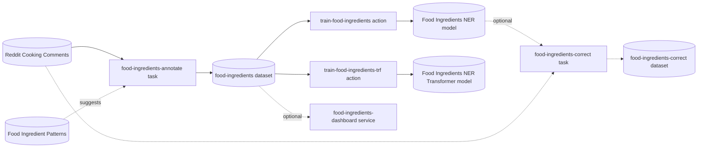

# Ellf Template: Food Ingredient Extraction

Train a named entity recognizer that finds food ingredients in text, e.g. to track which ingredients people talk about over time. You highlight ingredients in cooking comments with match patterns as suggestions, train a quick first model on CPU, and then a more accurate transformer-based pipeline on GPU.

*Adapted for [Ellf](https://ellf.ai) from the spaCy project [`ner_food_ingredients`](https://github.com/explosion/projects/tree/v3/tutorials/ner_food_ingredients) on 2026-10-28. Import it with the
[`/ellf-template`](https://ellf.ai/docs/modules#template) skill, or set it up by hand
with the commands below.*

## Workflow



## Overview

| Resource | Type | Name | Provided by | Details |
|---|---|---|---|---|
| Project | project | Food Ingredients | user picks name | [below](#project) |
| Comments | asset (`input`) | Reddit Cooking Comments | template sample or user | [assets/input/reddit_cooking.jsonl](assets/input/reddit_cooking.jsonl) |
| Patterns | asset (`patterns`) | Food Ingredient Patterns | template | [assets/food_patterns.jsonl](assets/food_patterns.jsonl) |
| Label | asset (`labels`) | Food Ingredient Label | template | [assets/food_ingredient_label.json](assets/food_ingredient_label.json) |
| Guidelines | asset (`instructions`) | Food Ingredient Guidelines | template | [assets/food_ingredient_guidelines.md](assets/food_ingredient_guidelines.md) |
| First model | asset (`model`) | Food Ingredients NER | written by train-food-ingredients | [train-food-ingredients](#train-food-ingredients) |
| Transformer model | asset (`model`) | Food Ingredients NER Transformer | written by train-food-ingredients-trf | [train-food-ingredients-trf](#train-food-ingredients-trf) |
| Annotation | task | food-ingredients-annotate | template | [Tasks](#food-ingredients-annotate) |
| Correction (optional) | task | food-ingredients-correct | template, created later | [Tasks](#food-ingredients-correct-optional) |
| CPU training | action | train-food-ingredients | template | [Actions](#train-food-ingredients) |
| GPU training | action | train-food-ingredients-trf | template | [Actions](#train-food-ingredients-trf) |
| Dashboard (optional) | service | food-ingredients-dashboard | template, created later | [Services](#food-ingredients-dashboard-optional) |
| Annotations | dataset (`ner`) | food-ingredients | created empty | [Datasets](#datasets) |
| Corrections (optional) | dataset (`ner`) | food-ingredients-correct | created with the correction task | [Tasks](#food-ingredients-correct-optional) |
| Project plan | plan | project_plan | template | [plans/project_plan.md](plans/project_plan.md) |

All jobs use built-in recipes: `ner`, `train` and `annotation_dashboard` from `ellf-recipes`, and `train_curated_transformer` from `ellf-recipes-gpu`.

## What you need to provide

- **Comments** (Reddit Cooking Comments): JSONL, one text per line, with the text in `text` and anything else in `meta`:

  ```json
  {"text": "Where do you get the mock duck? Hoisin we use for sandwich condiment mixed with sriracha.", "meta": {"section": "Cooking", "utc": "1364690064"}}
  ```

  The template includes 9,969 comments from the r/Cooking subreddit (2012–2019) in [assets/input/reddit_cooking.jsonl](assets/input/reddit_cooking.jsonl), a random sample of the original 2.1 million, with the subreddit and the UTC timestamp in `meta`. Annotating about 1,000 of them is enough to train a useful model. To find ingredients in your own texts, such as recipes, reviews or menus, bring them in the format above.
- **A GPU worker** for the transformer training: `train-food-ingredients-trf` runs on the `gpu` worker class, the default name on Ellf clusters. If your cluster's GPU worker class has another name, change `--worker-class` in its command. Without a GPU, skip the transformer and use the model from `train-food-ingredients`.

No secrets or API keys are needed: the transformer weights (`roberta-base`) are public on the Hugging Face Hub.

## Customize

- **Patterns:** the 209 patterns in `assets/food_patterns.jsonl` are common ingredients, found with sense2vec from a few seed terms. They only suggest entities, so missing ones are fine. Add terms that matter for your texts, in the same format.
- **Transformer:** `--hf-model-name roberta-base --hf-model-type roberta` fine-tunes RoBERTa. Any BERT, RoBERTa, CamemBERT or XLM-RoBERTa checkpoint on the Hugging Face Hub works; set `--hf-model-type` to its family, and use a multilingual one such as `xlm-roberta-base` for texts not in English, with a matching `--lang`.
- **Transformer training is optional.** It's recommended for the best accuracy, but needs a GPU. The CPU model from `train-food-ingredients` is a good result on its own; leave out `train-food-ingredients-trf` if you don't have a GPU.
- **The correction round is optional.** After the first training run, you can correct the model's suggestions on new comments instead of highlighting everything from scratch. See [food-ingredients-correct](#food-ingredients-correct-optional).
- **The dashboard is optional.** Once annotation is underway, a dashboard service shows the label distribution, conflicting annotations and every annotation in a table. See [food-ingredients-dashboard](#food-ingredients-dashboard-optional).

## Setup

### Project

```bash
ellf projects create "Food Ingredients" "Train a named entity recognizer that finds food ingredients in cooking comments."
ellf config project "Food Ingredients"
```

### Assets

```bash
ellf publish data assets/input/reddit_cooking.jsonl --kind input --name "Reddit Cooking Comments" --version 1.0.0
ellf publish data assets/food_patterns.jsonl --kind patterns --name "Food Ingredient Patterns" --version 1.0.0
ellf publish data assets/food_ingredient_label.json --kind labels --name "Food Ingredient Label" --version 1.0.0
ellf publish data assets/food_ingredient_guidelines.md --kind instructions --name "Food Ingredient Guidelines" --version 1.0.0
```

Publish the label, guidelines and patterns before the task: the task reads them when it's created.

### Datasets

Created empty, so the plan can link to it before any job has run.

```bash
ellf datasets create food-ingredients --kind ner
```

`food-ingredients` holds the highlighted ingredients from `food-ingredients-annotate`, which both training actions train on.

## Tasks

### food-ingredients-annotate

Annotators highlight every ingredient in each comment, with the patterns pre-highlighting common ones as suggestions to keep or remove. Comments without ingredients are accepted with nothing highlighted, so the model also learns what isn't an ingredient.

```bash
ellf tasks create ner --name food-ingredients-annotate --dataset food-ingredients --input "Reddit Cooking Comments" --label-scheme "Food Ingredient Label" --patterns "Food Ingredient Patterns" --settings.instructions "Food Ingredient Guidelines" --model-blank-spans --model.lang en --no-start
```

| Argument | Value | Notes |
|---|---|---|
| `--input` | Reddit Cooking Comments | template sample or your own texts |
| `--label-scheme` | Food Ingredient Label | the `INGRED` label and its definition |
| `--patterns` | Food Ingredient Patterns | suggestions; adapt to your texts |
| `--settings.instructions` | Food Ingredient Guidelines | what counts as an ingredient |

### food-ingredients-correct (optional)

A second round, once the first model is trained: the model from `train-food-ingredients` highlights the ingredients it finds in new comments, and annotators correct its suggestions instead of highlighting from scratch. That's faster, and it shows where the model goes wrong. Comments already in `food-ingredients` are left out.

The task uses the CPU model, not the transformer: tasks run on CPU workers, which can't load a transformer pipeline.

**Create after:** `train-food-ingredients` has run and written the Food Ingredients NER model.

```bash
ellf datasets create food-ingredients-correct --kind ner
ellf tasks create ner --name food-ingredients-correct --dataset food-ingredients-correct --input "Reddit Cooking Comments" --label-scheme "Food Ingredient Label" --settings.instructions "Food Ingredient Guidelines" --settings.exclude food-ingredients --model.name "Food Ingredients NER" --no-start
```

| Argument | Value | Notes |
|---|---|---|
| `--model.name` | Food Ingredients NER | the model asset `train-food-ingredients` writes |
| `--settings.exclude` | food-ingredients | skip comments that were already annotated |

Then train again on both datasets, as new actions with a new model version:

```bash
ellf actions create train --name train-food-ingredients-v2 --data.ner --ner.train food-ingredients,food-ingredients-correct --lang en --eval-split 0.2 --output.name "Food Ingredients NER" --output.version 0.2.0 --label-stats --no-start
ellf actions create train_curated_transformer --name train-food-ingredients-trf-v2 --data.ner --ner.train food-ingredients,food-ingredients-correct --hf-model-name roberta-base --hf-model-type roberta --lang en --eval-split 0.2 --output.name "Food Ingredients NER Transformer" --output.version 0.2.0 --label-stats --worker-class gpu --no-start
```

## Actions

### train-food-ingredients

Trains a spaCy NER pipeline on CPU, from a blank English pipeline, holding back 20% of the annotations for evaluation. It's quick, needs no GPU, and its model powers the optional correction task. Writes the Food Ingredients NER model. Run it once the task has a few hundred annotations.

```bash
ellf actions create train --name train-food-ingredients --data.ner --ner.train food-ingredients --lang en --eval-split 0.2 --output.name "Food Ingredients NER" --output.version 0.1.0 --label-stats --no-start
```

| Argument | Value | Notes |
|---|---|---|
| `--ner.train` | food-ingredients | the task's dataset |
| `--eval-split` | 0.2 | share of the annotations held back for evaluation |
| `--output.name` | Food Ingredients NER | must be a new model name on your cluster |

### train-food-ingredients-trf

Fine-tunes `roberta-base` with spaCy and `spacy-curated-transformers` on the same annotations, for the most accurate model. Needs a GPU. Writes the Food Ingredients NER Transformer model. The transformer weights are downloaded from the Hugging Face Hub when training starts.

```bash
ellf actions create train_curated_transformer --name train-food-ingredients-trf --data.ner --ner.train food-ingredients --hf-model-name roberta-base --hf-model-type roberta --lang en --eval-split 0.2 --output.name "Food Ingredients NER Transformer" --output.version 0.1.0 --label-stats --worker-class gpu --no-start
```

| Argument | Value | Notes |
|---|---|---|
| `--hf-model-name` | roberta-base | any BERT, RoBERTa, CamemBERT or XLM-RoBERTa checkpoint |
| `--hf-model-type` | roberta | the checkpoint's model family |
| `--worker-class` | gpu | your cluster's GPU worker class |
| `--output.name` | Food Ingredients NER Transformer | must be a new model name on your cluster |

## Services

### food-ingredients-dashboard (optional)

A live dashboard for the annotations in `food-ingredients`: how many ingredients have been highlighted, annotations that conflict between annotators, a table of every annotation, and health checks. It's useful to check the annotations before training, and to spot inconsistencies early. It opens in the browser for logged-in project members and refreshes every 30 seconds.

**Create after:** annotation has started, so the dashboard has something to show.

```bash
ellf services create annotation_dashboard --name food-ingredients-dashboard --dataset food-ingredients --refresh-seconds 30 --no-start
```

| Argument | Value | Notes |
|---|---|---|
| `--dataset` | food-ingredients | the dataset to show; use `food-ingredients-correct` for the correction round |

## Plans

```bash
ellf plans write project_plan --file plans/project_plan.md
```

Plans link to resources with `@@Type/name@@` placeholders. After everything is
created, replace each with a concept link to the new resource's id (the
`/ellf-template` skill does this for you).

---

*Exported: 2026-10-28T11:54:55Z &middot; Template format: 1 &middot; Ellf CLI: 21.0.8 &middot; Recipe packages: ellf-recipes 0.18.19, ellf-recipes-gpu 0.1.236 &middot; Exported with: Claude Code 2.1.312 (claude-opus-5-5)*
