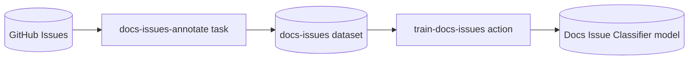

# Ellf Template: GitHub Docs Issue Classifier

Train a binary text classifier that predicts whether a GitHub issue is about documentation. You accept or reject one label, `DOCUMENTATION`, on each issue, then train a spaCy pipeline on your answers and get a model you can use to triage new issues.

*Adapted from the spaCy project [`textcat_docs_issues`](https://github.com/explosion/projects/tree/v3/tutorials/textcat_docs_issues) on 2026-10-28. Import it with the
[`/ellf-template`](https://ellf.ai/docs/modules#template) skill, or set it up by hand
with the commands below.*

## Workflow



## Overview

| Resource | Type | Name | Provided by | Details |
|---|---|---|---|---|
| Project | project | GitHub Docs Issues | user picks name | [below](#project) |
| Issues | asset (`input`) | GitHub Issues | template sample or user | [assets/input/github_issues.jsonl](assets/input/github_issues.jsonl) |
| Label | asset (`labels`) | Docs Issue Label | template | [assets/docs_issue_label.json](assets/docs_issue_label.json) |
| Guidelines | asset (`instructions`) | Docs Issue Guidelines | template | [assets/docs_issue_guidelines.md](assets/docs_issue_guidelines.md) |
| Classifier | asset (`model`) | Docs Issue Classifier | written by train-docs-issues | [train-docs-issues](#train-docs-issues) |
| Annotation | task | docs-issues-annotate | template | [Tasks](#docs-issues-annotate) |
| Training | action | train-docs-issues | template | [Actions](#train-docs-issues) |
| Annotations | dataset (`textcat`) | docs-issues | created empty | [Datasets](#datasets) |
| Project plan | plan | project_plan | template | [plans/project_plan.md](plans/project_plan.md) |

All jobs use built-in recipes: `textcat` and `train`.

## What you need to provide

- **Issues** (GitHub Issues): JSONL, one issue per line, with the text in `text` and anything else in `meta`:

  ```json
  {"text": "Add FAQ's to the documentation", "meta": {"url": "https://github.com/owner/repo/issues/9"}}
  ```

  The template includes 1,103 public GitHub issues in [assets/input/github_issues.jsonl](assets/input/github_issues.jsonl), found with the search queries "docs", "documentation", "readme" and "instructions". Most are just a title; some are the title as a Markdown heading followed by the body. Annotating about 600 of them is enough to train a useful first model. To classify your own project's issues, bring them in the format above, e.g. exported from the GitHub API.

No secrets or API keys are needed.

## Customize

- **The label:** the template trains one label, `DOCUMENTATION`. For another yes/no question about your issues, such as `BUG` or `QUESTION`, change the label and its definition in `assets/docs_issue_label.json` and rewrite the guidelines. For several categories at once, use a label scheme with one entry per category, add `--labels-exclusive` to the task if every issue gets exactly one, and train with `--data.textcat` instead of `--data.textcat-multilabel`.
- **Evaluation:** the training action holds back 20% of the annotations for evaluation (`--eval-split 0.2`). For scores you can compare across runs, annotate a separate evaluation set in a second task with its own dataset, and pass it with `--textcat-multilabel.eval`.
- **Base model:** training starts from a blank English pipeline (`--lang en`). For issues in another language, change `--lang`.

## Setup

### Project

```bash
ellf projects create "GitHub Docs Issues" "Train a text classifier that predicts whether a GitHub issue is about documentation."
ellf config project "GitHub Docs Issues"
```

### Assets

```bash
ellf publish data assets/input/github_issues.jsonl --kind input --name "GitHub Issues" --version 1.0.0
ellf publish data assets/docs_issue_label.json --kind labels --name "Docs Issue Label" --version 1.0.0
ellf publish data assets/docs_issue_guidelines.md --kind instructions --name "Docs Issue Guidelines" --version 1.0.0
```

Publish the label and guidelines before the task: the task reads them when it's created.

### Datasets

Created empty, so the plan can link to it before any job has run.

```bash
ellf datasets create docs-issues --kind textcat
```

`docs-issues` holds the accept and reject answers from `docs-issues-annotate`, which `train-docs-issues` trains on.

## Tasks

### docs-issues-annotate

Shows one issue at a time with the `DOCUMENTATION` label: accept if the issue is about documentation, reject if it isn't. With a single label, the task uses Prodigy's binary classification interface, so each decision is one keypress. Rejected issues are just as useful for training as accepted ones.

```bash
ellf tasks create textcat --name docs-issues-annotate --dataset docs-issues --input "GitHub Issues" --label-scheme "Docs Issue Label" --settings.instructions "Docs Issue Guidelines" --no-start
```

| Argument | Value | Notes |
|---|---|---|
| `--input` | GitHub Issues | template sample or your own issues |
| `--label-scheme` | Docs Issue Label | the label and its definition |
| `--settings.instructions` | Docs Issue Guidelines | shown on the H key |

## Actions

### train-docs-issues

Trains a spaCy text classifier on the annotations, evaluated on 20% of them held back from training. Uses `textcat_multilabel` with one label, so the model predicts a score between 0 and 1 for `DOCUMENTATION` and rejected issues train it towards 0. Writes the Docs Issue Classifier model. Run it once the task has a few hundred answers; run it again with a new `--output.version` as more come in.

```bash
ellf actions create train --name train-docs-issues --data.textcat-multilabel --textcat-multilabel.train docs-issues --lang en --eval-split 0.2 --output.name "Docs Issue Classifier" --output.version 0.1.0 --label-stats --no-start
```

| Argument | Value | Notes |
|---|---|---|
| `--textcat-multilabel.train` | docs-issues | the task's dataset |
| `--eval-split` | 0.2 | share of the annotations held back for evaluation |
| `--output.name` | Docs Issue Classifier | must be a new model name on your cluster |

## Plans

```bash
ellf plans write project_plan --file plans/project_plan.md
```

Plans link to resources with `@@Type/name@@` placeholders. After everything is
created, replace each with a concept link to the new resource's id (the
`/ellf-template` skill does this for you).

---

*Exported: 2026-10-28T11:34:30Z &middot; Template format: 1 &middot; Ellf CLI: 21.0.8 &middot; Recipe packages: ellf-recipes 0.18.19 &middot; Exported with: Claude Code 2.1.312 (claude-opus-5-5)*
