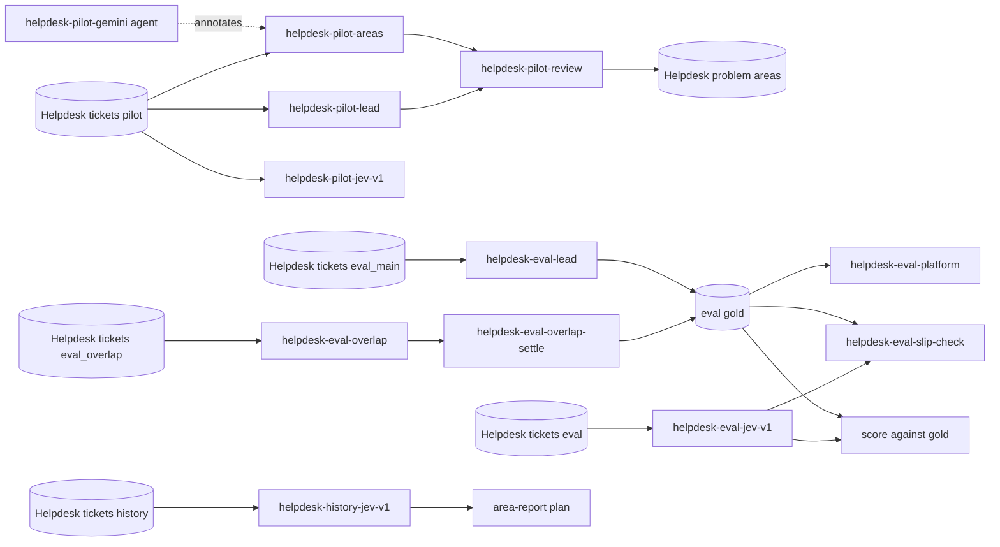

# Ellf Template: Helpdesk routing with Jev

Find out whether a hosted classifier, Jev, is good enough to route IT support tickets to the right technician by problem area, then put it to work. You settle the problem areas in a pilot with an LLM second opinion, build a human-labelled evaluation set, score Jev against a bar agreed in advance, and use it for daily routing and a monthly report of the most common problems.

*Exported from [Ellf](https://ellf.ai) on 2026-10-27. Import it with the
[`/ellf-template`](https://ellf.ai/docs/modules#template) skill, or set it up by hand
with the commands below.*

## Workflow



## Overview

| Resource | Type | Name | Provided by | Details |
|---|---|---|---|---|
| Project | project | Helpdesk routing | user picks name | [below](#project) |
| Pilot tickets | asset (`input`) | Helpdesk tickets (pilot) | template sample or user | [assets/input/pilot.jsonl](assets/input/pilot.jsonl) |
| Eval tickets | asset (`input`) | Helpdesk tickets (eval) | user | [What you need to provide](#what-you-need-to-provide) |
| Eval overlap tickets | asset (`input`) | Helpdesk tickets (eval_overlap) | user | [What you need to provide](#what-you-need-to-provide) |
| Eval main tickets | asset (`input`) | Helpdesk tickets (eval_main) | user | [What you need to provide](#what-you-need-to-provide) |
| History tickets | asset (`input`) | Helpdesk tickets (history) | user | [What you need to provide](#what-you-need-to-provide) |
| Eval platform tickets | asset (`input`) | Helpdesk tickets (eval platform) | built later from the eval gold | [helpdesk-eval-platform](#helpdesk-eval-platform) |
| Platform dev tickets | asset (`input`) | Helpdesk tickets (platform dev) | built later from pilot and backlog | [helpdesk-dev-platform](#helpdesk-dev-platform) |
| Slip check tickets | asset (`input`) | Helpdesk tickets (eval slip check) | built later from Jev's eval run | [helpdesk-eval-slip-check](#helpdesk-eval-slip-check) |
| Problem areas | asset (`labels`) | Helpdesk problem areas | template | [assets/problem_areas.json](assets/problem_areas.json) |
| Problem area guidelines | asset (`instructions`) | Helpdesk problem areas guidelines | template | [assets/problem_areas_guidelines.md](assets/problem_areas_guidelines.md) |
| Platforms | asset (`labels`) | Helpdesk platforms | template | [assets/platforms.json](assets/platforms.json) |
| Platform guidelines | asset (`instructions`) | Helpdesk platforms guidelines | template | [assets/platforms_guidelines.md](assets/platforms_guidelines.md) |
| Ticket layout | Prodigy config | prodigy_tickets | template | [config/prodigy_tickets.json](config/prodigy_tickets.json) |
| Pilot, lead | task | helpdesk-pilot-lead | template | [Tasks](#helpdesk-pilot-lead) |
| Pilot, Gemini | task | helpdesk-pilot-areas | template | [Tasks](#helpdesk-pilot-areas) |
| Pilot review | task | helpdesk-pilot-review | template | [Tasks](#helpdesk-pilot-review) |
| Eval overlap | task | helpdesk-eval-overlap | template | [Tasks](#helpdesk-eval-overlap) |
| Eval, lead | task | helpdesk-eval-lead | template | [Tasks](#helpdesk-eval-lead) |
| Eval overlap settle | task | helpdesk-eval-overlap-settle | template | [Tasks](#helpdesk-eval-overlap-settle) |
| Eval platforms | task | helpdesk-eval-platform | template | [Tasks](#helpdesk-eval-platform) |
| Dev platforms | task | helpdesk-dev-platform | template | [Tasks](#helpdesk-dev-platform) |
| Slip check | task | helpdesk-eval-slip-check | template | [Tasks](#helpdesk-eval-slip-check) |
| Jev on pilot | action | helpdesk-pilot-jev-v1 | template | [Actions](#helpdesk-pilot-jev-v1) |
| Jev on eval | action | helpdesk-eval-jev-v1 | template | [Actions](#helpdesk-eval-jev-v1) |
| Jev on history | action | helpdesk-history-jev-v1 | template | [Actions](#helpdesk-history-jev-v1) |
| Gemini annotator | agent | helpdesk-pilot-gemini | template | [Agents](#agents) |
| Pilot, lead's answers | dataset (`textcat`) | helpdesk-pilot-areas-lead | created empty | [Datasets](#datasets) |
| Pilot, Gemini's answers | dataset (`textcat`) | helpdesk-pilot-areas | created empty | [Datasets](#datasets) |
| Pilot, settled | dataset (`review`) | helpdesk-pilot-areas-gold | created empty | [Datasets](#datasets) |
| Eval overlap answers | dataset (`textcat`) | helpdesk-eval-overlap | created empty | [Datasets](#datasets) |
| Eval, lead's answers | dataset (`textcat`) | helpdesk-eval-lead | created empty | [Datasets](#datasets) |
| Eval overlap, settled | dataset (`review`) | helpdesk-eval-overlap-gold | created empty | [Datasets](#datasets) |
| Eval platforms | dataset (`textcat`) | helpdesk-eval-platform | created empty | [Datasets](#datasets) |
| Dev platforms | dataset (`textcat`) | helpdesk-dev-platform | created empty | [Datasets](#datasets) |
| Slip check answers | dataset (`textcat`) | helpdesk-eval-slip-check | created empty | [Datasets](#datasets) |
| Jev on pilot | dataset (`textcat`) | helpdesk-pilot-jev-v1 | created empty | [Datasets](#datasets) |
| Jev on eval | dataset (`textcat`) | helpdesk-eval-jev-v1 | created empty | [Datasets](#datasets) |
| Jev on history | dataset (`textcat`) | helpdesk-history-jev-v1 | created empty | [Datasets](#datasets) |
| Project plan | plan | project_plan | template | [plans/project_plan.md](plans/project_plan.md) |
| Keyword breakdown | plan | ticket-breakdown | template | [plans/ticket-breakdown.md](plans/ticket-breakdown.md) |
| Annotator agreement | plan | eval-agreement | template | [plans/eval-agreement.md](plans/eval-agreement.md) |
| Area report | plan | area-report | template | [plans/area-report.md](plans/area-report.md) |

All jobs use built-in recipes: `textcat`, `review`, `textcat_jev` and `gemini_agent`.

## What you need to provide

- **Ticket data:** a helpdesk export as JSONL, one ticket per line, with subject and body joined in `text`, and `ticket_id` and `created` (YYYY-MM-DD) in `meta`:

  ```json
  {"text": "Subject: Laptop won't boot from USB\n\nI'm trying to boot a ThinkPad from a USB stick but it never shows up in the boot menu...", "meta": {"ticket_id": "T-1042", "created": "2026-03-18"}}
  ```

  Split it deterministically by `ticket_id` hash (the project plan describes `scripts/make_splits.py`) into:
  - **Helpdesk tickets (pilot)**: 100 tickets from before the eval period. The template includes a sample of 100 IT support tickets in [assets/input/pilot.jsonl](assets/input/pilot.jsonl): the pilot split of the original project. Use it to try the pilot, or bring your own.
  - **Helpdesk tickets (eval)**: 500 recent tickets. No data is included: bring your own.
  - **Helpdesk tickets (eval_overlap)**: 100 of the 500 eval tickets, labelled by two people. No data is included.
  - **Helpdesk tickets (eval_main)**: the other 400 eval tickets. No data is included.
  - **Helpdesk tickets (history)**: the pilot plus every ticket not in the eval set, for the area report. No data is included.

  The pilot sample only makes sense with your own eval and history tickets from the same helpdesk: to evaluate Jev, use your own data throughout.
- **Secrets:** never included; create them yourself with `ellf secrets create <name>`.
  - `jev-key`: your TypeSafe API key, for the three Jev actions. Ticket text is sent to TypeSafe's API.
  - `gemini-api-key`: your Google AI API key, for the Gemini agent. The pilot tickets are sent to Google's Gemini API.
- **Two annotators:** the project lead, who labels the pilot and the eval set, and a second person (ideally a technician) for the 100 overlap tickets. Assign the second person to `helpdesk-eval-overlap` once it exists.
- **Scripts:** the plans refer to helper scripts that aren't part of Ellf and aren't included: write your own, or have your coding agent write them from the plan's descriptions. See [Scripts](#scripts).

## Customize

- **Problem areas and routing table:** the seven areas and the area→technician table assume four technicians (Windows PCs, networking and VPN, hardware and storage, Linux and servers) plus triage. Changing the team changes the routing table in `scripts/routing.py`, not the areas. Changing the areas means editing `assets/problem_areas.json` and the guidelines, and the label list in the two `review` tasks.
- **The bar:** the plan's example is ≥95% of auto-routed tickets to the correct technician at ≥50% coverage. Agree your own before any Jev run.
- **Jev model:** the eval and history actions pin `jev-1.13.0`. Pin the current model instead, and use the same one for every run you compare.
- **Gemini in the pilot:** optional. Without it, drop `helpdesk-pilot-areas`, its dataset and the agent, and review the lead's answers alone (or with a second person).
- **Ticket layout** (`config/prodigy_tickets.json`): widens the card to 1300px instead of Prodigy's default 675px, uses 70px buttons, left-aligns the ticket text in a box sized to the window height so the buttons stay in view, and lays the options out in a grid of columns at least 250px wide, so long labels such as LINUX_AND_SERVERS fit next to their shortcut badge. It also turns on flagging. Adjust the sizes for your ticket length and screens; every labelling task reads the same file.

## Setup

Run the commands from this directory: the task commands read `config/prodigy_tickets.json` by relative path.

### Project

```bash
ellf projects create "Helpdesk routing" "Route IT support tickets to the right technician by problem area with Jev, and report the most common problem areas."
ellf config project "Helpdesk routing"
```

### Assets

```bash
ellf publish data assets/input/pilot.jsonl --kind input --name "Helpdesk tickets (pilot)" --version 1.0.0
ellf publish data data/splits/eval.jsonl --kind input --name "Helpdesk tickets (eval)" --version 1.0.0
ellf publish data data/splits/eval_overlap.jsonl --kind input --name "Helpdesk tickets (eval_overlap)" --version 1.0.0
ellf publish data data/splits/eval_main.jsonl --kind input --name "Helpdesk tickets (eval_main)" --version 1.0.0
ellf publish data data/splits/history.jsonl --kind input --name "Helpdesk tickets (history)" --version 1.0.0
ellf publish data assets/problem_areas.json --kind labels --name "Helpdesk problem areas" --version 1.1.0
ellf publish data assets/problem_areas_guidelines.md --kind instructions --name "Helpdesk problem areas guidelines" --version 1.1.0
ellf publish data assets/platforms.json --kind labels --name "Helpdesk platforms" --version 1.0.0
ellf publish data assets/platforms_guidelines.md --kind instructions --name "Helpdesk platforms guidelines" --version 1.0.0
```

The `data/splits/` paths are where `scripts/make_splits.py` writes the splits: use your own files. The problem areas are at version 1.1.0, after one revision from a pilot and one from Jev's pilot errors. Publish your own revisions under the same names with a new version.

Helpdesk tickets (eval platform), (platform dev) and (eval slip check) are built later from labelled data, so they're published when the jobs that read them are created.

### Datasets

Created empty, so the plans can link to them before any job has run.

```bash
ellf datasets create "helpdesk-pilot-areas-lead" --kind textcat
ellf datasets create "helpdesk-pilot-areas" --kind textcat
ellf datasets create "helpdesk-pilot-areas-gold" --kind review
ellf datasets create "helpdesk-eval-overlap" --kind textcat
ellf datasets create "helpdesk-eval-lead" --kind textcat
ellf datasets create "helpdesk-eval-overlap-gold" --kind review
ellf datasets create "helpdesk-eval-platform" --kind textcat
ellf datasets create "helpdesk-dev-platform" --kind textcat
ellf datasets create "helpdesk-eval-slip-check" --kind textcat
ellf datasets create "helpdesk-pilot-jev-v1" --kind textcat
ellf datasets create "helpdesk-eval-jev-v1" --kind textcat
ellf datasets create "helpdesk-history-jev-v1" --kind textcat
```

- `helpdesk-pilot-areas-lead` and `helpdesk-pilot-areas` hold the lead's and Gemini's pilot answers; `helpdesk-pilot-review` settles both into `helpdesk-pilot-areas-gold`.
- `helpdesk-eval-overlap` holds both annotators' answers on the overlap and `helpdesk-eval-lead` the lead's other 400; `helpdesk-eval-overlap-settle` settles the overlap into `helpdesk-eval-overlap-gold`. The eval gold is built from the gold dataset and `helpdesk-eval-lead`.
- `helpdesk-eval-platform`, `helpdesk-dev-platform` and `helpdesk-eval-slip-check` hold the platform labels and the blind re-labels.
- The three `-jev-v1` datasets hold Jev's answers from the actions of the same name.

## Tasks

### helpdesk-pilot-lead

The project lead labels the 100 pilot tickets to settle the problem-area definitions, flagging every ticket they hesitate on. Their answers are compared with Gemini's in `helpdesk-pilot-areas`; the disagreements and flags show where the definitions need work.

```bash
ellf tasks create textcat --name helpdesk-pilot-lead --dataset helpdesk-pilot-areas-lead --input 'Helpdesk tickets (pilot)' --label-scheme 'Helpdesk problem areas' --labels-exclusive --settings.config "$(cat config/prodigy_tickets.json)" --settings.goal overlap --settings.instructions 'Helpdesk problem areas guidelines' --no-start
```

| Argument | Value | Notes |
|---|---|---|
| `--input` | Helpdesk tickets (pilot) | template sample or your own pilot split |
| `--label-scheme` | Helpdesk problem areas | label scheme from assets/problem_areas.json |
| `--settings.instructions` | Helpdesk problem areas guidelines | shown on the H key |
| `--settings.config` | config/prodigy_tickets.json | the ticket layout |

### helpdesk-pilot-areas

The same pilot tickets for the Gemini agent, in its own task, so the lead's layout can change without disturbing Gemini's answers.

```bash
ellf tasks create textcat --name helpdesk-pilot-areas --dataset helpdesk-pilot-areas --input 'Helpdesk tickets (pilot)' --label-scheme 'Helpdesk problem areas' --labels-exclusive --settings.config "$(cat config/prodigy_tickets.json)" --settings.goal overlap --settings.instructions 'Helpdesk problem areas guidelines' --no-start
```

### helpdesk-pilot-review

Goes over the lead's and Gemini's answers and saves one settled answer per ticket. Offer only the current labels. Leave auto-accept off when the definitions changed after the answers were given, so the lead confirms every ticket under the current guidelines.

```bash
ellf tasks create review --name helpdesk-pilot-review --dataset helpdesk-pilot-areas-gold --datasets helpdesk-pilot-areas-lead,helpdesk-pilot-areas --label WINDOWS,APPS,HARDWARE,LINUX_AND_SERVERS,NETWORK,STORAGE,OTHER --no-start
```

| Argument | Value | Notes |
|---|---|---|
| `--label` | the seven areas | must match `assets/problem_areas.json` |

### helpdesk-eval-overlap

The 100 overlap tickets, labelled independently by the project lead and the second annotator, each in their own session, without drafts. The lead labels these first, so agreement is known before the other 400 are labelled.

```bash
ellf tasks create textcat --name helpdesk-eval-overlap --dataset helpdesk-eval-overlap --input 'Helpdesk tickets (eval_overlap)' --label-scheme 'Helpdesk problem areas' --labels-exclusive --settings.config "$(cat config/prodigy_tickets.json)" --settings.goal overlap --settings.instructions 'Helpdesk problem areas guidelines' --no-start
```

### helpdesk-eval-lead

The other 400 eval tickets, labelled by the project lead only. Together with the settled overlap they make the eval gold.

```bash
ellf tasks create textcat --name helpdesk-eval-lead --dataset helpdesk-eval-lead --input 'Helpdesk tickets (eval_main)' --label-scheme 'Helpdesk problem areas' --labels-exclusive --settings.config "$(cat config/prodigy_tickets.json)" --settings.goal overlap --settings.instructions 'Helpdesk problem areas guidelines' --no-start
```

### helpdesk-eval-overlap-settle

Settles the overlap: agreed tickets are saved without being shown, and the conflicts are shown for the two annotators (or the written rule) to decide.

```bash
ellf tasks create review --name helpdesk-eval-overlap-settle --auto-accept --dataset helpdesk-eval-overlap-gold --datasets helpdesk-eval-overlap --label WINDOWS,APPS,HARDWARE,LINUX_AND_SERVERS,NETWORK,STORAGE,OTHER --no-start
```

### helpdesk-eval-platform

For gold tickets labelled APPS or STORAGE, the technician depends on the system the problem is on, so the lead picks the platform too. The gold area shows in the card's meta.

**Create after:** the eval gold is locked and its APPS/STORAGE tickets are published as Helpdesk tickets (eval platform).

```bash
ellf tasks create textcat --name helpdesk-eval-platform --dataset helpdesk-eval-platform --input 'Helpdesk tickets (eval platform)' --label-scheme 'Helpdesk platforms' --labels-exclusive --settings.config "$(cat config/prodigy_tickets.json)" --settings.goal overlap --settings.instructions 'Helpdesk platforms guidelines' --no-start
```

### helpdesk-dev-platform

About 100 pilot and backlog tickets, none from the eval set, for improving the platform rules without tuning them on the test set.

**Create after:** the pilot is settled and the dev tickets are published as Helpdesk tickets (platform dev).

```bash
ellf tasks create textcat --name helpdesk-dev-platform --dataset helpdesk-dev-platform --input 'Helpdesk tickets (platform dev)' --label-scheme 'Helpdesk platforms' --labels-exclusive --settings.config "$(cat config/prodigy_tickets.json)" --settings.goal overlap --settings.instructions 'Helpdesk platforms guidelines' --no-start
```

### helpdesk-eval-slip-check

The lead re-labels, blind, the tickets where Jev is confident and disagrees with the gold, mixed with as many where it agrees. The fresh answers go into a new gold version.

**Create after:** `helpdesk-eval-jev-v1` has run and the selected tickets are published as Helpdesk tickets (eval slip check).

```bash
ellf tasks create textcat --name helpdesk-eval-slip-check --dataset helpdesk-eval-slip-check --input 'Helpdesk tickets (eval slip check)' --label-scheme 'Helpdesk problem areas' --labels-exclusive --settings.config "$(cat config/prodigy_tickets.json)" --settings.goal overlap --settings.instructions 'Helpdesk problem areas guidelines' --no-start
```

## Actions

All three run Jev with the same instructions and `--min-confidence 0.0`, so every answer and its confidence is kept and the threshold can be picked from the curve.

| Argument | Value | Notes |
|---|---|---|
| `--api-key` | jev-key | secret you create |
| `--label-scheme` | Helpdesk problem areas | the current version |
| `--model` | jev-1.13.0 | pin the current model |
| `--instructions` | see the commands | don't mention technicians, like the guidelines |

### helpdesk-pilot-jev-v1

Jev on the pilot tickets, before the definitions are frozen, to find the boundaries it struggles with. It can't decide the bar: the definitions were written from these tickets.

```bash
ellf actions create textcat_jev --name helpdesk-pilot-jev-v1 --api-key jev-key --input 'Helpdesk tickets (pilot)' --instructions 'Classify the IT support ticket by the area of the main problem the user needs fixed, not where they noticed it. The area is used to route the ticket to the right technician.' --label-scheme 'Helpdesk problem areas' --labels-exclusive --min-confidence 0.0 --output helpdesk-pilot-jev-v1 --no-start
```

### helpdesk-eval-jev-v1

The evaluation run on the 500 eval tickets, scored against the gold labels at every threshold.

```bash
ellf actions create textcat_jev --name helpdesk-eval-jev-v1 --api-key jev-key --input 'Helpdesk tickets (eval)' --instructions 'Classify the IT support ticket by the area of the main problem the user needs fixed, not where they noticed it. The area is used to route the ticket to the right technician.' --label-scheme 'Helpdesk problem areas' --labels-exclusive --min-confidence 0.0 --model jev-1.13.0 --output helpdesk-eval-jev-v1 --no-start
```

### helpdesk-history-jev-v1

Jev on every ticket outside the eval set, for the first area report.

```bash
ellf actions create textcat_jev --name helpdesk-history-jev-v1 --concurrency 16 --api-key jev-key --input 'Helpdesk tickets (history)' --instructions 'Classify the IT support ticket by the area of the main problem the user needs fixed, not where they noticed it. The area is used to route the ticket to the right technician.' --label-scheme 'Helpdesk problem areas' --labels-exclusive --min-confidence 0.0 --model jev-1.13.0 --output helpdesk-history-jev-v1 --no-start
```

## Agents

### helpdesk-pilot-gemini

A second opinion on the pilot tickets: Gemini answers each ticket in `helpdesk-pilot-areas` while the lead labels the same tickets blind. It reads the task's label scheme and guidelines. Some answers come back as skips when the model replies in prose instead of JSON; those aren't judgements about the ticket.

```bash
ellf agents create gemini_agent --name helpdesk-pilot-gemini --idle-shutdown-seconds 600.0 --api-key gemini-api-key --no-start
ellf agents assign "helpdesk-pilot-gemini" --task "helpdesk-pilot-areas"
```

| Argument | Value | Notes |
|---|---|---|
| `--api-key` | gemini-api-key | secret you create |

## Plans

```bash
ellf plans write project_plan --file plans/project_plan.md
ellf plans write ticket-breakdown --file plans/ticket-breakdown.md
ellf plans write eval-agreement --file plans/eval-agreement.md
ellf plans write area-report --file plans/area-report.md
```

`project_plan` is the full plan. `ticket-breakdown`, `eval-agreement` and `area-report` are outlines to fill in at the matching steps.

Plans link to resources with `@@Type/name@@` placeholders. After everything is
created, replace each with a concept link to the new resource's id (the
`/ellf-template` skill does this for you).

## Scripts

The workflow uses local helper scripts that aren't part of Ellf. They aren't included; the project plan describes what each does, so your coding agent can write them for your data.

| Script | What it does |
|---|---|
| `make_splits.py` | Deterministic pilot, eval, overlap, eval_main and backlog splits by ticket-ID hash |
| `keyword_baseline.py` | Keyword rules per area, for the breakdown and as a baseline |
| `routing.py` | The area→technician table, with keyword platform rules for APPS and STORAGE |
| `compare_pilot.py` | Agreement between the lead's and Gemini's pilot answers |
| `agreement_overlap.py` | Agreement and confusion matrix on the eval overlap |
| `score_jev.py` | Threshold curve, accuracies with Wilson intervals and confusion matrix for Jev |
| `score_baselines.py`, `score_platform_rules.py` | Baselines and the platform rules on their own |
| `slip_check.py` | Selects the slip-check tickets and applies the fresh answers as a new gold version |
| `area_report.py` | Monthly counts per area and the recurring terms in each |
| `route_daily.py`, `triage_month.py`, `week_check.py` | Daily routing, the monthly triage task and the weekly check |

---

*Exported: 2026-10-27T09:08:20Z &middot; Template format: 1 &middot; Ellf CLI: 21.0.7 &middot; Recipe packages: ellf-recipes 0.18.15 &middot; Exported with: Claude Code 2.1.311 (claude-opus-5-5)*
