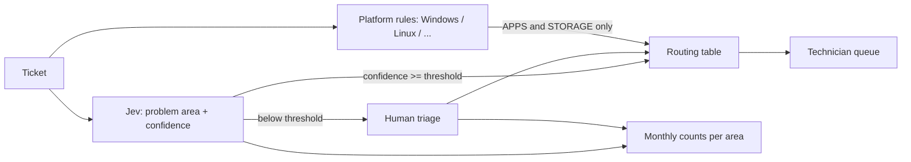

# NLP Project Plan: Helpdesk routing with Jev

## Problem Statement
Classify incoming IT support tickets by problem area, so they're routed to the right technician automatically when the classifier is confident and triaged by a person otherwise, and report monthly counts per area to find recurring problems to fix at the source.

The question this project answers first: **is Jev good enough on our tickets to do this?** It evaluates Jev (`textcat_jev`), a hosted classifier, rather than training a model of our own.

## Context
- Fill in: who sends tickets, how many a month, and who handles them. Personal and power-user questions are normal tickets, not noise.
- Fill in: the technicians and how work is split between them today. The routing table below assumes four, loosely split by area: Windows PCs, networking and VPN, hardware and storage, Linux and servers.
- Get approval to send ticket text to TypeSafe's API (Jev), and to Google's Gemini API for the pilot, before any ticket is sent.

## Pipeline Overview
One classifier (Jev via `textcat_jev`) picks **one problem area per ticket**. A routing table (`scripts/routing.py`) assigns each area to a technician. For APPS and STORAGE, the technician depends on the system the problem is on, which keyword rules read from the ticket. Tickets below the confidence threshold go to a person, who picks the area in a monthly `textcat` task, with a few of Jev's confident tickets mixed in blind as a check.

The model predicts **what the problem is**. **Who handles it** is a business rule in the routing table, so when responsibilities shift, the table changes and Jev's labels stay the same.

### Running it
- **Daily:** export the new tickets, keep the ones not seen before, publish them as an input asset and run Jev with the signed-off settings at the chosen `--min-confidence` into one live dataset. Write a routes file (ticket → technician through `scripts/routing.py`) for whoever applies it in the helpdesk. Three kinds of ticket stay in the shared queue: the ones Jev is unsure about, OTHER, and APPS/STORAGE on a Mac, a phone or several systems. Optionally hold back a share of the tickets Jev would route (by a salted hash of the ticket ID), for a fixed period, as a comparison group for the business outcome. Log daily coverage.
- **Weekly (~15 minutes):** export the technicians' record of who resolved each ticket and whether it was handed over, and check it against the routes. At low volume the weekly check catches breakage and reads every wrong route; **it doesn't measure accuracy**. It shows:
  - days with no run (rerun them; the routing script skips tickets it has already answered);
  - coverage for the week and for the last 4 weeks. A single week varies a lot; a **4-week figure below the coverage bar** is a real drop. Look for what's new in the unsure tickets (a product, a customer), and don't lower the threshold;
  - the week's auto-routed tickets, one line each (subject, area, confidence, technician), to skim for anything plainly wrong;
  - every auto-routed ticket that was handed over or resolved by someone other than the routed technician, with its cause recorded: Jev, the platform rules, the routing table, or workload (workload isn't an error);
  - tickets per technician. If one person gets more than they can take, change the routing table, not the areas;
  - with a holdout: routed against held-back tickets, by time to pickup and how often they're handed over.

  **Stop auto-routing and recheck** if the wrong routes caused by Jev or the rules over 4 weeks are well above what the eval accuracy predicts. Work out the expected number and the stop line from the eval accuracy and the weekly volume before going live. Platform-rule errors from live tickets can go into the platform dev set; Jev's errors are collected for the next version of the scheme. Neither touches the eval set.
- **Monthly:** create a `textcat` task with the label scheme, the guidelines and `config/prodigy_tickets.json`, holding the tickets Jev was unsure about plus a few it was sure about, sampled with the month as seed and mixed in by ticket-ID hash. Jev's answer isn't shown, and nothing on the card tells the two kinds apart. Keep the spot-check IDs outside the task. Build this input directly rather than excluding the live dataset, which would also drop the spot-check tickets. Once every ticket has an area, write the month's section of @@Plans/area-report@@ and compare people's answers on the spot-check tickets with Jev's. A handful a month only catches a large drop, but it's the one check that doesn't depend on someone handing a ticket over.
- **Trial first:** run the daily and monthly steps in a test mode on a few eval tickets, through a test action and task, and delete them afterwards.

### Problem areas
Published as @@Assets/Helpdesk problem areas@@ (`assets/problem_areas.json`), with the full definitions, look-alikes and examples, and the guidelines @@Assets/Helpdesk problem areas guidelines@@ (`assets/problem_areas_guidelines.md`). Exclusive labels: each ticket gets the area of **the main problem the user needs fixed, not where they noticed it**. Confirm this rule with the technicians before the pilot. Keep the label order fixed between versions, so annotators' keyboard shortcuts don't move. Publish every revision under the same asset name with a new version, and use the latest for every new task and Jev run.

| Label | Covers | Technician |
|---|---|---|
| WINDOWS | The Windows desktop OS: install, boot, updates, settings, drivers, built-in tools (winget), signing in to Windows, Windows scripting | Windows PCs |
| APPS | Apps and tools on any system: Office, browsers, media and file tools, **command-line and developer tools** (git, rsync, gpg, regex), **hosted services** (Microsoft 365, S3), apps inside a VM, signing in to an app | by platform, see below |
| HARDWARE | Devices and components, peripherals, power, BIOS/firmware, **boot menu and boot order**, drives that are dead or not detected | Hardware & storage |
| LINUX_AND_SERVERS | Linux/Unix (including sign-in and permissions), **Windows Server**, self-hosted services, VMs and containers themselves | Linux & servers |
| NETWORK | Wi-Fi, LAN, DNS, routers and switches, VPN, firewalls, proxies, remote access, **network settings and commands on any system** | Networking & VPN |
| STORAGE | Disks, partitions, file systems, RAID, backup, recovery on a drive that still shows up, even with I/O errors | by platform, see below |
| OTHER | The thing to fix is a Mac, iPhone/iPad or Android device, or an app on one, or nothing above fits | Triage (whoever is free) |

A sign-in or password problem belongs to the area of what the user signs in to.

**APPS and STORAGE by platform:**

| Platform named in the ticket | APPS | STORAGE |
|---|---|---|
| Windows | Windows PCs | Hardware & storage |
| Linux, or Windows Server | Linux & servers | Linux & servers |
| macOS or mobile | Triage | Triage |
| Several systems | Triage | Triage |
| None | Windows PCs | Windows PCs |

Agree the "none" row with the technicians: it can decide a large share of tickets, since many app questions name no system. Sending them to Windows PCs assumes nearly all users are on Windows. If that puts too much on one person, rebalance the routing table, not the areas.

The platform is deliberately **not** part of the area labels. Splitting APPS into "apps on Windows" and "apps on Linux" would put the team structure back into the labels and break the APPS count in the monthly report. If OTHER takes more than ~10% of the pilot, an area is missing.

### What the pilot labels say
The project lead labels the pilot tickets in @@Tasks/helpdesk-pilot-lead@@ and Gemini answers the same tickets in @@Tasks/helpdesk-pilot-areas@@. Compare them (`scripts/compare_pilot.py` on the dataset exports) and write the findings here:

- Is an area missing? (OTHER under ~10%, and what's in it.)
- How tickets split across areas, and what share the "none" routing rule decides.
- Agreement between the lead and Gemini on areas and on technicians, on tickets where both gave one area.
- Which boundaries cause the disagreements and flags. Settle each in the definitions, with the pilot tickets as examples.
- How the keyword rules do against the lead's labels: the baseline Jev has to clear.

## Data Strategy
- **Source:** a helpdesk export as JSONL, one ticket per line, `text` = subject + body, `meta` with `ticket_id` and `created`. Profile it first: volume per month, length, how many tickets touch several areas. That's why each label has to say which problem counts as the "main" one.
- If volume or the ticket mix shifted over time, take the evaluation set from **recent** tickets.
- **Splits** (deterministic, by `ticket_id` hash, with `scripts/make_splits.py`; rerunning on the same export gives the same files):
  - **Pilot**, @@Assets/Helpdesk tickets (pilot)@@: 100 tickets from before the eval period. Used to settle the label definitions.
  - **Eval**, @@Assets/Helpdesk tickets (eval)@@: 500 recent tickets. Never used to tune definitions or keyword rules.
  - **Eval overlap**, @@Assets/Helpdesk tickets (eval_overlap)@@: 100 of those 500, also labelled by a second person.
  - **Eval main**, @@Assets/Helpdesk tickets (eval_main)@@: the other 400 eval tickets, labelled by the project lead only.
  - **Backlog**: the remaining tickets, published together with the pilot as @@Assets/Helpdesk tickets (history)@@ for the area report.
  - **Eval gold** (local, read-only, with its SHA-256 recorded): one area per eval ticket, the lead's 400 plus the 100 settled overlap answers. Built and checked from the dataset exports.
  - **Eval gold platforms** (local, read-only): one platform for each APPS/STORAGE ticket in the gold areas, from @@Tasks/helpdesk-eval-platform@@.
  - **Platform dev set**, @@Assets/Helpdesk tickets (platform dev)@@: about 100 tickets for improving the platform rules, none from the eval split: the pilot tickets settled as APPS or STORAGE plus a seeded sample of backlog tickets the keyword rules call APPS or STORAGE. Labelled in @@Tasks/helpdesk-dev-platform@@ and locked as a local file.
- Lock every gold file once it's built: read-only, SHA-256 recorded here. A correction makes a new version with each change and its reason logged, and results are reported on both.

## Annotation Plan
The project lead labels the pilot and all 500 eval tickets. A second person, ideally a technician, labels the 100 overlap tickets independently, as a second opinion.

1. **Pilot (100 tickets), the project lead and Gemini side by side, in two tasks over the same tickets:** the project lead labels in @@Tasks/helpdesk-pilot-lead@@ (dataset @@Datasets/helpdesk-pilot-areas-lead@@), and Gemini in @@Tasks/helpdesk-pilot-areas@@ (dataset @@Datasets/helpdesk-pilot-areas@@). Both run on @@Assets/Helpdesk tickets (pilot)@@ with @@Assets/Helpdesk problem areas@@ and @@Assets/Helpdesk problem areas guidelines@@. The labels are exclusive, flagging is on, and the goal is `overlap`, so everyone answers every ticket. The Prodigy config in `config/prodigy_tickets.json` widens the card to 1300px, uses 70px buttons, sizes the ticket text to the screen height so the buttons stay in view, and lays the options out in a grid of columns at least 250px wide; every labelling task uses it. The agent @@Agents/helpdesk-pilot-gemini@@ (`gemini_agent`) answers each ticket, and the project lead labels the same tickets without seeing Gemini's answers. Keeping Gemini in its own task means the lead's layout can change without disturbing Gemini's answers. A `review` task, @@Tasks/helpdesk-pilot-review@@, goes over both datasets and saves one settled answer per ticket to @@Datasets/helpdesk-pilot-areas-gold@@. Turn auto-accept **off** if the definitions changed since the answers were given, so the lead confirms every ticket under the current guidelines. Disagreements and flagged tickets become `do_not_mark` entries and boundary examples.
2. **Revise the label scheme** from the pilot: publish a new version of @@Assets/Helpdesk problem areas@@ and @@Assets/Helpdesk problem areas guidelines@@. Jev and the eval annotation tasks both use it, so people and Jev work from the same definitions. Correct any settled pilot answers the new version contradicts, and have the lead confirm each correction.
3. **Eval set (500 tickets), no drafts:** the project lead labels all 500 from scratch, and the second annotator labels the 100 overlap tickets. Two `textcat` tasks, both with the label scheme, the guidelines, exclusive labels, `config/prodigy_tickets.json` (flagging on) and goal `overlap`:
   - @@Tasks/helpdesk-eval-overlap@@: the 100 overlap tickets, labelled by both people, each in their own session, into @@Datasets/helpdesk-eval-overlap@@. Neither sees the other's answers. The second annotator is assigned to this task only. **The lead labels these first**, so agreement can be measured before the other 400 are labelled.
   - @@Tasks/helpdesk-eval-lead@@: the 400 tickets in @@Assets/Helpdesk tickets (eval_main)@@, labelled by the lead only, into @@Datasets/helpdesk-eval-lead@@.

   The gold labels are the settled overlap answers plus the lead's 400.

   **Settling the overlap:** @@Tasks/helpdesk-eval-overlap-settle@@, a `review` task with auto-accept, saves agreed tickets without showing them and shows the conflicts, into @@Datasets/helpdesk-eval-overlap-gold@@. Decide in advance who settles the conflicts: when one of the two annotators settles alone, they tend to keep their own answers, so settling together, or by the written rule, is safer. Measure agreement first and write it up in @@Plans/eval-agreement@@.
4. **Platform for APPS and STORAGE eval tickets:** the technician for these depends on the system, so the gold answer needs it too. The project lead picks the platform for the gold tickets labelled APPS or STORAGE (@@Assets/Helpdesk tickets (eval platform)@@, built from the eval gold) in @@Tasks/helpdesk-eval-platform@@. It uses @@Assets/Helpdesk platforms@@ (WINDOWS, WINDOWS_SERVER, LINUX, MAC_MOBILE, SEVERAL, UNSTATED: the names `scripts/routing.py` uses) and @@Assets/Helpdesk platforms guidelines@@, with the ticket layout and flagging. The gold area shows in the card's meta. The rule is the system **the problem is on, as the ticket shows it**: named, or shown beyond doubt by a path or command (`C:\`, PowerShell, `apt`, `sudo`). The app alone doesn't count.

**Why the eval set gets no LLM drafts:** people tend to accept a pre-filled answer when they're unsure, and the uncertain tickets are exactly where Jev would be judged. The eval labels have to be people's own independent answers.

**Slips:** expect a few percent of one person's answers to be slips (a wrong button, or accepted with no area). At that rate, a perfect classifier would score just under 100% against the gold labels, which can be too close to the bar. So the eval labels need a slip check before Jev is scored.

**Slip check (agree it before Jev's eval run, run it after):** take the tickets where Jev's confidence is at least 0.8 and its area differs from the locked gold, and mix in as many tickets where Jev agrees at that confidence (decoys, seeded). Write them with only text and ticket ID: no gold area, no Jev answer, no flag, as @@Assets/Helpdesk tickets (eval slip check)@@. The project lead re-labels them blind in @@Tasks/helpdesk-eval-slip-check@@ (dataset @@Datasets/helpdesk-eval-slip-check@@). Every re-labelled ticket takes the fresh answer in a new gold version, with a change log; changes that move a ticket into or out of APPS/STORAGE need a platform recheck. Jev is scored on both gold versions and both are reported. The decoys' change rate is the lead's baseline for changing an answer anyway: if the checks change much more often than the decoys, the gold had real slips. The check only looks where Jev disagrees, so the new version can only move toward Jev, which is why the original is always reported too.

**Single-annotator risk:** 400 eval tickets carry one person's labels, and that person also wrote the definitions. Agreement on the 100 overlap tickets is the check on this. If technician-level agreement is below ~90%, fix the definitions before running Jev. Otherwise Jev would be scored against one person's reading of the areas.

## Evaluation Strategy
**What decides it:** on the 500 human-labelled recent tickets, what share of tickets Jev routes to the correct technician, and what share it can handle at all, at one threshold, against a bar agreed in advance. Fix the bar before any Jev run. The threshold is picked from the eval-set curve, as the most conservative threshold that clears both lines, not the one that scores best. That makes the result slightly optimistic, and live monitoring after launch should check it.

- **Jev runs:** `textcat_jev` with the current label scheme, `--labels-exclusive`, the instructions *"Classify the IT support ticket by the area of the main problem the user needs fixed, not where they noticed it. The area is used to route the ticket to the right technician."* (they don't mention technicians, because the guidelines tell people not to think about routing), a pinned `--model` and `--min-confidence 0`, so every answer and its confidence is kept. A rerun with different labels, definitions or instructions gets a new output dataset.
  - **Pilot run (not the evaluation):** @@Actions/helpdesk-pilot-jev-v1@@ on @@Assets/Helpdesk tickets (pilot)@@ into @@Datasets/helpdesk-pilot-jev-v1@@. It shows which boundaries Jev struggles with before the definitions are frozen. It can't decide the bar: the definitions were written from these tickets, and some are examples in the scheme, so Jev saw them in its prompt.
  - **Eval run:** @@Actions/helpdesk-eval-jev-v1@@ on @@Assets/Helpdesk tickets (eval)@@ into @@Datasets/helpdesk-eval-jev-v1@@. Lock the export like the gold files.
- **Two accuracies:**
  - **Technician accuracy**, reported two ways. **With the rules:** Jev's area plus the platform rules (`scripts/routing.py`), the system as it would run; this decides routing. **With the gold platforms:** Jev's area plus the gold platform, so only Jev's own errors count. Where the gold area isn't APPS/STORAGE there's no gold platform, and the rules decide in both. Score the platform rules on their own too, so a routing error can be traced to Jev or to the rules.
  - **Area accuracy:** this decides how far the monthly report can be trusted. WINDOWS and APPS on Windows (or naming no system) share a technician, so confusing them doesn't break routing, but it does skew the report.
- **Threshold curve:** for each threshold, coverage (share of tickets Jev answers) against technician accuracy and area accuracy on those tickets, with 95% Wilson intervals, plus a confusion matrix by area.
- **Baselines** on the same 500: always predicting the most common area, and keyword rules (`scripts/keyword_baseline.py`, routed through the same `scripts/routing.py`). Jev has to clearly beat the keyword rules to be worth it.
- **Platform rules:** improve them on the platform dev set only, then score them **once** on the eval set, and don't tune them further on that result. Freeze each version (`scripts/routing_v1.py`, …) so earlier numbers stay reproducible. Disclose any rule that wasn't motivated by the dev set.
- **Ceiling:** agreement between the two annotators on the 100 overlap tickets. Don't expect Jev to agree with the gold labels more often than two people agree with each other.
- **Bar (agree it before any Jev run).** For example, Jev passes only if both hold at the same threshold:
  - at least **95%** of auto-routed tickets reach the correct technician;
  - Jev auto-routes at least **50%** of tickets.

  At 500 tickets this separates 95% from 90%, but not 95% from 94%. A result close to either line is "too close to call", not a pass. Prefer the threshold where the lower ends of both intervals clear the bar.
- **Record in this plan:** Jev model name, scheme version, instructions, platform rules version, chosen threshold, and the curve it came from.
- **Business outcome:** time until a ticket reaches the technician who resolves it, and how often tickets get handed over. Start logging who resolved each ticket, any handovers and the pickup date **before** routing goes live, so there's a baseline; otherwise compare routed against held-back tickets.

## Roadmap
### Phase 1: Set up
- [ ] Start logging resolving technician, handovers and pickup date in the helpdesk (business baseline)
- [ ] Agree the bar: technician accuracy on auto-routed tickets and minimum coverage
- [ ] Write `scripts/make_splits.py` and create the pilot, eval, overlap, eval_main and backlog splits
- [ ] Upload the splits as input assets
- [ ] Create the TypeSafe and Gemini API key secrets
- [ ] Get approval to send the pilot tickets to Gemini and ticket text to TypeSafe

### Phase 2: Settle the labels
- [ ] Write `scripts/keyword_baseline.py` (rules from pilot and backlog only)
- [ ] Keyword breakdown for the technicians' review (@@Plans/ticket-breakdown@@)
- [ ] Technicians review the areas and the area→technician table, including the "none" row
- [ ] Write `scripts/routing.py` (routing table and platform rules for APPS/STORAGE)
- [ ] Start the pilot: @@Tasks/helpdesk-pilot-lead@@, @@Tasks/helpdesk-pilot-areas@@ and @@Agents/helpdesk-pilot-gemini@@
- [ ] Project lead labels the 100 pilot tickets, flagging the unsure ones
- [ ] Compare the lead's labels with Gemini's and the keyword rules (`scripts/compare_pilot.py`)
- [ ] Revise the definitions from the disagreements and flags
- [ ] Project lead settles the pilot in @@Tasks/helpdesk-pilot-review@@
- [ ] Run Jev on the pilot (@@Actions/helpdesk-pilot-jev-v1@@) and clarify the boundaries its errors point to
- [ ] Publish the final label scheme and guidelines, and freeze them

### Phase 3: Evaluation set
- [ ] Project lead labels the 100 overlap tickets in @@Tasks/helpdesk-eval-overlap@@
- [ ] Second annotator labels the same 100
- [ ] Measure agreement (@@Plans/eval-agreement@@); fix the definitions if technician agreement is below ~90%
- [ ] Project lead labels the other 400 in @@Tasks/helpdesk-eval-lead@@
- [ ] Settle the overlap conflicts in @@Tasks/helpdesk-eval-overlap-settle@@
- [ ] Lock the eval gold areas
- [ ] Agree the slip check, before Jev runs on the eval set
- [ ] Platform labels for the APPS/STORAGE gold tickets in @@Tasks/helpdesk-eval-platform@@; lock the gold platforms
- [ ] Score the keyword and most-common-area baselines
- [ ] Platform dev set: label it in @@Tasks/helpdesk-dev-platform@@, lock it, improve the platform rules on it, score them once on eval

### Phase 4: Evaluate Jev
- [ ] Run `textcat_jev` on the eval set with no threshold (@@Actions/helpdesk-eval-jev-v1@@)
- [ ] Write `scripts/score_jev.py`: threshold curve and confusion matrix
- [ ] Slip check: select, re-label blind in @@Tasks/helpdesk-eval-slip-check@@, apply, score on both gold versions
- [ ] Decide: does Jev meet the bar, and at what threshold? Record it in this plan

### Phase 5: Use it
- [ ] Run Jev on the history tickets with no threshold (@@Actions/helpdesk-history-jev-v1@@)
- [ ] First area report (@@Plans/area-report@@), checked against people's labels on the eval set
- [ ] Write the daily routing, monthly triage and weekly check scripts; trial them on a few eval tickets
- [ ] Agree who exports the new tickets and applies the routes each day
- [ ] First live run, first weekly check, first monthly triage and report
- [ ] After the first month, add up the weekly wrong routes into a live technician accuracy with its range, next to the spot check
- [ ] Quarterly: does the bar still hold on live tickets?
- [ ] Real-time routing in the helpdesk, once the daily batch has run for a month

## Next Steps
1. Profile the ticket export and confirm the problem statement.
2. Agree the bar and start logging the business outcome.
3. Create the splits and upload them, then the keyword breakdown for the technicians' review.

## Decision Log
- **Framing**: one exclusive problem-area classifier, with technicians assigned through a lookup table. _Rationale: the area can be read from the text, while who handles it is a business rule that will change; one label set serves both routing and reporting._
- **Rejected: predicting technicians directly**. _Rationale: it puts team structure into the labels, and gives a coarser report than problem areas._
- **Rejected: clustering or key-phrase extraction as the "common problems" report**. _Rationale: clusters shift between runs and months, group by vocabulary rather than problem, and can't be checked against a right answer. Kept as a drill-down tool inside an area._
- **Rejected: training our own model**. _Rationale: the goal is to find out whether Jev is good enough; the human-labelled eval set would still allow a comparison later._
- **Classifier: Jev (`textcat_jev`), exclusive labels, label scheme asset as definitions**. _Rationale: routing with a confidence and a human fallback is exactly what the action does._
- **Evaluation set: 500 recent tickets, scored at every threshold**. _Rationale: the ticket mix can shift over time; 500 is enough to tell ~5-point differences apart; the threshold has to come from the curve, not from one number._
- **Bar agreed before any results; threshold picked from the curve as the most conservative passing one**. _Rationale: keeps the decision honest; the small optimism is checked by live monitoring._
- **LLM drafts for the pilot only, not the eval set**. _Rationale: drafts speed up the pilot, but on the eval set they would anchor the gold labels exactly where Jev is uncertain._
- **Pilot: blind labelling next to Gemini, then review, instead of correcting Gemini's drafts**. _Rationale: blind answers make the disagreements point straight at unclear definitions, and the `textcat` task keeps flagging, label descriptions and instructions._
- **Breakdown before the area review: keyword estimate, not Jev**. _Rationale: free and transparent, and it doubles as the baseline; running Jev before the definitions are settled would make its answers shape the areas it's then judged on._
- **Routing by platform for APPS and STORAGE**: the area labels stay platform-free; keyword rules read the platform, and the routing table combines the two. _Rationale: technicians route apps and disks by the system they run on; folding the platform into the labels would encode team structure and split the APPS and STORAGE counts in the report._
- **No ACCOUNTS area; a sign-in problem goes to the area of what the user signs in to**. _Rationale: account tickets are too few to measure, and a fixed route for them sends, for example, a locked-out network switch to the wrong technician._
- **Network settings and commands on a Windows PC are NETWORK**. _Rationale: the connection is the thing to fix (main-problem rule); this boundary is a common source of disagreement._
- **Command-line and developer tools, hosted services and apps inside a VM are APPS**. _Rationale: they are applications; the platform rules still send Linux ones to Linux & servers._
- **A drive that still shows up is STORAGE, even with I/O errors; HARDWARE only when it's dead or not detected**. _Rationale: a clear test that annotators can apply from the ticket text._
- **The boot menu and boot order are HARDWARE; Windows' built-in tools such as winget are WINDOWS**. _Rationale: open boundaries that Jev's pilot errors are likely to show; clarifying them before the eval labels exist costs nothing._
- **Label order kept between versions**. _Rationale: annotators' shortcuts stay the same, which helps avoid slips._
- **Jev: model pinned; instructions don't mention technicians**. _Rationale: reproducible eval results; the guidelines tell people to judge the problem, not the routing, so Jev gets the same framing._
- **Eval labelling: both annotators share one overlap task, and the lead labels it before the other 400**. _Rationale: agreement is known after about an hour of the lead's time, so a low score costs no relabelling._
- **Gold files locked; corrections make a new version, reported next to the original**. _Rationale: gold that changes after Jev's answers are seen could drift toward Jev._
- **Platform rules and keyword rules aren't changed using eval tickets**. _Rationale: they're part of what's being measured; fixes are developed on pilot or backlog tickets and scored once on the eval set._
- **Gold platform = the system the problem is on, as the ticket shows it, not guessed from the app**. _Rationale: it's what a technician would route on; the keyword rules see the same words, so the gold measures how well they read them._
- **Slip check: Jev confidence ≥ 0.8 and disagreeing with gold, plus as many decoys; Jev scored on both gold versions**. _Rationale: 0.8 covers the candidate thresholds; the decoys keep the re-label blind and show how often the lead changes an answer anyway._
- **No definition changes from Jev's eval errors**. _Rationale: revising the definitions from test-set errors would make the eval result optimistic. Collect them for the next version and check on fresh tickets._
- **Live routing: a daily batch first, real time later**. _Rationale: nothing changes in the helpdesk, and it can move to real time once it has run for a month._
- **Unsure live tickets get their area in a monthly triage task, with a few confident tickets mixed in blind**. _Rationale: people's answers keep the monthly counts accurate, and the spot check doesn't depend on someone handing a ticket over._
- **Weekly check: catch breakage and read each wrong route; accuracy is added up monthly and judged quarterly**. _Rationale: at a few auto-routed tickets a day, a weekly accuracy figure is noise._
