# Ellf Template: Knowledge Graph from Documents

Builds a graph of the entities your documents mention and the relations between them,
where every link opens the passages behind it, and measures how far it can be trusted:
each step on its own, the finished graph, and the answers to the questions it was built
for. It's a method, not an example: it ships no data, and your documents, entity types,
entity list and relations are settings of your project.

*Exported from [Ellf](https://ellf.ai) on 2026-11-16. Import it with the
[`/ellf-template`](https://ellf.ai/docs/modules#template) skill, or set it up by hand
with the commands below.*

## How it works

The [plan](plans/project_plan.md) describes the method and the decisions it leaves to
you. In short:

0. **Questions.** Write the questions the graph has to answer, each with the answer you
   expect on a few documents you know. They decide which entity and relation types the
   graph holds.
1. **Documents.** Your documents, in one format, become one row per passage. Whole
   documents are set aside for evaluation before anything is labelled.
2. **Mentions** of each entity type are labelled in a mentions task, with a tokenizer
   that splits words where your text needs it. Rules and pretrained models are labellers
   there too, next to agents and people.
3. **Entity linking.** Each mention is linked to entries in your entity list, or to NIL.
   A single exact match is linked by rule; the rest become yes/no questions, one per
   mention and candidate. Optional sources add candidates the names don't find, and a
   second round asks again where every candidate was rejected or one name was given two
   entries.
4. **Relations.** Every pair of linked entities the schema allows, in a passage or a
   whole document, becomes one row with both ends marked, and one question: which
   relation does the passage state, or none.
5. **The graph.** A service runs Neo4j inside its own pod, builds the graph from the
   settled datasets, runs the schema's checks, and serves a page and an API.

Each component is scored against gold labels on the evaluation documents, and so is the
finished graph: a person checks a random sample of its links, and its recall is measured
on the evaluation documents. Which method labels each component (rules, a pretrained
model, a decision model such as Jev, LLM agents, a trained model, people) is chosen per
project with `/ellf-project`, from those scores; nothing here fixes one.

[`config/graph_schema.json`](config/graph_schema.json) is the one file that says what the
graph holds. It's published once as the Graph schema asset, and every action and the
service read it from there. A different set of documents changes
the schema, the entity list, the label texts and a small converter, not the code.

## Workflow

```mermaid
flowchart LR
    accTitle: Knowledge graph from documents
    accDescr: Source documents become documents and documents-eval. Mentions are labelled by rules, models, agents and people, with the project's tokenizer, and settled; link candidates come from the entity list, the rest are yes/no questions settled in review, and fix-links asks again where the answers leave a group unresolved; relation pairs are labelled and settled; the service builds the graph. The evaluation documents go through the same steps into gold datasets, and score.py compares every labeller and the graph with them.
    src[(Source documents)] --> add[add-documents action]
    add --> docs[(documents)]
    add --> evaldocs[(documents-eval)]
    tok[make-tokenizer action] --> tkn[(tokenizer)] -.-> mtask
    docs --> mtask[mentions task] --> mrev[mentions-review] --> mset[(mentions-settled)]
    find[find-mentions action] -. rules and models .-> mtask
    mset --> cand[link-candidates action]
    elist[(Entity list)] --> cand
    cand --> groups[(mention-groups)]
    cand --> q[(link-questions)] --> ltask[links task] --> lrev[links-review] --> lset[(links-settled)]
    lset --> fix[fix-links action] --> fq[(link-questions-fix)] --> ftask[links-fix task] --> frev[links-fix-review] --> fset[(links-fix-settled)]
    lset & fset --> mk["make-pairs-relation_group action"] --> prs[("pairs-relation_group")] --> rtask["relations-relation_group task"] --> rrev["relations-relation_group-review"] --> rset[("relations-relation_group-settled")]
    agents[LLM agents] -. label .-> mtask & ltask & ftask & rtask
    mset & groups & lset & fset & rset --> svc[knowledge-graph service]
    rset --> sample[sample-links action] --> chk[link-check task]
    evaldocs -. same steps, blind .-> gold[(gold datasets or Gold labels)]
    gold & chk --> score[score.py]
    score -. scores .-> svc
```



## Overview

| Resource | Type | Name | Provided by | Details |
|---|---|---|---|---|
| Project | project | Knowledge Graph | user picks name | [below](#project) |
| Custom recipes | package | kg_recipes | template | [`recipes/kg_recipes`](recipes/kg_recipes) |
| Your documents | asset (`input`) | Source documents | user | [format](#what-you-need-to-provide) |
| Entity list | asset (`input`) | Entity list | user | [format](#what-you-need-to-provide) |
| Gold labels | asset (`input`) | Gold labels | user, optional | [format](#what-you-need-to-provide) |
| Graph schema | asset (`input`) | Graph schema | template, filled in by you | [config/graph_schema.json](config/graph_schema.json) |
| Questions | asset (`input`) | Questions | template, filled in by you | [config/questions.json](config/questions.json) |
| Tokenizer | asset (`model`) | tokenizer | written by `make-tokenizer` | [make-tokenizer](#make-tokenizer) |
| Mention patterns | asset (`patterns`) | Mention patterns | user, optional | [find-mentions](#find-mentions) |
| Passages to label | asset (`input`) | documents | written by `add-documents` | [add-documents](#add-documents) |
| Evaluation passages | asset (`input`) | documents-eval | written by `add-documents` | [add-documents](#add-documents) |
| Mention groups | asset (`input`) | mention-groups, mention-groups-eval | written by `link-candidates` | [link-candidates](#link-candidates) |
| Link questions | asset (`input`) | link-questions, link-questions-eval | written by `link-candidates` | [link-candidates](#link-candidates) |
| Second-round link questions | asset (`input`) | link-questions-fix | written by `fix-links` | [fix-links](#fix-links) |
| Relation pairs | asset (`input`) | pairs-relation_group, pairs-relation_group-eval, one pair per relation group | written by `make-pairs` | [make-pairs](#make-pairs) |
| Links to check | asset (`input`) | link-sample | written by `sample-links` | [sample-links](#sample-links) |
| Scores | asset (`input`) | Scores | written by `scripts/score.py`, optional | [score.py](#scorepy) |
| Mention labels | asset (`labels`) | Mention labels | from the schema | [labels_from_schema.py](#labels_from_schemapy) |
| Relation labels | asset (`labels`) | Relation labels (relation_group), one per relation group | from the schema | [labels_from_schema.py](#labels_from_schemapy) |
| Link labels | asset (`labels`) | Link labels | template | [assets/link_labels.json](assets/link_labels.json) |
| Link check labels | asset (`labels`) | Link check labels | template | [assets/link_check_labels.json](assets/link_check_labels.json) |
| Mention guidelines | asset (`instructions`) | Mention guidelines | template, filled in by you | [assets/mention_guidelines.md](assets/mention_guidelines.md) |
| Link guidelines | asset (`instructions`) | Link guidelines | template, notes per entity type filled in by you | [assets/link_guidelines.md](assets/link_guidelines.md) |
| Relation guidelines | asset (`instructions`) | Relation guidelines | template, filled in by you | [assets/relation_guidelines.md](assets/relation_guidelines.md) |
| Link check guidelines | asset (`instructions`) | Link check guidelines | template | [assets/link_check_guidelines.md](assets/link_check_guidelines.md) |
| Annotation interface | config | textcat_prodigy.json, mentions_prodigy.json | template | [config/](config/) |
| LLM API key | secret | gemini-api-key | user, if you use an LLM anywhere | [What you need to provide](#what-you-need-to-provide) |
| Mention answers | dataset (`spans`) | mentions, mentions-eval | created empty | [Datasets](#datasets) |
| Settled mentions | dataset (`review`) | mentions-settled | created empty, with more than one labeller | [Datasets](#datasets) |
| Gold mentions | dataset (`review`; `spans` with Gold labels) | mentions-gold | created empty | [Datasets](#datasets) |
| Link answers | dataset (`textcat`) | links, links-eval | created empty | [Datasets](#datasets) |
| Settled links | dataset (`review`) | links-settled | created empty, with more than one labeller | [Datasets](#datasets) |
| Gold links | dataset (`review`; `textcat` with Gold labels) | links-gold | created empty | [Datasets](#datasets) |
| Second-round link answers | dataset (`textcat`) | links-fix | created empty, with `fix-links` | [Datasets](#datasets) |
| Settled second-round links | dataset (`review`) | links-fix-settled | created empty, with `fix-links` and more than one labeller | [Datasets](#datasets) |
| Relation answers | dataset (`textcat`) | relations-relation_group, relations-relation_group-eval | created empty | [Datasets](#datasets) |
| Settled relations | dataset (`review`) | relations-relation_group-settled | created empty, with more than one labeller | [Datasets](#datasets) |
| Gold relations | dataset (`review`; `textcat` with Gold labels) | relations-relation_group-gold | created empty | [Datasets](#datasets) |
| Link checks | dataset (`textcat`) | link-check | created empty | [Datasets](#datasets) |
| Documents | action (`kg_add_documents`) | add-documents | template | [Actions](#add-documents) |
| Tokenizer | action (`kg_make_tokenizer`) | make-tokenizer | template | [Actions](#make-tokenizer) |
| Gold labels | action (`kg_import_gold`) | import-gold | template, optional | [Actions](#import-gold) |
| Rules and models as labellers | action (`kg_find_mentions`) | find-mentions, find-mentions-eval | template, optional | [Actions](#find-mentions) |
| Link candidates | action (`kg_link_candidates`) | link-candidates, link-candidates-eval | template | [Actions](#link-candidates) |
| Second round of links | action (`kg_fix_links`) | fix-links | template, optional | [Actions](#fix-links) |
| Relation pairs | action (`kg_make_pairs`) | make-pairs-relation_group, make-pairs-relation_group-eval | template | [Actions](#make-pairs) |
| Links to check | action (`kg_sample_links`) | sample-links | template | [Actions](#sample-links) |
| Mentions | task (`kg_mentions`) | mentions, mentions-eval | template | [Tasks](#mentions) |
| Links | task (`textcat`) | links, links-eval, links-fix | template | [Tasks](#links) |
| Relations | task (`textcat`) | relations-relation_group, relations-relation_group-eval | template | [Tasks](#relations) |
| Reviews | task (`review`) | mentions-review, links-review, links-fix-review, relations-relation_group-review, and the -eval-review tasks | template | [Tasks](#reviews) |
| Link check | task (`textcat`) | link-check | template | [Tasks](#link-check) |
| LLM labellers | agent (`gemini_agent`, or any agent recipe) | smaller-llm, larger-llm | template, optional | [Agents](#agents) |
| Graph | service (`kg_graph`) | knowledge-graph | template | [Services](#knowledge-graph) |
| Scores | script | score.py | template | [Scripts](#scorepy) |
| Local graph builds | script | build_graph.py | template | [Scripts](#build_graphpy) |
| Label schemes from the schema | script | labels_from_schema.py | template | [Scripts](#labels_from_schemapy) |
| Plan | plan | project_plan | template | [`plans/project_plan.md`](plans/project_plan.md) |

The commands use the skeleton schema's one relation group, `RELATION_GROUP`. Everything named
after it comes once per relation group in your schema: `RELATION_GROUP` is the group's name as
the schema writes it (`--relation`), and `relation_group` the same in lower case, as
`labels_from_schema.py` prints it, in every asset, dataset and job name.

The jobs use the built-in recipes `textcat`, `review` and `gemini_agent` (or another
agent recipe), and ten custom recipes from the package: the actions `kg_add_documents`,
`kg_make_tokenizer`, `kg_import_gold`, `kg_find_mentions`, `kg_link_candidates`,
`kg_fix_links`, `kg_make_pairs` and `kg_sample_links`, the task `kg_mentions` (the
built-in `spans` task with the project's tokenizer, which the built-in one can't take),
and the service `kg_graph`.

## What you need to provide

- **Questions and schema:** what the graph has to answer, and the entity and relation
  types it needs, in [`config/questions.json`](config/questions.json) and
  [`config/graph_schema.json`](config/graph_schema.json). Both ship as skeletons; the
  formats are described at the top of `recipes/kg_recipes/kg_recipes/schema.py` and in
  `app.py`. A question's `expected` is the answer you expect on documents you know, as
  rows with some of the answer's columns, e.g. `[{"entity": "Acme Corporation"}]`; `score.py
  questions` compares the graph's answer with it. The import should help write them,
  starting from the plan's Questions table.
- **Source documents:** JSONL, one document per line, with an id and either passages or
  the whole text, which is split into paragraphs at blank lines. Version and date are
  optional but kept on every link; tables can be one passage per row (`"kind":
  "table_row"`). PDFs, XML or other formats need a small converter that writes this
  format; write it in your project, not in the recipes.

  ```json
  {"doc_id": "D1", "version": "2", "date": "2024-05-01", "title": "...", "url": "...", "passages": [{"text": "...", "section": "Results", "kind": "paragraph"}]}
  {"doc_id": "D2", "text": "First paragraph.\n\nSecond paragraph."}
  ```

- **Entity list:** JSONL, one entry per line, for every entity type the schema links.
  The type must match the schema's; a short description helps people and models pick
  between candidates. `broader` is optional: the ids of broader entries, for lists with
  a hierarchy, which `link-candidates` can offer as candidates.

  ```json
  {"id": "E1", "type": "TYPE_A", "name": "...", "aliases": ["...", "..."], "description": "...", "broader": ["E0"]}
  ```

- **Gold labels (optional):** if your documents come with them, e.g. a shared task. One
  row per document; `passage` is the passage's index in that document, counting only the
  passages that have text (`add-documents` drops empty ones), a mention with no `ids` is
  NIL, and a relation's `passage` can be left out when its group's scope is the whole
  document. Without gold labels, the evaluation tasks make them.

  ```json
  {"doc_id": "D1", "mentions": [{"passage": 0, "start": 10, "end": 18, "type": "TYPE_A", "ids": ["E1"]}], "relations": [{"label": "LABEL_ONE", "head": "E1", "tail": "E2", "passage": 0}]}
  ```

- **Mention patterns (optional):** spaCy token or phrase patterns for `find-mentions`,
  JSONL, each labelled with an entity type from the schema:

  ```json
  {"label": "TYPE_A", "pattern": [{"lower": "acme"}, {"lower": "corporation"}]}
  ```

- **Secrets:** never included. If you use an LLM (agents, the names `link-candidates` and
  `fix-links` can ask for, or plain-language questions in the service), create the key
  yourself with `ellf secrets create gemini-api-key`. What each step sends to the provider
  is listed with it.
- **People** to pilot each task and to label the evaluation documents, assigned with
  `ellf users assign "<email>" --task <task>`, and someone to settle the reviews.
- **For the service:** internet access from the cluster on its first start, to download
  Java and Neo4j Community (checked against pinned checksums, then kept on the cluster's
  shared storage), and an x64 (amd64) node, since the pinned Java build is x64 only.

The template includes no data.

## Customize

- **Names:** asset and dataset names are shared by every project on the cluster, so a
  second project from this template on the same cluster can't reuse them. Choose a short
  prefix for this project and put it in front of every asset and dataset name below, in
  every command that uses it; job names belong to the project and need no prefix. The
  prefix takes two forms, because the names an action writes (the `.name` arguments, and
  dataset names) can only hold letters, digits, dashes and underscores, which the app's
  form checks when a job is edited or duplicated: a readable one for the assets you
  publish ("Project A: Entity list") and a short one for the rest (`pa-documents`,
  `pa-mentions`).
- **The schema** ([`config/graph_schema.json`](config/graph_schema.json)) sets the entity types, which ones are linked and at which level of the
  list, what happens to NIL mentions, the relation groups (head and tail types, labels,
  direction, passage or whole-document scope, conditions found by rule, how passages
  combine into one link), and the checks. Run
  [`scripts/labels_from_schema.py`](scripts/labels_from_schema.py) after every change to
  it, publish the schema and the label schemes as new versions, and recreate the jobs
  that read them: a job keeps the version it was created with.
- **Guidelines:** the mention and relation guidelines, and the "Notes per entity type"
  section of the link guidelines, are written for your documents: what counts as a
  mention, which level of the list a name links to, and the borderline cases. They ship
  as outlines; the import should help fill all three from the schema and a few
  documents, since labellers rely on them for every case the definitions don't settle.
- **Methods per component:** decide with `/ellf-project` which labellers each task gets,
  from the scores on the evaluation documents. The agents below are one option.
- **Datasets:** how many each component has follows from its labellers and from whether
  you have gold labels: one labeller needs no review, a Gold labels asset needs no
  evaluation reviews. The import chooses them from your answers about both; see
  [Datasets](#datasets).
- **Candidate search:** names, other names, abbreviations and approximate matches are
  always used. Two sources are optional, for mentions no name matches exactly: broader
  entries from the list (`--broader`) and names an LLM proposes (`--llm-api-key`). Run
  `link-candidates-eval` with and without them and compare what `score.py linking`
  reports: candidate recall, which source found each right entry, and the mentions
  still missed. `/ellf-project` can suggest which to use from those figures.
- **Tokenizer:** `make-tokenizer` splits words at `( ) [ ] / + -` as well as spaCy's
  usual places. Change `--split` for your text: a mention can only start and end where
  the tokenizer splits.
- **LLM provider:** every step that calls an LLM takes `--llm-url` and `--llm-model`:
  any OpenAI-compatible chat completions endpoint (Gemini, OpenAI, Anthropic, Mistral, or
  a server you run).
- **One label or several per pair:** a relation group's labels are exclusive by default.
  Set `"exclusive": false` in the schema when a passage can state two of them for the
  same pair, and create that group's relations tasks without `--labels-exclusive`.
- **Scope and load:** a relation group whose scope is the whole document pairs every
  entity with every other one the schema allows, which grows quickly; count the pairs
  `make-pairs` writes on a few documents before choosing how to label them.
- **Evaluation share:** `add-documents` sets 20% of the documents aside by default. Keep
  at least 100 examples per figure you want to compare; with few documents, raise the
  share, or expect the wide intervals `score.py` prints.
- **Annotation interface:** [config/textcat_prodigy.json](config/textcat_prodigy.json)
  (every `textcat` task) and [config/mentions_prodigy.json](config/mentions_prodigy.json)
  (the mentions tasks) turn on flagging, widen the card, and keep the text in a box that
  scrolls, so the options and the example's ids stay in view; the textcat one keeps the
  line breaks the questions use and lays the relation labels out in three columns.
  These fit English abstracts; before creating the rest of the tasks, check the first one
  of each kind with `/ellf-annotate` on your longest documents and change the config
  there: a task's settings can't be changed after it's created.
- **Overlapping mentions:** the mentions task shows passages compactly, with labels
  inline, and doesn't allow one mention inside another. If your schema needs nested
  mentions, add `--overlapping`: the task then uses the spans view, which leaves room
  under every line.
- **Link questions** show the candidate first, then 400 characters on each side of the
  mention (`--context`, 0 for the whole passage), so the candidate is read before the
  text and the mention is in view.

## Setup

Work in a copy of this directory: your schema, questions and guidelines go in it, and
the commands read `assets/`, `config/` and `recipes/` from it by relative path.

An import creates the project, the recipes, the assets, the datasets, `add-documents`,
`make-tokenizer`, the reviews and the plan. Every other job reads an asset an earlier job
writes, so it's created once that job has run, in this order:

1. Run `add-documents` and `make-tokenizer`; then create `import-gold`, `find-mentions`
   and the mentions tasks.
2. Once the mentions are settled (and the gold mentions exist), create `link-candidates`
   and `link-candidates-eval`, and the links tasks once they've run.
3. Once the links are settled, `fix-links` (optional) and its task, then `make-pairs`
   for each relation group and its relations tasks.
4. The service once `link-candidates` has run; restart it as answers are settled.
   `sample-links` and `link-check` once the relations are settled.

### Project

```bash
ellf projects create "Knowledge Graph" "A graph of the entities and relations in our documents, with the evidence behind every link."
ellf config project "Knowledge Graph"
```

### Recipes

```bash
ellf publish code recipes/kg_recipes
```

### Assets

Write the label schemes from your schema first, with
[`scripts/labels_from_schema.py`](scripts/labels_from_schema.py): it reads only the schema
and writes one JSON file per task, so the labels never drift from it. An import shows you
the script and runs it once you agree. Then publish the schema, the questions and the rest:

```bash
python scripts/labels_from_schema.py config/graph_schema.json assets/
```

```bash
ellf publish data config/graph_schema.json --kind input --name "Graph schema" --version 1.0.0
ellf publish data config/questions.json --kind input --name "Questions" --version 1.0.0
ellf publish data assets/mention_labels.json --kind labels --name "Mention labels" --version 1.0.0
ellf publish data assets/relation_labels_relation_group.json --kind labels --name "Relation labels (relation_group)" --version 1.0.0
ellf publish data assets/link_labels.json --kind labels --name "Link labels" --version 1.0.0
ellf publish data assets/link_check_labels.json --kind labels --name "Link check labels" --version 1.0.0
ellf publish data assets/mention_guidelines.md --kind instructions --name "Mention guidelines" --version 1.0.0
ellf publish data assets/link_guidelines.md --kind instructions --name "Link guidelines" --version 1.0.0
ellf publish data assets/relation_guidelines.md --kind instructions --name "Relation guidelines" --version 1.0.0
ellf publish data assets/link_check_guidelines.md --kind instructions --name "Link check guidelines" --version 1.0.0
ellf publish data <your documents>.jsonl --kind input --name "Source documents" --version 1.0.0 --loader jsonl
ellf publish data <your entity list>.jsonl --kind input --name "Entity list" --version 1.0.0 --loader jsonl
```

With gold labels, and with patterns for `find-mentions`:

```bash
ellf publish data <your gold labels>.jsonl --kind input --name "Gold labels" --version 1.0.0 --loader jsonl
ellf publish data <your patterns>.jsonl --kind patterns --name "Mention patterns" --version 1.0.0
```

Publish one relation label scheme per relation group, as "Relation labels (<group in lower case>)".

### Datasets

The datasets are created empty, before the jobs, so the reviews and the plan can refer
to them from the start. The template doesn't fix how many a project needs: the import
chooses them for each component from who labels it and whether there are gold labels,
and writes the layout in the plan. Every step takes its datasets as arguments, and the
ones that read answers (`--mentions`, `--links`, `--relations`) take a comma-separated
list, so any layout works.

A component (mentions, links, the second round of links, each relation group, the link
check) has a dataset for each of these roles it needs:

| Role | Needed when | Read by | Names in the commands below |
|---|---|---|---|
| Answers | always: the component's labellers write here | its review, or the later steps when there's no review | mentions, links, links-fix, relations-relation_group, link-check |
| Settled answers | the component has more than one labeller, so a review picks one answer per example | the later steps and the service | mentions-settled, links-settled, links-fix-settled, relations-relation_group-settled |
| Evaluation answers | the component's labellers are scored on the evaluation documents | `score.py`, and the evaluation review | mentions-eval, links-eval, relations-relation_group-eval |
| Gold | the component is scored, or the gold graph is built | `link-candidates-eval`, `make-pairs-eval`, `score.py`, the gold service | mentions-gold, links-gold, relations-relation_group-gold |

Every person assigned to a task counts as a labeller, and so does each agent and each
method `find-mentions` runs. Which roles a component can do without:

- **One labeller** (one person, or a method whose answers are used unchecked): no review
  and no settled dataset; pass its answers wherever the commands below name the settled one.
- **A Gold labels asset:** `import-gold`, `link-candidates-eval --gold-links` and
  `make-pairs-eval --gold-relations` fill the gold datasets, so there are no evaluation
  reviews, and the gold datasets take those actions' kinds: `spans` for mentions-gold,
  `textcat` for links-gold and relations-relation_group-gold. Evaluation answers are only
  needed for the labellers being compared.
- **No gold labels:** the evaluation reviews settle the evaluation answers into the gold
  datasets.
- **No `fix-links`:** no second-round datasets.

```bash
ellf datasets create mentions --kind spans
ellf datasets create mentions-eval --kind spans
ellf datasets create mentions-settled --kind review
ellf datasets create mentions-gold --kind review
ellf datasets create links --kind textcat
ellf datasets create links-eval --kind textcat
ellf datasets create links-settled --kind review
ellf datasets create links-gold --kind review
ellf datasets create links-fix --kind textcat
ellf datasets create links-fix-settled --kind review
ellf datasets create relations-relation_group --kind textcat
ellf datasets create relations-relation_group-eval --kind textcat
ellf datasets create relations-relation_group-settled --kind review
ellf datasets create relations-relation_group-gold --kind review
ellf datasets create link-check --kind textcat
```

With a Gold labels asset, create the gold datasets with the kinds the actions write instead:

```bash
ellf datasets create mentions-gold --kind spans
ellf datasets create links-gold --kind textcat
ellf datasets create relations-relation_group-gold --kind textcat
```

The commands below use every role, under these names. Leave out the datasets and jobs the
project doesn't need, and put the chosen names in the remaining commands.

## Actions

### add-documents

Turns the source documents into one row per passage, and sets whole documents aside as
the evaluation documents, chosen by a hash of their id, before anything is labelled.
Problems with a document (no id, no text, an unknown passage kind) stop it with every
line that needs fixing.

```bash
ellf actions create kg_add_documents --name add-documents --source "Source documents" --documents.name "documents" --eval-documents --eval-documents.name "documents-eval" --eval-share 0.2 --no-start
```

| Argument | Value | Notes |
|---|---|---|
| `--source` | Source documents | your documents in the format above |
| `--eval-share` | 0.2 | share of documents for evaluation |
| `--whole-document` | off | add one passage holding each whole document, for relation groups whose scope is the whole document |
| `--earlier` | | for a later batch: the documents assets of earlier runs, whose documents are skipped |

### make-tokenizer

Saves the project's tokenizer as a model asset: a blank spaCy pipeline that also splits
words at the characters you list. The mentions task, `import-gold` and `find-mentions` all
use it, so a mention like `VCM` in `(VCM)-induced` can be marked on its own and their
offsets match. Its log shows how a sample sentence is split.

```bash
ellf actions create kg_make_tokenizer --name make-tokenizer --tokenizer.name "tokenizer" --lang en --split "( ) [ ] / + -" --no-start
```

### import-gold

Optional, when your documents come with gold labels: saves the gold mentions of the
evaluation documents to `mentions-gold`, every passage of a gold document included, those
with no mentions too. Gold links and relations stay in the Gold labels asset, which
`link-candidates-eval` and `make-pairs-eval` save to `links-gold` and the relations gold
datasets. Add `--overlapping` if the mentions tasks use it, so the gold is saved in the
same view.

**Create after:** `add-documents` and `make-tokenizer` have run.

```bash
ellf actions create kg_import_gold --name import-gold --gold "Gold labels" --documents "documents-eval" --dataset mentions-gold --schema "Graph schema" --tokenizer "tokenizer" --no-start
```

### find-mentions

Optional: saves the mentions that patterns or a pretrained spaCy pipeline find, each
under its own annotator name, to the mentions task's dataset, so they're scored and
settled like any other labeller. Run it twice: on the documents into `mentions`, and on
the evaluation documents into `mentions-eval`.

**Create after:** `add-documents` and `make-tokenizer` have run.

```bash
ellf actions create kg_find_mentions --name find-mentions --documents "documents" --dataset mentions --schema "Graph schema" --patterns "Mention patterns" --tokenizer "tokenizer" --no-start
ellf actions create kg_find_mentions --name find-mentions-eval --documents "documents-eval" --dataset mentions-eval --schema "Graph schema" --patterns "Mention patterns" --tokenizer "tokenizer" --no-start
```

| Argument | Value | Notes |
|---|---|---|
| `--patterns` | Mention patterns | spaCy patterns, each labelled with an entity type |
| `--model`, `--label-map` | | a spaCy pipeline asset, and its labels mapped to your types as JSON |
| `--overlapping` | off | the same as the mentions task's: off, overlapping pattern matches keep only the longest |

### link-candidates

Groups the settled mentions by document, type and text, looks up each group's candidate
entries (names, other names, abbreviations the document defines, approximate matches,
only entries of the mention's type), links the groups a single exact match decides, and
writes one yes/no question per remaining group and candidate. Its log says how many were
linked by rule, how many had no candidate, and how many questions it wrote. Run it on
the settled mentions, and on the gold mentions for the evaluation.

**Create after:** `mentions-review` has settled the mentions (and `mentions-eval-review`
or `import-gold` has filled `mentions-gold`, for the evaluation run).

```bash
ellf actions create kg_link_candidates --name link-candidates --documents "documents" --mentions mentions-settled --entity-list "Entity list" --schema "Graph schema" --questions.name "link-questions" --groups.name "mention-groups" --no-start
ellf actions create kg_link_candidates --name link-candidates-eval --documents "documents-eval" --mentions mentions-gold --entity-list "Entity list" --schema "Graph schema" --questions.name "link-questions-eval" --groups.name "mention-groups-eval" --ask-all --no-start
```

`--ask-all` asks about the groups the rule links too, on the evaluation documents only:
their gold answers are what the rule, the baseline, is scored against. Groups with no
candidate get no question; with gold made in the reviews, their gold is NIL.

With a Gold labels asset, add `--gold "Gold labels" --gold-links links-gold` to the
evaluation run: it saves the gold links as answers to every group's candidates, a yes of
their own for gold entries the search missed, and answers per mention where one name
has different gold entries in a document, so `links-gold` holds the gold links in the
same shape the reviews would, and the gold graph below can be built.

| Argument | Value | Notes |
|---|---|---|
| `--ask-all` | on for the evaluation run | also ask about the groups a single exact match links |
| `--broader` | off | for mentions no name matches exactly, also offer the broader entries of the candidates found (the list's `broader` field) |
| `--llm-api-key` | gemini-api-key | optional: for mentions no name matches exactly, an LLM proposes up to 5 names the entry could be listed under, which are looked up too. Each such mention, its type and about 600 characters around it are sent to the provider; the log gives the calls and tokens |
| `--llm-model`, `--llm-url` | gemini-3.8-flash, Gemini's endpoint | any OpenAI-compatible chat completions endpoint |

The log counts the candidates by source. Decide on the optional ones from the
evaluation run: see Customize.

### fix-links

Optional, after the links review. Writes a second round of the same yes/no questions
where the settled answers leave a group unresolved:

- every candidate was rejected: a wider search (`--wider` candidates, 15 by default,
  with the optional sources above), without the candidates already asked about;
- a name was linked to more than one entry, but its type links a mention to one (the
  same name means two things in one document): one question per mention and entry.

The `links-fix` task and `links-fix-review` settle them into `links-fix-settled`, which
every later step reads next to `links-settled`; an answer about one mention overrides
its group's. Run it again on its own settled answers for a third round if the second
leaves many unresolved. Without `fix-links`, take `links-fix-settled` out of `--links` in
the `make-pairs`, `sample-links` and service commands.

**Create after:** `links-review` has settled the links.

```bash
ellf actions create kg_fix_links --name fix-links --documents "documents" --groups "mention-groups" --links links-settled,links-fix-settled --entity-list "Entity list" --schema "Graph schema" --questions.name "link-questions-fix" --no-start
```

### make-pairs

Writes one row per pair of linked entities the relation group allows, with the head
marked `[[like this]]`, the tail `{{like this}}`, and the conditions found by the
group's patterns. Groups nobody has linked yet are left out. For the evaluation, it
builds the pairs from the gold mentions and links, so relations are scored without
linking errors.

**Create after:** `links-review` (and `links-fix-review`, if you ran `fix-links`) has
settled the links, and, for the evaluation run, the gold labels exist.

```bash
ellf actions create kg_make_pairs --name make-pairs-relation_group --documents "documents" --mentions mentions-settled --groups "mention-groups" --links links-settled,links-fix-settled --entity-list "Entity list" --schema "Graph schema" --relation RELATION_GROUP --pairs.name "pairs-relation_group" --no-start
ellf actions create kg_make_pairs --name make-pairs-relation_group-eval --documents "documents-eval" --gold "Gold labels" --gold-relations relations-relation_group-gold --entity-list "Entity list" --schema "Graph schema" --relation RELATION_GROUP --pairs.name "pairs-relation_group-eval" --no-start
```

Once per relation group, with the group's name in place of `RELATION_GROUP` and
`relation_group`. `--gold-relations` saves each pair's gold label, NONE included, to
`relations-relation_group-gold`, and the log says how many of the group's gold relations are
among the pairs: the rest (an entity dropped as NIL, a passage-scope relation with no
passage) can't be labelled by anyone.
Without a Gold labels asset, `make-pairs-eval` reads the gold datasets instead, and the
evaluation pairs are labelled in `relations-relation_group-eval` and settled into the gold
dataset by `relations-relation_group-eval-review`:

```bash
ellf actions create kg_make_pairs --name make-pairs-relation_group-eval --documents "documents-eval" --mentions mentions-gold --groups "mention-groups-eval" --links links-gold --entity-list "Entity list" --schema "Graph schema" --relation RELATION_GROUP --pairs.name "pairs-relation_group-eval" --no-start
```

### sample-links

Draws a random sample of the graph's links per relation label, grouped by document,
with the passages behind each, for the link-check task.

**Create after:** the `relations-relation_group-review` tasks have settled the relations.

```bash
ellf actions create kg_sample_links --name sample-links --schema "Graph schema" --documents "documents" --entity-list "Entity list" --groups "mention-groups" --mentions mentions-settled --links links-settled,links-fix-settled --relations relations-relation_group-settled --per-label 50 --sample.name "link-sample" --no-start
```

## Tasks

Before people start, open the first task of each kind on your longest documents and
check it with `/ellf-annotate`: the text should be readable, every option in view, and
the example's id visible. Changes go in the config files above; a task keeps the settings
it was created with, so recreate the tasks of that kind after a change.

### mentions

Marks the mentions of each entity type. The pilot is the first 50 to 100 passages, by
a person, alongside the methods `/ellf-project` shortlisted; the scores on the
evaluation documents decide which of them labels the rest. `mentions-eval` is the same
task on the evaluation documents, blind, for the gold labels.

`kg_mentions` is the built-in `spans` task with the project's tokenizer (the built-in
task only accepts a pipeline that has a span categorizer) and a compact view when
mentions can't overlap.

**Create after:** `add-documents` and `make-tokenizer` have run.

```bash
ellf tasks create kg_mentions --name mentions --dataset mentions --input "documents" --label-scheme "Mention labels" --tokenizer "tokenizer" --settings.config "$(cat config/mentions_prodigy.json)" --settings.goal overlap --settings.instructions "Mention guidelines" --no-start
ellf tasks create kg_mentions --name mentions-eval --dataset mentions-eval --input "documents-eval" --label-scheme "Mention labels" --tokenizer "tokenizer" --settings.config "$(cat config/mentions_prodigy.json)" --settings.goal overlap --settings.instructions "Mention guidelines" --no-start
```

### links

One yes/no question per mention and candidate: is the marked mention this entry?
`links-eval` asks the same about the evaluation documents' gold mentions, and
`links-fix` the second round from `fix-links`.

**Create after:** `link-candidates` (or `link-candidates-eval`, or `fix-links`) has run.

```bash
ellf tasks create textcat --name links --dataset links --input "link-questions" --label-scheme "Link labels" --settings.config "$(cat config/textcat_prodigy.json)" --settings.goal overlap --settings.instructions "Link guidelines" --no-start
ellf tasks create textcat --name links-eval --dataset links-eval --input "link-questions-eval" --label-scheme "Link labels" --settings.config "$(cat config/textcat_prodigy.json)" --settings.goal overlap --settings.instructions "Link guidelines" --no-start
ellf tasks create textcat --name links-fix --dataset links-fix --input "link-questions-fix" --label-scheme "Link labels" --settings.config "$(cat config/textcat_prodigy.json)" --settings.goal overlap --settings.instructions "Link guidelines" --no-start
```

### relations

One question per pair: which relation the passage states between the two marked
entities, or NONE. `relations-relation_group-eval` labels the evaluation pairs, blind. Once per
relation group.

**Create after:** `make-pairs-relation_group` (or `make-pairs-relation_group-eval`) has run.

```bash
ellf tasks create textcat --name relations-relation_group --dataset relations-relation_group --input "pairs-relation_group" --label-scheme "Relation labels (relation_group)" --labels-exclusive --settings.config "$(cat config/textcat_prodigy.json)" --settings.goal overlap --settings.instructions "Relation guidelines" --no-start
ellf tasks create textcat --name relations-relation_group-eval --dataset relations-relation_group-eval --input "pairs-relation_group-eval" --label-scheme "Relation labels (relation_group)" --labels-exclusive --settings.config "$(cat config/textcat_prodigy.json)" --settings.goal overlap --settings.instructions "Relation guidelines" --no-start
```

`--labels-exclusive` gives one answer per pair. Leave it out for a group whose schema
sets `"exclusive": false`, where one passage can state two relations for the same pair
(a company that both makes and sells a product): the labellers then choose every
label that applies, and the graph gets a link for each.

### Reviews

Each review saves what the labellers agree on and shows only the conflicts, with every
labeller's answer, for a person to settle. The `-eval-review` tasks settle the
evaluation answers into the gold datasets; the reviewer judges by the guidelines, not
by who gave an answer. A component with one labeller has no review, and with a Gold
labels asset there are no `-eval-review` tasks (see [Datasets](#datasets)).

A review reads only datasets, which exist from the start, so the reviews are created
with the rest of the setup.

```bash
ellf tasks create review --name mentions-review --auto-accept --dataset mentions-settled --datasets mentions --no-start
ellf tasks create review --name links-review --auto-accept --dataset links-settled --datasets links --no-start
ellf tasks create review --name links-fix-review --auto-accept --dataset links-fix-settled --datasets links-fix --no-start
ellf tasks create review --name relations-relation_group-review --auto-accept --dataset relations-relation_group-settled --datasets relations-relation_group --no-start
ellf tasks create review --name mentions-eval-review --auto-accept --dataset mentions-gold --datasets mentions-eval --no-start
ellf tasks create review --name links-eval-review --auto-accept --dataset links-gold --datasets links-eval --no-start
ellf tasks create review --name relations-relation_group-eval-review --auto-accept --dataset relations-relation_group-gold --datasets relations-relation_group-eval --no-start
```

### link-check

A person checks each sampled link against its passages: the precision of the graph's
links, per relation label.

**Create after:** `sample-links` has run.

```bash
ellf tasks create textcat --name link-check --dataset link-check --input "link-sample" --label-scheme "Link check labels" --settings.config "$(cat config/textcat_prodigy.json)" --settings.instructions "Link check guidelines" --no-start
```

## Agents

Optional. Which labellers each component gets is decided with `/ellf-project` from the
scores on the evaluation documents; agents are one kind, next to rules
(`find-mentions`), a decision model and people. These are the roles, and the recipes
that can fill them:

| Role | Components | Recipes | Where the text goes |
|---|---|---|---|
| A pretrained or fine-tuned model | mentions; links and relations as text classification | `hf_model_agent` (a Hugging Face model, on a GPU worker); a spaCy pipeline through `find-mentions` | stays on the cluster |
| A decision model | links, relations, link check | the `textcat_jev` action (Jev), which keeps the answers it's confident about; exclude its dataset from the task to leave the rest to others | TypeSafe |
| A smaller and a larger LLM | all | `gemini_agent`, `hf_llm_agent` (models on Hugging Face Inference Providers), or an agent recipe of your own | the model's provider |

Two LLMs of different sizes make fewer of the same mistakes than two of one size. The
commands below create the LLM pair with `gemini_agent`; swap the recipe and its
arguments for another. Providers retire models and reroute their names, which changes a
labeller in the middle of a comparison: check the provider's current list before creating
agents, and keep the same model for every run you compare.

### smaller-llm

```bash
ellf agents create gemini_agent --name smaller-llm --idle-shutdown-seconds 600.0 --api-key gemini-api-key --model gemini-3.8-flash --no-start
```

### larger-llm

```bash
ellf agents create gemini_agent --name larger-llm --idle-shutdown-seconds 600.0 --api-key gemini-api-key --model gemini-4-hydrogen --no-start
```

Assign an agent to a task once the task exists, e.g.
`ellf agents assign "smaller-llm" --task "relations"`. Agents label the mentions tasks
with free-form spans, and the `links`, `links-fix`, `relations` and `link-check` tasks as
yes/no or one choice. For a relation group whose labels aren't exclusive, look at an
agent's first answers to check it chooses more than one label where a passage states two.

## Services

### knowledge-graph

Runs Neo4j inside its own pod (Java and Neo4j Community are downloaded on the first
start and kept on the cluster's shared storage, checked against pinned checksums),
builds the graph from the schema, the documents and the settled datasets, and runs the
schema's checks. Until the checks return no rows, the questions and the API answer with
the failed checks instead. It serves, to project members:

- **Questions:** a box for asking a new question, which needs `--llm-api-key` (an LLM
  writes the query, shown with the answer, marked unchecked; without a key the box says
  so). Below it, the questions from the Questions asset, each run with one click, with
  the precision and recall of the links it uses, from the Scores asset. Entity names in
  an answer open the entity, and the answer's entities and the links between them can be
  shown as a diagram.
- **Entities:** search by name or id; an entity's links, as a diagram of its neighbours
  and as a table, and for every link the passages behind it with both entities marked,
  each labeller's answer, the method and the document version.
- **Query and API:** read-only Cypher with example queries, and the API routes with this
  service's URLs.

Programs reach the same through an API under the service's URL, with the token from
`ellf services url knowledge-graph`: `api/questions/<name>`, `api/cypher` (POST),
`api/subgraph` (POST), `api/node/<id>`, `api/link/<id>`, `api/search`, `api/checks`, `api/export` (the graph as
JSON lines, with provenance). Every query is read-only.

**Create after:** `link-candidates` has run. Recreate it for new documents or datasets:
a service's arguments are fixed when it's created; restart it to pick up new answers.

```bash
ellf services create kg_graph --name knowledge-graph --schema "Graph schema" --questions "Questions" --documents "documents,documents-eval" --entity-list "Entity list" --groups "mention-groups" --mentions mentions-settled --links links-settled,links-fix-settled --relations relations-relation_group-settled --relations-labelled relations-relation_group --no-start
```

`--relations` and `--relations-labelled` take every relation group's dataset,
comma-separated (`relations-makes-settled,relations-near-settled`), and so does
`sample-links`'s `--relations`. `--relations-labelled` is optional: every labeller's
answers, shown beside each piece of evidence, so a reader sees where they disagreed.

A second service on the gold datasets is the graph as it should be on the evaluation
documents: the reference that the graph's precision and recall are measured against
(see [Evaluating the whole graph](#evaluating-the-whole-graph)).

```bash
ellf services create kg_graph --name knowledge-graph-gold --schema "Graph schema" --questions "Questions" --documents "documents-eval" --entity-list "Entity list" --groups "mention-groups-eval" --mentions mentions-gold --links links-gold --relations relations-relation_group-gold --no-start
```

| Argument | Value | Notes |
|---|---|---|
| `--scores` | Scores | optional: the published `scores.json`, shown beside the answers |
| `--llm-api-key`, `--llm-model`, `--llm-url` | gemini-api-key, gemini-3.8-flash, Gemini's endpoint | optional: plain-language questions; the question and the schema are sent to the provider |

## Scripts

### labels_from_schema.py

Writes `assets/mention_labels.json` and one `assets/relation_labels_relation_group.json` per
relation group from the schema, so the label schemes never drift from it.

```bash
python scripts/labels_from_schema.py config/graph_schema.json assets/
```

### score.py

Scores every labeller of every component against the gold datasets, and the finished
graph against the gold graph, with 95% intervals, and writes `scores.json`. It needs only
Python's standard library. The gold is always the gold datasets, whether the evaluation
reviews settled them or the actions filled them from a Gold labels asset: both write the
same shape. For linking it also reports, per entity type, which candidate source found
each right entry, how many names have different gold entries per mention (what
`fix-links` splits), and examples of mentions whose right entry no source found.

```bash
for d in mentions-gold mentions-eval links-gold links-eval relations-relation_group-gold relations-relation_group-eval link-check; do
  ellf datasets export $d --output $d.jsonl
done
python scripts/score.py mentions --gold mentions-gold.jsonl --answers mentions-eval.jsonl
python scripts/score.py linking --groups mention-groups-eval.jsonl --gold links-gold.jsonl --answers links-eval.jsonl
python scripts/score.py relations --schema config/graph_schema.json --pairs pairs-relation_group-eval.jsonl --gold relations-relation_group-gold.jsonl --answers relations-relation_group-eval.jsonl
python scripts/score.py links --answers link-check.jsonl
python scripts/score.py compare --graph graph-relations.jsonl --gold-graph graph-gold.jsonl
python scripts/score.py questions --questions config/questions.json --answers answers/
ellf publish data scores.json --kind input --name "Scores" --version 1.0.0
```

The assets (`mention-groups-eval.jsonl`, `pairs-relation_group-eval.jsonl`) come from the
cluster with `ellf files cp "<path from ellf assets info>" .`, `graph-gold.jsonl` from the
`knowledge-graph-gold` service's `api/export`, `graph-relations.jsonl` from `build_graph.py`
below, and `answers/<name>.json` from the service's `api/questions/<name>`, one file per
question. `compare` gives the graph's recall per relation label, which the service shows
beside the link check's precision.

Gold settled in the reviews can only say yes to a candidate, so a name whose right entry
no source found is NIL there: the link guidelines ask the reviewer to flag those, and
`score.py linking` counts the flagged ones. A Gold labels asset has every right entry, so
its candidate recall is the real one.

### build_graph.py

Builds the graph locally from dataset exports and the assets, the way the service builds
it, and writes it in the format of `api/export`. It needs only Python's standard library.
Add `:<labeller>` to an export to keep only that labeller's answers.

```bash
python scripts/build_graph.py --schema config/graph_schema.json --entity-list entity_list.jsonl --documents documents-eval.jsonl --groups mention-groups-eval.jsonl --mentions mentions-gold.jsonl --links links-gold.jsonl --relations relations-relation_group-eval.jsonl:<labeller> --out graph-relations.jsonl
python scripts/score.py compare --graph graph-relations.jsonl --gold-graph graph-gold.jsonl
```

### Evaluating the whole graph

The graph the service builds covers the documents to label, which have no gold labels, so
its own recall can't be measured there. Two figures stand in for it:

- **Precision:** the link check, a person's judgement of a random sample of the real
  graph's links (`score.py links`).
- **Precision and recall on the evaluation documents:** a graph built there from the
  labellers' answers, compared with the gold graph (`build_graph.py`, then
  `score.py compare`).

Which labellers' answers depend on how far back the comparison starts, because every step
reads the one before it: link questions are made from mentions, and relation pairs from
mentions and links. Each pair carries the entity ids it was made with, so swapping a
labeller's links in after the pairs exist changes nothing.

- **The relation step alone:** the gold mentions and links with one labeller's relation
  answers to the evaluation pairs. These answers exist already, so this costs nothing
  more: it measures what the relation step loses.
- **From linking on:** the labellers have already answered the evaluation link
  questions (`links-eval`). Run `make-pairs-eval` again with `--mentions mentions-gold
  --groups mention-groups-eval --links links-eval` and new output names, label the new
  pairs, and build with those links and answers. This adds the linking step's losses.
  `make-pairs` takes every labeller's yes answers in `links-eval` together, so this
  measures the labellers' links combined; to measure one linker, give it its own links
  dataset, or settle `links-eval` in a review first, as the documents to label are.
- **From mentions on:** the same, starting from the evaluation mentions settled as the
  documents to label are: the whole method on the evaluation documents, and the closest
  measure of the real graph's recall.

Each step back means labelling the new questions and pairs it produces, so start with the
relation step and go further back where the questions need it, starting with the questions
about absence, whose answers are only as good as the recall behind them.

## Plans

```bash
ellf plans write project_plan --file plans/project_plan.md
```

The plan holds the method, the questions, the evaluation and a roadmap. It links to
resources with `@@Type/name@@` placeholders. After everything is created, replace each
with a concept link to the new resource's id (the `/ellf-template` skill does this for
you).

---

*Exported: 2026-11-16T13:20:10Z &middot; Template format: 1 &middot; Ellf CLI: 24.0.0 &middot; Recipe packages: ellf-recipes 0.18.47, kg-recipes 0.2.11 &middot; Exported with: Claude Code 2.1.314 (claude-opus-5-5)*
