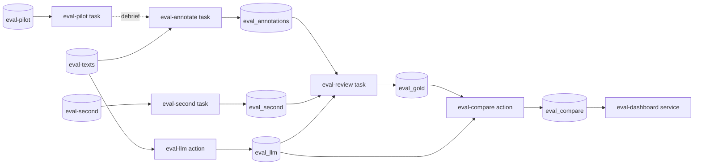

# Ellf Template: Evaluating an LLM Classifier

Measures a classifier that's built on an LLM prompt against people, for teams that run
one in production and have never checked it. The outcome is how often the classifier
agrees with people, where it goes wrong, and a set of settled labels to re-check every
prompt change against.

*Import it with the [`/ellf-template`](https://ellf.ai/docs/modules#template) skill,
or set it up by hand with the commands below.*

## How it works

You publish a random sample of the texts your classifier sees in production. An action
runs your LLM over them and saves its answers to a dataset, as if it were one more
annotator. People label the same texts blind, a review settles every text where they
and the LLM disagree, and the annotation dashboard shows how often the LLM agrees with
the settled labels and which labels it confuses. The classifier itself **isn't
changed**.

Everything except the LLM call is a built-in task, action or service. The one custom
action, `llm_to_dataset`, is where your LLM goes: its prompt, its API and how its reply
is read.

About an hour or two of annotation is usually enough: a 50-text pilot, then around
300 texts. This workflow is for classification decisions; it's **not suitable** for
evaluating generated text.

## Workflow



## Overview

| Resource | Type | Name | Provided by | Details |
|---|---|---|---|---|
| Project | project | llm-classifier-eval | user picks name | [below](#project) |
| Texts | asset (`input`) | eval-texts | user | [format](#what-you-need-to-provide) |
| Pilot texts | asset (`input`) | eval-pilot | user, 50 of the texts | [format](#what-you-need-to-provide) |
| Second-annotator texts | asset (`input`) | eval-second | user, 50 of the texts | [format](#what-you-need-to-provide) |
| Labels | asset (`labels`) | classifier-labels | user, from the prompt | [format](#what-you-need-to-provide) |
| Annotation guidelines | asset (`instructions`) | annotation-guidelines | template | [assets/annotation_guidelines.md](assets/annotation_guidelines.md) |
| LLM secret | secret | LLM_API_KEY | user | [What you need to provide](#what-you-need-to-provide) |
| The LLM's answers | dataset (`textcat`) | eval_llm | written by `eval-llm` | [eval-llm](#eval-llm) |
| Pilot labels | dataset (`textcat`) | eval_pilot | created empty | [Datasets](#datasets) |
| People's labels | dataset (`textcat`) | eval_annotations | created empty | [Datasets](#datasets) |
| Second annotator's labels | dataset (`textcat`) | eval_second | created empty | [Datasets](#datasets) |
| Settled labels | dataset (`review`) | eval_gold | created empty | [Datasets](#datasets) |
| Comparison | dataset | eval_compare | written by `eval-compare` | [eval-compare](#eval-compare) |
| Custom recipe | package | llm_recipes | template, customised by you | [`recipes/llm_recipes`](recipes/llm_recipes) |
| LLM answers | action (`llm_to_dataset`) | eval-llm | template | [Actions](#eval-llm) |
| Comparison | action (`db_actions`) | eval-compare | template | [Actions](#eval-compare) |
| Pilot | task | eval-pilot | template | [Tasks](#eval-pilot) |
| Annotation | task | eval-annotate | template | [Tasks](#eval-annotate) |
| Agreement check | task | eval-second | template, optional | [Tasks](#eval-second) |
| Review | task (`review`) | eval-review | template | [Tasks](#eval-review) |
| Dashboard | service (`annotation_dashboard`) | eval-dashboard | template | [Services](#eval-dashboard) |
| Plan | plan | project_plan | template | [`plans/project_plan.md`](plans/project_plan.md) |

## What you need to provide

- **Texts** (eval-texts): a random sample of the inputs your classifier sees in
  production, as JSONL with the text in `text`, ideally a few hundred. Take them at
  random, so the figures describe the classifier as it runs. Include the context the
  LLM sees: if its prompt includes earlier messages or other fields, put them in `text`.

  ```json
  {"text": "I was charged twice for my subscription this month.", "meta": {"id": "t-1042"}}
  ```

  A label the classifier rarely gives gets few examples in a random sample: about 9 in
  300 for a label on 3% of traffic. If a rare label matters, take a bigger sample, or
  run a second round on texts the LLM gave that label.

  **Pilot and second-annotator texts** (eval-pilot, eval-second): 50 texts each, taken
  at random from the same file, e.g. `shuf -n 50 texts.jsonl > pilot.jsonl`.

- **Labels** (`assets/labels.json`): the classifier's labels with their definitions,
  written from what each label is meant to mean to the business. The prompt's
  definitions are a starting point; leave out its examples and output-format
  instructions, which are there to steer the model.

  ```json
  {
    "BILLING": {"description": "Charges, refunds, invoices or payment methods."},
    "TECHNICAL": {"description": "The product doesn't work as expected."},
    "FRAUD": {"description": "The customer reports a payment or account they didn't make."}
  }
  ```

  With one label, the task asks yes or no for that label.

- **Your LLM**, in `recipes/llm_recipes/llm_recipes/recipes/llm_to_dataset.py`. The
  `classify` function there is called once per text and returns the labels your LLM
  gives it. The default calls an OpenAI-compatible chat endpoint with your
  instructions and the label definitions, and reads label names from the reply.
  Change it to match your production classifier: its prompt, API and parsing. If your
  LLM's decisions are already logged, put them in each text's `meta` and have
  `classify` return them instead of calling anything.

- **Secret**: `LLM_API_KEY`, your LLM provider's API key, if `classify` calls an API.
  Never included; create it yourself with `ellf secrets create LLM_API_KEY`.

## Customize

- **Exclusive labels**: the commands assume one label per text. For labels that
  aren't exclusive, drop `--labels-exclusive` from the tasks and from `eval-llm`.
- **Second annotator**: optional. Without it, there's no measure of how much of the
  LLM's apparent error is people disagreeing.
- **Guidelines**: add domain notes to `assets/annotation_guidelines.md`, e.g. jargon
  or the business rules the definitions rely on.

## Setup

Run the commands from this directory: they read `assets/` and `recipes/` by relative
path.

### Project

```bash
ellf projects create "llm-classifier-eval" "Measure an LLM classifier against people, and keep settled labels to re-check prompt changes against."
ellf config project "llm-classifier-eval"
```

### Recipes

After customising `classify`:

```bash
ellf publish code recipes/llm_recipes
```

### Assets

```bash
ellf publish data <your texts>.jsonl --kind input --name "eval-texts" --version 1.0.0
ellf publish data <your pilot texts>.jsonl --kind input --name "eval-pilot" --version 1.0.0
ellf publish data <your second-annotator texts>.jsonl --kind input --name "eval-second" --version 1.0.0
ellf publish data assets/labels.json --kind labels --name "classifier-labels" --version 1.0.0
ellf publish data assets/annotation_guidelines.md --kind instructions --name "annotation-guidelines" --version 1.0.0
```

### Datasets

```bash
ellf datasets create "eval_pilot" --kind textcat
ellf datasets create "eval_annotations" --kind textcat
ellf datasets create "eval_second" --kind textcat
ellf datasets create "eval_gold" --kind review
```

## Actions

### eval-llm

Step 1: runs your LLM over the texts and saves its answers to `eval_llm`, credited to
`LLM`. The answers are saved the way the text classification task saves a person's,
so the review and the dashboard treat the LLM as one more annotator.

```bash
ellf actions create llm_to_dataset --name "eval-llm" --input "eval-texts" --label-scheme "classifier-labels" --labels-exclusive --output "eval_llm" --api-key LLM_API_KEY --model "<your model>" --instructions "<your production prompt, without its output format>" --no-start
```

| Argument | Value | Notes |
|---|---|---|
| `--input` | eval-texts | the same texts people label |
| `--label-scheme` | classifier-labels | the same labels as the tasks |
| `--labels-exclusive` | | the same setting as the tasks |
| `--api-key`, `--model`, `--base-url` | LLM_API_KEY, your model | for the default `classify`; leave out what yours doesn't use |
| `--instructions` | your prompt | what your LLM is told about the task |
| `--session` | LLM, the default | who the answers are credited to |

Its log says how many answers were saved, and how many texts got no usable answer.
Those are left out, so the review shows the person's answer alone.

### eval-compare

Step 5: puts the settled labels and the LLM's answers in one dataset, for the
dashboard. It uses the built-in `db_actions` merge.

**Create after:** `eval-review` is done.

```bash
ellf actions create db_actions --name "eval-compare" --merge.in-sets "eval_gold" --merge.in-sets "eval_llm" --merge.out-set "eval_compare"
```

## Tasks

The first three are built-in `textcat` tasks over the labels. Annotators press the
ignore button when they could defend more than one answer, and the review settles
those texts.

| Argument | Value | Notes |
|---|---|---|
| `--label-scheme` | classifier-labels | the same labels as `eval-llm` |
| `--labels-exclusive` | | drop for labels that aren't exclusive |
| `--settings.instructions` | annotation-guidelines | shown to the annotator |

### eval-pilot

Step 2: the annotator labels 50 texts, blind, to test the definitions before the
main round.

```bash
ellf tasks create textcat --name "eval-pilot" --dataset "eval_pilot" --input "eval-pilot" --label-scheme "classifier-labels" --labels-exclusive --settings.instructions "annotation-guidelines" --no-start
```

Afterwards, debrief: go through the ignored texts and the annotator's notes, and
compare the pilot with the LLM in the dashboard (`eval-compare` on `eval_pilot` and
`eval_llm`). Settle the definitions that turned out unclear; if anything changed,
publish the labels and guidelines again with `--version 1.0.1`. The pilot texts are
part of the main sample too, so they're labelled again under the settled definitions.

### eval-annotate

Step 3: the annotator labels all of the texts, blind.

**Create after:** the pilot debrief, so the task uses the settled labels and
guidelines.

```bash
ellf tasks create textcat --name "eval-annotate" --dataset "eval_annotations" --input "eval-texts" --label-scheme "classifier-labels" --labels-exclusive --settings.instructions "annotation-guidelines" --no-start
```

### eval-second

Optional: a second annotator labels 50 texts, blind, to measure agreement between
people. Have someone other than the first annotator do it.

```bash
ellf tasks create textcat --name "eval-second" --dataset "eval_second" --input "eval-second" --label-scheme "classifier-labels" --labels-exclusive --settings.instructions "annotation-guidelines" --no-start
```

If people agree less often than the LLM agrees with them, the definitions need work
before the LLM's figures mean much.

### eval-review

Step 4: the built-in review over people's labels and the LLM's. Texts everyone agrees
on are accepted automatically. Every other text is shown with each answer as a
version: the annotators', and `LLM`. That includes texts an annotator ignored, which
show only the LLM's answer. The reviewer keeps a version or picks another label, and
that's the settled label. The reviewer judges by the label definitions, not by who
gave an answer. Ideally it's someone other than the annotator, e.g. the owner of the
classifier.

```bash
ellf tasks create review --name "eval-review" --dataset "eval_gold" --datasets "eval_annotations" --datasets "eval_second" --datasets "eval_llm" --auto-accept --no-start
```

**Start after:** `eval-annotate` and `eval-llm` are done, and `eval-second` if you use
it.

## Services

### eval-dashboard

Step 6: the built-in annotation dashboard on `eval_compare`. Its conflicts table
lists every text where the LLM's answer differs from the settled label, and the
share of texts without a conflict is the LLM's agreement with the settled labels.
With several labels, its confusion matrix shows which labels the LLM confuses. A
single label gets the conflict counts only.

**Create after:** `eval-compare` has run.

```bash
ellf services create annotation_dashboard --name "eval-dashboard" --dataset "eval_compare"
```

For the figures outside the dashboard, export the dataset with
`ellf datasets export eval_compare`.

## Re-checking a prompt change

Change the prompt in `--instructions` (or `classify`), run a new `llm_to_dataset`
action into a new dataset, compare it with the same settled labels, and point a
dashboard at the result:

```bash
ellf actions create llm_to_dataset --name "eval-llm-v2" --input "eval-texts" --label-scheme "classifier-labels" --labels-exclusive --output "eval_llm_v2" --session "LLM-v2" --api-key LLM_API_KEY --model "<your model>" --instructions "<the revised prompt>"
ellf actions create db_actions --name "eval-compare-v2" --merge.in-sets "eval_gold" --merge.in-sets "eval_llm_v2" --merge.out-set "eval_compare_v2"
ellf services create annotation_dashboard --name "eval-dashboard-v2" --dataset "eval_compare_v2"
```

A fix written from the settled labels' own disagreements looks better on them than
it will on new traffic. Confirm it on the next round's fresh sample.

## Repeating it

To track the classifier over time, run the workflow again on a newer sample of
traffic, with the resources named for the round (e.g. `eval-texts-2026-12`). The
pilot can be skipped once the definitions are settled.

If you're considering replacing the LLM with a cheaper classifier, the
[llm-to-jev](../llm-to-jev) template compares one against it.

## Plans

```bash
ellf plans write project_plan --file plans/project_plan.md
```

Plans link to resources with `@@Type/name@@` placeholders. After everything is
created, replace each with a concept link to the new resource's id (the
`/ellf-template` skill does this for you).

---

*Template format: 1 &middot; Ellf CLI: 21.0.8 &middot; Recipe packages: ellf-recipes 0.18.19, llm_recipes 0.3.0 &middot; Written with: Claude Code 2.1.312 (claude-opus-5-5)*
