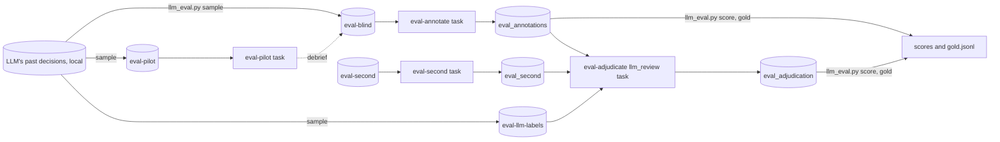

# Ellf Template: Evaluating an LLM Classifier

Measures a classifier that's built on an LLM prompt against people, for teams that run
one in production and have never checked it. The outcome is the classifier's accuracy
across all of its traffic, and a gold set to re-score every prompt change against.

*Import it with the [`/ellf-template`](https://ellf.ai/docs/modules#template) skill,
or set it up by hand with the commands below.*

## How it works

A stratified random sample of the classifier's real decisions is labelled blind,
disagreements are settled with both answers in view, and the result is its accuracy
and each label's precision, recall and true rate across all of its traffic, with
confidence intervals. You also get a list of the mistakes worth fixing. The
classifier itself **isn't changed**.

About an hour or two of annotation is usually enough: a 50-text pilot, then around
300 texts. This workflow is for classification decisions; it's **not suitable** for
evaluating generated text.

## Workflow



## Overview

| Resource | Type | Name | Provided by | Details |
|---|---|---|---|---|
| Project | project | llm-classifier-eval | user picks name | [below](#project) |
| The LLM's past decisions | local file | records.jsonl | user | [format](#what-you-need-to-provide); stays on your machine |
| Label scheme | local file | assets/labels.json | user, from the prompt | [format](#what-you-need-to-provide) |
| Annotation labels | asset (`labels`) | annotation-labels | derived from the label scheme | `assets/annotation_labels.json`, [Assets](#assets) |
| Annotation guidelines | asset (`instructions`) | annotation-guidelines | template | [assets/annotation_guidelines.md](assets/annotation_guidelines.md) |
| Adjudication guidelines | asset (`instructions`) | adjudication-guidelines | template | [assets/adjudication_guidelines.md](assets/adjudication_guidelines.md) |
| Pilot sample | asset (`input`) | eval-pilot | built by `scripts/llm_eval.py sample` | [Assets](#assets) |
| Blind sample | asset (`input`) | eval-blind | built by `scripts/llm_eval.py sample` | [Assets](#assets) |
| Second-annotator sample | asset (`input`) | eval-second | built by `scripts/llm_eval.py sample` | [Assets](#assets) |
| The LLM's labels for the sample | asset (`input`) | eval-llm-labels | built by `scripts/llm_eval.py sample` | [Assets](#assets); read only by the adjudication |
| Pilot labels | dataset (`textcat`) | eval_pilot | created empty | [Datasets](#datasets) |
| Labels | dataset (`textcat`) | eval_annotations | created empty | [Datasets](#datasets) |
| Second annotator's labels | dataset (`textcat`) | eval_second | created empty | [Datasets](#datasets) |
| Settled labels | dataset (`review`) | eval_adjudication | created empty | [Datasets](#datasets) |
| Adjudication recipe | package | llm_eval_recipes | template | [`recipes/llm_eval_recipes`](recipes/llm_eval_recipes) |
| Pilot | task | eval-pilot | template | [Tasks](#eval-pilot) |
| Annotation | task | eval-annotate | template | [Tasks](#eval-annotate) |
| Agreement check | task | eval-second | template, optional | [Tasks](#eval-second) |
| Adjudication | task (`llm_review`) | eval-adjudicate | template | [Tasks](#eval-adjudicate) |
| Sampling and scoring | local script | llm_eval.py | template | [`scripts/llm_eval.py`](scripts/llm_eval.py) |
| Plan | plan | project_plan | template | [`plans/project_plan.md`](plans/project_plan.md) |

## What you need to provide

- **The LLM's past decisions** (`records.jsonl`): JSONL, one decision per line, with
  the text the LLM saw in `text` and its label in `meta.reference_label`. Take a
  recent period of real traffic, ideally a few thousand decisions or more; only the
  sample is uploaded.

  ```json
  {"text": "I was charged twice for my subscription this month.", "meta": {"id": "t-1042", "reference_label": "BILLING"}}
  ```

  - **Use the LLM's raw output**, before any transform downstream (defaults,
    mappings, business rules), so you measure what the model actually said.
  - **Include the context the LLM saw**: if the prompt includes earlier messages or
    other fields, put them in `text`, so the annotator judges the same input.
  - **One label**: `reference_label` is the label when the LLM applied it, and
    anything else (e.g. `NOT_FRAUD`) when it didn't.
  - **Several labels that aren't exclusive**: `reference_label` is a list.

- **The label scheme** (`assets/labels.json`): the labels and their definitions,
  written from what the label is meant to mean to the business. The prompt's
  definitions are a starting point; leave out its examples and output-format
  instructions, which are there to steer the model.

  ```json
  {
    "BILLING": {"description": "Charges, refunds, invoices or payment methods."},
    "TECHNICAL": {"description": "The product doesn't work as expected."},
    "FRAUD": {"description": "The customer reports a payment or account they didn't make."}
  }
  ```

No data is included in this template, and no API keys are needed: the LLM isn't
called from Ellf.

## Customize

- **Sample size**: `sample --size 300 --min-per-label 20` by default. Each label gets
  its share of the sample, and at least the minimum, so rare labels can be measured.
  More labels, or a rare label that matters, need a larger minimum. For long texts,
  use a smaller sample.
- **Exclusive labels**: the commands assume one label per text. For labels that
  aren't exclusive, drop `--labels-exclusive` from the tasks and pass
  `--no-exclusive` to every `llm_eval.py` command.
- **Second annotator**: optional. 50 texts by default (`--second`). Without it, there's
  no measure of how much of the LLM's apparent error is people disagreeing.
- **Guidelines**: add domain notes to `assets/annotation_guidelines.md`, e.g. jargon
  or the business rules the definitions rely on.

## Setup

Run the commands from this directory: they read `assets/` and `build/` by relative
path.

### Project

```bash
ellf projects create "llm-classifier-eval" "Measure an LLM classifier against people, and keep a gold set for re-scoring prompt changes."
ellf config project "llm-classifier-eval"
```

### Recipes

The adjudication task uses the template's own `llm_review` recipe:

```bash
ellf publish code recipes/llm_eval_recipes
```

### Assets

Build the annotation labels and the samples locally. The annotation labels are the
classifier's labels plus UNCLEAR, and for a single label `X`, `X`, `NOT_X` and
UNCLEAR. `sample` writes:

- `build/blind.jsonl`: each sampled text once, with only an id;
- `build/pilot.jsonl` and `build/second.jsonl`: random subsets of it;
- `build/llm_labels.jsonl`: each sampled text with the LLM's label, for the
  adjudication;
- `build/key.jsonl`: the LLM's label and weight of each sampled record, which the
  scoring needs.

```bash
python scripts/llm_eval.py labels assets/labels.json --out assets/annotation_labels.json
python scripts/llm_eval.py sample records.jsonl --labels assets/labels.json --out-dir build --size 300 --min-per-label 20
```

```bash
ellf publish data assets/annotation_labels.json --kind labels --name "annotation-labels" --version 1.0.0
ellf publish data assets/annotation_guidelines.md --kind instructions --name "annotation-guidelines" --version 1.0.0
ellf publish data assets/adjudication_guidelines.md --kind instructions --name "adjudication-guidelines" --version 1.0.0
ellf publish data build/pilot.jsonl --kind input --name "eval-pilot" --version 1.0.0
ellf publish data build/blind.jsonl --kind input --name "eval-blind" --version 1.0.0
ellf publish data build/second.jsonl --kind input --name "eval-second" --version 1.0.0
ellf publish data build/llm_labels.jsonl --kind input --name "eval-llm-labels" --version 1.0.0
```

The annotation tasks only ever load the blind samples, so annotators don't see the
LLM's labels. Keep `build/key.jsonl`: every score is computed from it.

### Datasets

```bash
ellf datasets create "eval_pilot" --kind textcat
ellf datasets create "eval_annotations" --kind textcat
ellf datasets create "eval_second" --kind textcat
ellf datasets create "eval_adjudication" --kind review
```

## Tasks

The first three are built-in `textcat` tasks over the annotation labels; the
adjudication uses the template's `llm_review` recipe.

| Argument | Value | Notes |
|---|---|---|
| `--label-scheme` | annotation-labels | your labels plus UNCLEAR |
| `--labels-exclusive` | | drop for labels that aren't exclusive |
| `--settings.instructions` | annotation-guidelines | shown to the annotator |

### eval-pilot

Step 1: the annotator labels about 50 texts, blind, to test the definitions before
the main round.

```bash
ellf tasks create textcat --name "eval-pilot" --dataset "eval_pilot" --input "eval-pilot" --label-scheme "annotation-labels" --labels-exclusive --settings.instructions "annotation-guidelines" --no-start
```

Afterwards, debrief: go through the UNCLEAR answers and the annotator's notes, and
the pilot's disagreements with the LLM:

```bash
ellf datasets export eval_pilot -o build/eval_pilot.jsonl
python scripts/llm_eval.py score --key build/key.jsonl --labels assets/labels.json --annotations build/eval_pilot.jsonl --bootstrap 0 --show 5
```

The pilot's figures cover only 50 texts, so read them for patterns, not for
accuracy. Settle the definitions that turned out unclear in `assets/labels.json`
and the guidelines. If anything changed, rebuild `assets/annotation_labels.json`
and publish the labels and guidelines again with `--version 1.0.1`. The pilot texts
are part of the main sample too, so they're labelled again under the settled
definitions.

### eval-annotate

Step 2: the annotator labels the whole sample, blind.

**Create after:** the pilot debrief, so the task uses the settled labels and
guidelines.

```bash
ellf tasks create textcat --name "eval-annotate" --dataset "eval_annotations" --input "eval-blind" --label-scheme "annotation-labels" --labels-exclusive --settings.instructions "annotation-guidelines" --no-start
```

### eval-second

Optional: a second annotator labels a random subset, blind, to measure agreement
between people. Have someone other than the first annotator do it.

```bash
ellf tasks create textcat --name "eval-second" --dataset "eval_second" --input "eval-second" --label-scheme "annotation-labels" --labels-exclusive --settings.instructions "annotation-guidelines" --no-start
```

Once both are done:

```bash
ellf datasets export eval_annotations -o build/eval_annotations.jsonl
ellf datasets export eval_second -o build/eval_second.jsonl
python scripts/llm_eval.py agreement build/eval_annotations.jsonl build/eval_second.jsonl --labels assets/labels.json
```

If people agree less often than the LLM agrees with the annotator, the definitions
need work before the LLM's figures mean much.

### eval-adjudicate

Step 3: every text where an annotator and the LLM disagree, or an annotator chose
UNCLEAR, is settled in Prodigy's review interface. Each answer is shown as a version
credited to where it came from: `eval_annotations`, `eval_second` and `LLM`. The
reviewer keeps one or picks another label, and that's the settled label. Texts
everyone agrees on aren't shown.

```bash
ellf tasks create llm_review --name "eval-adjudicate" --dataset "eval_adjudication" --annotations "eval_annotations" --annotations "eval_second" --llm-labels "eval-llm-labels" --settings.instructions "adjudication-guidelines" --no-start
```

| Argument | Value | Notes |
|---|---|---|
| `--annotations` | eval_annotations, eval_second | the blind labels; `eval_second` adds nothing if it's empty |
| `--llm-labels` | eval-llm-labels | the LLM's label for each sampled text |
| `--unclear` | UNCLEAR, the default | the annotation labels' "more than one answer" option |
| `--settings.instructions` | adjudication-guidelines | how to settle a disagreement |

**Start after:** `eval-annotate` is done, and `eval-second` if you use it. The task
picks the texts to review when it starts. Ideally someone other than the annotator
adjudicates, e.g. the owner of the classifier.

## Scoring and the gold set

Step 4: score the LLM against the settled labels.

```bash
ellf datasets export eval_adjudication -o build/eval_adjudication.jsonl
python scripts/llm_eval.py score --key build/key.jsonl --labels assets/labels.json --annotations build/eval_annotations.jsonl --adjudication build/eval_adjudication.jsonl --show 5
```

It reports accuracy, each label's precision, recall and F1, and each label's rate as
the LLM assigns it against its estimated true rate. Every figure is weighted back to
the whole of the traffic sampled, with approximate 95% intervals from a stratified
bootstrap. The most common mistakes, with example texts, say what to fix in the
prompt. Recall of a rare label has a wide interval: its misses hide among the much
larger set of texts given other labels.

Then write the gold set, the sample with its settled labels:

```bash
python scripts/llm_eval.py gold --key build/key.jsonl --labels assets/labels.json --annotations build/eval_annotations.jsonl --adjudication build/eval_adjudication.jsonl --out build/gold.jsonl
```

### Re-scoring a prompt change

Step 5: run your classifier with the revised prompt on the texts in
`build/gold.jsonl`, outside Ellf, and save its answers as JSONL with `text` and
`label`. Score them against the same gold labels:

```bash
python scripts/llm_eval.py score --key build/key.jsonl --labels assets/labels.json --annotations build/eval_annotations.jsonl --adjudication build/eval_adjudication.jsonl --predictions build/predictions_v2.jsonl --show 5
```

A fix written from the gold set's own mistakes scores optimistically on it. Confirm
it on the next round's fresh sample.

### Repeating it

To track the classifier over time, run the workflow again on a newer period of
traffic, with the resources named for the round (e.g. `eval-blind-2026-12`). The pilot
can be skipped once the definitions are settled.

If you're considering replacing the LLM with a cheaper classifier, the
[llm-to-jev](../llm-to-jev) template compares one against it, using the same
`records.jsonl` format.

## Scripts

[`scripts/llm_eval.py`](scripts/llm_eval.py) runs locally and needs only the Python
standard library:

| Command | When |
|---|---|
| `labels` | at setup: the annotation labels |
| `sample` | at setup: the stratified blind sample, its subsets, and the key |
| `score` | after the pilot, after adjudication, and for each prompt change |
| `agreement` | after the second annotator |
| `gold` | after adjudication: the gold set |

## Plans

```bash
ellf plans write project_plan --file plans/project_plan.md
```

Plans link to resources with `@@Type/name@@` placeholders. After everything is
created, replace each with a concept link to the new resource's id (the
`/ellf-template` skill does this for you).

---

*Template format: 1 &middot; Ellf CLI: 21.0.8 &middot; Recipe packages: ellf-recipes 0.18.19, llm_eval_recipes 0.1.0 &middot; Written with: Claude Code 2.1.312 (claude-opus-5-5)*
