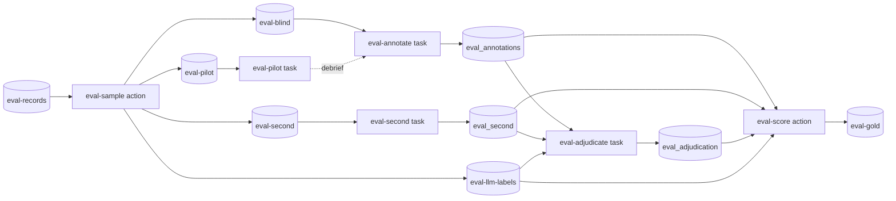

# Ellf Template: Evaluating an LLM Classifier

Measures a classifier that's built on an LLM prompt against people, for teams that run
one in production and have never checked it. The outcome is the classifier's accuracy
across all of its traffic, and a gold set to re-score every prompt change against.

*Import it with the [`/ellf-template`](https://ellf.ai/docs/modules#template) skill,
or set it up by hand with the commands below.*

## How it works

You publish the classifier's past decisions, and an action draws a sample of them,
separately within each label the classifier gave, so rare labels can be measured.
People label the sample blind, any disagreement with the classifier is settled with
every answer in view, and a second action scores the classifier: its accuracy and
each label's precision, recall and true rate across all of its traffic, with
confidence intervals, plus the mistakes worth fixing. The classifier itself **isn't
changed**.

About an hour or two of annotation is usually enough: a 50-text pilot, then around
300 texts. This workflow is for classification decisions; it's **not suitable** for
evaluating generated text.

## Workflow



## Overview

| Resource | Type | Name | Provided by | Details |
|---|---|---|---|---|
| Project | project | llm-classifier-eval | user picks name | [below](#project) |
| The LLM's past decisions | asset (`input`) | eval-records | user | [format](#what-you-need-to-provide) |
| Annotation labels | asset (`labels`) | annotation-labels | user, from the prompt | [format](#what-you-need-to-provide) |
| Annotation guidelines | asset (`instructions`) | annotation-guidelines | template | [assets/annotation_guidelines.md](assets/annotation_guidelines.md) |
| Adjudication guidelines | asset (`instructions`) | adjudication-guidelines | template | [assets/adjudication_guidelines.md](assets/adjudication_guidelines.md) |
| Pilot sample | asset (`input`) | eval-pilot | written by `eval-sample` | [eval-sample](#eval-sample) |
| Blind sample | asset (`input`) | eval-blind | written by `eval-sample` | [eval-sample](#eval-sample) |
| Second-annotator sample | asset (`input`) | eval-second | written by `eval-sample` | [eval-sample](#eval-sample) |
| Sample with the LLM's labels | asset (`input`) | eval-llm-labels | written by `eval-sample` | [eval-sample](#eval-sample); never loaded by the annotation tasks |
| Gold set | asset (`input`) | eval-gold | written by `eval-score` | [eval-score](#eval-score) |
| Pilot labels | dataset (`textcat`) | eval_pilot | created empty | [Datasets](#datasets) |
| Labels | dataset (`textcat`) | eval_annotations | created empty | [Datasets](#datasets) |
| Second annotator's labels | dataset (`textcat`) | eval_second | created empty | [Datasets](#datasets) |
| Settled labels | dataset (`review`) | eval_adjudication | created empty | [Datasets](#datasets) |
| Custom recipes | package | llm_eval_recipes | template | [`recipes/llm_eval_recipes`](recipes/llm_eval_recipes) |
| Sampling | action (`llm_eval_sample`) | eval-sample | template | [Actions](#eval-sample) |
| Scoring | action (`llm_eval_score`) | eval-score | template | [Actions](#eval-score) |
| Pilot | task | eval-pilot | template | [Tasks](#eval-pilot) |
| Annotation | task | eval-annotate | template | [Tasks](#eval-annotate) |
| Agreement check | task | eval-second | template, optional | [Tasks](#eval-second) |
| Adjudication | task (`llm_review`) | eval-adjudicate | template | [Tasks](#eval-adjudicate) |
| Plan | plan | project_plan | template | [`plans/project_plan.md`](plans/project_plan.md) |

## What you need to provide

- **The LLM's past decisions** (eval-records): JSONL, one decision per line, with the
  text the LLM saw in `text` and its label in `meta.reference_label`. Take a recent
  period of real traffic, ideally a few thousand decisions or more.

  ```json
  {"text": "I was charged twice for my subscription this month.", "meta": {"id": "t-1042", "reference_label": "BILLING"}}
  ```

  - **Use the LLM's raw output**, before any transform downstream (defaults,
    mappings, business rules), so you measure what the model actually said.
  - **Include the context the LLM saw**: if the prompt includes earlier messages or
    other fields, put them in `text`, so the annotator judges the same input.
  - **Keep every decision**, duplicates included: two identical texts are two
    decisions, and both count towards the classifier's traffic.
  - **One label**: `reference_label` is the label when the LLM applied it, and
    anything else (e.g. `OK`) when it didn't.
  - **Several labels that aren't exclusive**: `reference_label` is a list.

- **The annotation labels** (`assets/annotation_labels.json`): the classifier's
  labels with their definitions, plus UNCLEAR. Write the definitions from what each
  label is meant to mean to the business: the prompt's definitions are a starting
  point, but leave out its examples and output-format instructions, which are there
  to steer the model.

  ```json
  {
    "BILLING": {"description": "Charges, refunds, invoices or payment methods."},
    "TECHNICAL": {"description": "The product doesn't work as expected."},
    "FRAUD": {"description": "The customer reports a payment or account they didn't make."},
    "UNCLEAR": {"description": "You could defend more than one answer."}
  }
  ```

  For one label `X`, the labels are `X`, `NOT_X` (with a definition of when it
  doesn't apply) and UNCLEAR.

No data is included in this template, and no API keys are needed: the LLM isn't
called from Ellf.

## Customize

- **Sample size**: `eval-sample` draws 300 records by default, with at least 20 for
  each label the LLM gives. More labels, or a rare label that matters, need a larger
  minimum; for long texts, use a smaller sample.
- **Exclusive labels**: the commands assume one label per text. For labels that
  aren't exclusive, drop `--labels-exclusive` from the tasks and pass
  `--no-labels-exclusive` to both actions.
- **Second annotator**: optional. Without it, there's no measure of how much of the
  LLM's apparent error is people disagreeing.
- **Guidelines**: add domain notes to `assets/annotation_guidelines.md`, e.g. jargon
  or the business rules the definitions rely on.

## Setup

Run the commands from this directory: they read `assets/` and `recipes/` by relative
path.

### Project

```bash
ellf projects create "llm-classifier-eval" "Measure an LLM classifier against people, and keep a gold set for re-scoring prompt changes."
ellf config project "llm-classifier-eval"
```

### Recipes

The sampling and scoring actions and the adjudication task use the template's own
recipes:

```bash
ellf publish code recipes/llm_eval_recipes
```

### Assets

```bash
ellf publish data <your records>.jsonl --kind input --name "eval-records" --version 1.0.0
ellf publish data assets/annotation_labels.json --kind labels --name "annotation-labels" --version 1.0.0
ellf publish data assets/annotation_guidelines.md --kind instructions --name "annotation-guidelines" --version 1.0.0
ellf publish data assets/adjudication_guidelines.md --kind instructions --name "adjudication-guidelines" --version 1.0.0
```

The samples and the gold set are written by the actions.

### Datasets

```bash
ellf datasets create "eval_pilot" --kind textcat
ellf datasets create "eval_annotations" --kind textcat
ellf datasets create "eval_second" --kind textcat
ellf datasets create "eval_adjudication" --kind review
```

## Actions

### eval-sample

Step 1: draws the sample from the LLM's decisions. Each label the LLM gave gets its
share of the sample, and at least the minimum, and each sampled record carries the
weight that brings it back to its share of all the decisions. It writes four assets:

- **eval-blind**: each sampled text once, with no labels, for the annotation task;
- **eval-pilot** and **eval-second**: random subsets of it, for the pilot and a
  second annotator;
- **eval-llm-labels**: every sampled record with the LLM's label and its weight, which
  only the adjudication and the scoring read.

```bash
ellf actions create llm_eval_sample --name "eval-sample" --records "eval-records" --label-scheme "annotation-labels" --blind.name "eval-blind" --pilot.name "eval-pilot" --second.name "eval-second" --sample.name "eval-llm-labels" --size 300 --min-per-label 20 --no-start
```

| Argument | Value | Notes |
|---|---|---|
| `--records` | eval-records | your published decisions |
| `--label-scheme` | annotation-labels | tells the LLM's labels apart from UNCLEAR, and maps one label's other answers to `NOT_X` |
| `--size`, `--min-per-label` | 300, 20 | the sample size and the minimum per LLM label |
| `--pilot-size`, `--second-size` | 50, 50 | the defaults |

It's the first job to run. Its log shows, for each label the LLM gave, the number of
decisions, the number sampled and the weight.

### eval-score

Step 4: scores the LLM against the settled labels, straight from the datasets, and
saves the gold set: each settled text with its label, the LLM's label and its
weight.

```bash
ellf actions create llm_eval_score --name "eval-score" --annotations "eval_annotations" --sample "eval-llm-labels" --adjudication "eval_adjudication" --second "eval_second" --gold --gold.name "eval-gold" --no-start
```

| Argument | Value | Notes |
|---|---|---|
| `--annotations` | eval_annotations | the blind labels |
| `--sample` | eval-llm-labels | the LLM's labels and the weights |
| `--adjudication` | eval_adjudication | the settled labels overrule the annotations |
| `--second` | eval_second | optional: adds agreement between the two annotators (Cohen's kappa) |
| `--gold`, `--gold.name` | eval-gold | optional: saves the gold set as an asset |
| `--show` | 5, the default | example texts per mistake |

**Start after:** `eval-adjudicate` is done. Its log reports accuracy, each label's
precision, recall and F1, and each label's rate as the LLM assigns it against its
estimated true rate. Every figure is weighted back to all of the LLM's decisions,
with approximate 95% intervals from a stratified bootstrap. The most common
mistakes, with example texts, say what to fix in the prompt. Recall of a rare label
has a wide interval: its misses hide among the much larger set of texts given other
labels.

The same recipe scores the pilot: create an action with `--annotations "eval_pilot"`
and `--bootstrap 0`, and read it for patterns, not for accuracy.

#### Re-scoring a prompt change

Rerun your classifier with the revised prompt on the texts in eval-gold, outside
Ellf, and publish its answers in the records format, then score them against the
same settled labels:

```bash
ellf files cp "{__data__}/outputs/eval-gold.jsonl" ./gold.jsonl
# run your classifier on the texts in gold.jsonl, writing records.jsonl-style answers
ellf publish data predictions_v2.jsonl --kind input --name "eval-predictions-v2" --version 1.0.0
ellf actions create llm_eval_score --name "eval-score-v2" --annotations "eval_annotations" --sample "eval-llm-labels" --adjudication "eval_adjudication" --predictions "eval-predictions-v2" --no-start
```

A fix written from the gold set's own mistakes scores optimistically on it. Confirm
it on the next round's fresh sample.

## Tasks

The first three are built-in `textcat` tasks over the annotation labels; the
adjudication uses the template's `llm_review` recipe.

| Argument | Value | Notes |
|---|---|---|
| `--label-scheme` | annotation-labels | your labels plus UNCLEAR |
| `--labels-exclusive` | | drop for labels that aren't exclusive |
| `--settings.instructions` | annotation-guidelines | shown to the annotator |

### eval-pilot

Step 2: the annotator labels about 50 texts, blind, to test the definitions before
the main round.

**Create after:** `eval-sample` has run.

```bash
ellf tasks create textcat --name "eval-pilot" --dataset "eval_pilot" --input "eval-pilot" --label-scheme "annotation-labels" --labels-exclusive --settings.instructions "annotation-guidelines" --no-start
```

Afterwards, debrief: go through the UNCLEAR answers, the annotator's notes and the
pilot's disagreements with the LLM (score the pilot, see [eval-score](#eval-score)).
Settle the definitions that turned out unclear; if anything changed, publish the
labels and guidelines again with `--version 1.0.1`. The pilot texts are part of the
main sample too, so they're labelled again under the settled definitions.

### eval-annotate

Step 3: the annotator labels the whole sample, blind.

**Create after:** the pilot debrief, so the task uses the settled labels and
guidelines.

```bash
ellf tasks create textcat --name "eval-annotate" --dataset "eval_annotations" --input "eval-blind" --label-scheme "annotation-labels" --labels-exclusive --settings.instructions "annotation-guidelines" --no-start
```

### eval-second

Optional: a second annotator labels a random subset, blind, to measure agreement
between people. Have someone other than the first annotator do it.

**Create after:** `eval-sample` has run.

```bash
ellf tasks create textcat --name "eval-second" --dataset "eval_second" --input "eval-second" --label-scheme "annotation-labels" --labels-exclusive --settings.instructions "annotation-guidelines" --no-start
```

If people agree less often than the LLM agrees with the annotator, the definitions
need work before the LLM's figures mean much.

### eval-adjudicate

Step 3, continued: every text where an annotator and the LLM disagree, or an
annotator chose UNCLEAR, is settled in Prodigy's review interface. Each answer is
shown as a version credited to where it came from: `eval_annotations`, `eval_second`
and `LLM`. The reviewer keeps one or picks another label, and that's the settled
label. Texts everyone agrees on aren't shown.

**Create after:** `eval-sample` has run.

```bash
ellf tasks create llm_review --name "eval-adjudicate" --dataset "eval_adjudication" --annotations "eval_annotations" --annotations "eval_second" --sample "eval-llm-labels" --settings.instructions "adjudication-guidelines" --no-start
```

| Argument | Value | Notes |
|---|---|---|
| `--annotations` | eval_annotations, eval_second | the blind labels; `eval_second` adds nothing if it's empty |
| `--sample` | eval-llm-labels | the LLM's label for each sampled text |
| `--settings.instructions` | adjudication-guidelines | how to settle a disagreement |

**Start after:** `eval-annotate` is done, and `eval-second` if you use it. The task
picks the texts to review when it starts. Ideally someone other than the annotator
adjudicates, e.g. the owner of the classifier.

## Repeating it

To track the classifier over time, run the workflow again on a newer period of
traffic, with the resources named for the round (e.g. `eval-records-2026-12`). The
pilot can be skipped once the definitions are settled.

If you're considering replacing the LLM with a cheaper classifier, the
[llm-to-jev](../llm-to-jev) template compares one against it, using the same records
format.

## Plans

```bash
ellf plans write project_plan --file plans/project_plan.md
```

Plans link to resources with `@@Type/name@@` placeholders. After everything is
created, replace each with a concept link to the new resource's id (the
`/ellf-template` skill does this for you).

---

*Template format: 1 &middot; Ellf CLI: 21.0.8 &middot; Recipe packages: ellf-recipes 0.18.19, llm_eval_recipes 0.2.0 &middot; Written with: Claude Code 2.1.312 (claude-opus-5-5)*
