# Ellf Template: Replacing an LLM Classifier with Jev

Moves a classification decision that's currently made by prompting an LLM over to
TypeSafe's Jev, which answers with calibrated probabilities instead of text. Jev is
compared with the LLM on a sample of past records. A person then judges a blind
sample of the disagreements, and what they show is written into Jev's instructions
as rules. You end up with a Jev configuration and a confidence cut-off, plus an
annotation task where people label only the records Jev isn't confident about. No
annotated training data is needed.

*Exported from [Ellf](https://ellf.ai) on 2026-10-28. Import it with the
[`/ellf-template`](https://ellf.ai/docs/modules#template) skill, or set it up by hand
with the commands below.*

## Workflow

```mermaid
flowchart LR
    accTitle: Replacing an LLM classifier with Jev
    accDescr: Past records with the LLM's labels are classified by a Jev baseline action. A script samples the disagreements into a blind input that a person judges. Rules from the judging go into a second Jev action. Once a cut-off is chosen, a Jev action saves its confident answers and a review task shows people the rest.
    input[(llm-labelled-sample)] --> base[jev-baseline action]
    base --> baseds[(jev_baseline)]
    baseds -- jev_eval.py sample --> blind[(adjudication-blind)]
    blind --> adj[adjudicate task]
    adj --> adjds[(adjudication)]
    adjds -. rules .-> rules[jev-rules action]
    input --> rules
    rules --> rulesds[(jev_rules)]
    rulesds -. cut-off .-> conf[jev-confident action]
    input --> conf
    conf --> confds[(jev_confident)]
    input --> review[review task]
    confds -. excluded .-> review
    review --> reviewds[(review)]
```



## Overview

| Resource | Type | Name | Provided by | Details |
|---|---|---|---|---|
| Project | project | llm-to-jev | user picks name | [below](#project) |
| TypeSafe key | secret | TYPESAFE_API_KEY | user | [What you need to provide](#what-you-need-to-provide) |
| Past records with LLM labels | asset (`input`) | llm-labelled-sample | user | [format](#what-you-need-to-provide) |
| Label scheme | asset (`labels`) | classifier-labels | user, from the current prompt | `assets/labels.json`, [format](#what-you-need-to-provide) |
| Adjudication labels | asset (`labels`) | adjudication-labels | derived from the label scheme | `assets/adjudication_labels.json`, [Assets](#assets) |
| Adjudication guidelines | asset (`instructions`) | adjudication-guidelines | template | [assets/adjudication_guidelines.md](assets/adjudication_guidelines.md) |
| Review guidelines | asset (`instructions`) | review-guidelines | template, rules added later | [assets/review_guidelines.md](assets/review_guidelines.md) |
| Blind adjudication sample | asset (`input`) | adjudication-blind | built by `scripts/jev_eval.py sample` | [adjudicate](#adjudicate) |
| Jev's baseline answers | dataset (`textcat`) | jev_baseline | created empty | [Datasets](#datasets) |
| Jev's answers with rules | dataset (`textcat`) | jev_rules | created empty | [Datasets](#datasets) |
| Adjudications | dataset (`textcat`) | adjudication | created empty | [Datasets](#datasets) |
| Jev's confident answers | dataset (`textcat`) | jev_confident | created empty | [Datasets](#datasets) |
| Reviewed records | dataset (`textcat`) | review | created empty | [Datasets](#datasets) |
| Baseline run | action | jev-baseline | template | [Actions](#jev-baseline) |
| Run with rules | action | jev-rules | template | [Actions](#jev-rules) |
| Confident answers | action | jev-confident | template | [Actions](#jev-confident) |
| Adjudication | task | adjudicate | template | [Tasks](#adjudicate) |
| Review below the cut-off | task | review | template | [Tasks](#review) |
| Jev instructions | config | instructions_baseline.txt, later instructions_rules.txt | user, from the current prompt | [`config/`](config) |
| Scoring and sampling | local script | jev_eval.py | template | [`scripts/jev_eval.py`](scripts/jev_eval.py) |
| Worked example | docs | worked_example.md | template | [`docs/worked_example.md`](docs/worked_example.md) |
| Plan | plan | project_plan | template | [`plans/project_plan.md`](plans/project_plan.md) |

## What you need to provide

- **The current prompt.** The label scheme and Jev's instructions are written from
  it, so Jev is judged on the same definitions as the LLM:

  - **Label scheme** (`assets/labels.json`): the labels and the definition of each,
    as in the prompt.

    ```json
    {
      "BILLING": {"description": "Charges, refunds, invoices or payment methods."},
      "TECHNICAL": {"description": "The product doesn't work as expected."},
      "ACCOUNT": {"description": "Signing in, access, or changes to the account."}
    }
    ```

    One label (e.g. `{"URGENT": {...}}`) makes it a yes/no question. Several labels
    are a choice between them when they're exclusive (the default, `--labels-exclusive`),
    or a yes/no question each when a text can have several.
  - **Instructions** (`config/instructions_baseline.txt`): one or two sentences
    describing the setting, plus the definition for a single label. Replace the
    placeholder text. Leave out output-format instructions and examples meant to
    make the LLM parseable; Jev doesn't need them.

- **Past records with the LLM's labels** (llm-labelled-sample): JSONL, one record
  per line, with the text in `text` and the LLM's label in `meta.reference_label`. A
  few hundred to two thousand records is enough. Give Jev the same input the LLM
  sees: if the prompt includes context such as earlier messages, put it in `text`.
  Other `meta` fields are kept and come back in the exported datasets.

  ```json
  {"text": "I was charged twice for my subscription this month.", "meta": {"id": "t-1042", "reference_label": "BILLING"}}
  ```

  - **One label**: `reference_label` is the label when the LLM applied it, and
    anything else (e.g. `NOT_URGENT`) when it didn't.
  - **Several non-exclusive labels**: `reference_label` is a list.
  - **A rare label**: include more of it than real traffic has, and give every
    record a `meta.weight` (its share of real traffic over its share of the sample),
    so agreement figures are weighted back to the real rate.

  No data is included in this template. [docs/worked_example.md](docs/worked_example.md)
  describes a project that used it.

- **Secret**: `TYPESAFE_API_KEY`, your TypeSafe API key, used by every Jev action.
  Never included; create it yourself with `ellf secrets create TYPESAFE_API_KEY`.
  The actions send the texts to TypeSafe's API, so check that you may send this data
  there.

## Customize

- **Labels and exclusivity**: commands use `--labels-exclusive`, for a choice between
  several labels. Drop it from every action and the review task when a text can have
  several labels. For one label it makes no difference.
- **Jev model**: the actions use `jev-latest`. Pin a version with `--model` to keep
  the baseline and rules runs comparable.
- **Adjudication sample size**: `jev_eval.py sample` takes 6 records per kind of
  disagreement and 10 low-confidence agreements by default (`--per-pair`,
  `--low-confidence`, `--low-below`). A one-label classifier has only two kinds of
  disagreement, so take 20 or more of each.
- **Cut-off**: 0.7 in `jev-confident` is a starting point; choose yours from the
  rules run (see [jev-confident](#jev-confident)).
- **Review input**: `jev-confident` and `review` read llm-labelled-sample, which
  shows the workflow end to end. For real use, publish new records as another input
  asset and point both at it.
- **Annotation guidelines**: `assets/adjudication_guidelines.md` is general and works
  as is. Add domain notes if annotators need them, e.g. jargon.

## Setup

Run the commands from this directory: they read `assets/` and `config/` by relative
path.

### Project

```bash
ellf projects create "llm-to-jev" "Evaluate Jev as a calibrated replacement for an LLM classifier, and hand uncertain records to people."
ellf config project "llm-to-jev"
```

### Assets

The adjudication label scheme is the classifier's labels plus UNCLEAR, and for a
single label `X`, `X`, `NOT_X` and UNCLEAR. Write it by hand, or with the script:

```bash
python scripts/jev_eval.py labels assets/labels.json --out assets/adjudication_labels.json
```

```bash
ellf publish data <your records>.jsonl --kind input --name "llm-labelled-sample" --version 1.0.0
ellf publish data assets/labels.json --kind labels --name "classifier-labels" --version 1.0.0
ellf publish data assets/adjudication_labels.json --kind labels --name "adjudication-labels" --version 1.0.0
ellf publish data assets/adjudication_guidelines.md --kind instructions --name "adjudication-guidelines" --version 1.0.0
```

The blind sample and the review guidelines depend on results, so they're published
later, in the [adjudicate](#adjudicate) and [review](#review) sections.

### Datasets

Each Jev action writes its answers to its own dataset, and each task writes its
annotations to its own. `scripts/jev_eval.py` reads the exports.

```bash
ellf datasets create "jev_baseline" --kind textcat
ellf datasets create "jev_rules" --kind textcat
ellf datasets create "adjudication" --kind textcat
ellf datasets create "jev_confident" --kind textcat
ellf datasets create "review" --kind textcat
```

## Actions

All three use the built-in `textcat_jev` recipe and the `TYPESAFE_API_KEY` secret.

| Argument | Value | Notes |
|---|---|---|
| `--input` | llm-labelled-sample | your records |
| `--api-key` | TYPESAFE_API_KEY | secret name |
| `--label-scheme` | classifier-labels | from your prompt |
| `--labels-exclusive` | | drop for non-exclusive labels |
| `--instructions` | `config/instructions_*.txt` | the setting, definitions and rules |
| `--min-confidence` | 0.0, or the cut-off | which answers are saved |

### jev-baseline

Step 1: Jev answers every record with the same definitions as the LLM, and every
answer is saved so it can be compared.

```bash
ellf actions create textcat_jev --name "jev-baseline" --api-key TYPESAFE_API_KEY --input "llm-labelled-sample" --instructions "$(cat config/instructions_baseline.txt)" --label-scheme "classifier-labels" --labels-exclusive --min-confidence 0.0 --output "jev_baseline" --no-start
```

Once it has run, score it:

```bash
ellf datasets export jev_baseline -o jev_baseline.jsonl
python scripts/jev_eval.py agreement jev_baseline.jsonl
```

### jev-rules

Step 3: the same run, with rules from the adjudication added to the instructions.

**Create after:** `adjudicate` has been annotated and scored, and the rules are
written. Instructions are fixed when an action is created, so write them first:

```bash
cp config/instructions_baseline.txt config/instructions_rules.txt
# add one sentence per rule to config/instructions_rules.txt
ellf actions create textcat_jev --name "jev-rules" --api-key TYPESAFE_API_KEY --input "llm-labelled-sample" --instructions "$(cat config/instructions_rules.txt)" --label-scheme "classifier-labels" --labels-exclusive --min-confidence 0.0 --output "jev_rules" --no-start
```

For another round of rules, create a new action (e.g. `jev-rules-2`) with its own
output dataset, so each round can be compared.

### jev-confident

Step 5: saves only the answers at or above the cut-off. The [review](#review) task
excludes them, so people see only the rest.

**Create after:** the cut-off is chosen. Pick it from the rules run's `agreement`
output, by reading the disagreements just above each candidate value:

```bash
ellf datasets export jev_rules -o jev_rules.jsonl
python scripts/jev_eval.py agreement jev_rules.jsonl --cutoffs 0.6,0.7,0.8,0.9
```

```bash
ellf actions create textcat_jev --name "jev-confident" --api-key TYPESAFE_API_KEY --input "llm-labelled-sample" --instructions "$(cat config/instructions_rules.txt)" --label-scheme "classifier-labels" --labels-exclusive --min-confidence 0.7 --output "jev_confident" --no-start
```

| Argument | Value | Notes |
|---|---|---|
| `--min-confidence` | 0.7 | your cut-off |
| `--input` | llm-labelled-sample | swap in new records for real use; use the same input in `review` |

## Tasks

### adjudicate

Step 2: one annotator judges a blind sample of the baseline's disagreements, plus
some agreements where Jev was unsure, without seeing either system's answer.

**Create after:** `jev-baseline` has run. The blind sample is built from its output:

```bash
ellf datasets export jev_baseline -o jev_baseline.jsonl
python scripts/jev_eval.py sample jev_baseline.jsonl --out adjudication-blind.jsonl
ellf publish data adjudication-blind.jsonl --kind input --name "adjudication-blind" --version 1.0.0
ellf tasks create textcat --name "adjudicate" --dataset "adjudication" --input "adjudication-blind" --label-scheme "adjudication-labels" --labels-exclusive --settings.instructions "adjudication-guidelines" --no-start
```

| Argument | Value | Notes |
|---|---|---|
| `--input` | adjudication-blind | text and id only |
| `--label-scheme` | adjudication-labels | your labels plus UNCLEAR |
| `--settings.instructions` | adjudication-guidelines | how to judge and when to use UNCLEAR |

Once it's annotated, score the runs against it. Add `rules=jev_rules.jsonl` after
the rules run:

```bash
ellf datasets export adjudication -o adjudication.jsonl
python scripts/jev_eval.py adjudicated adjudication.jsonl baseline=jev_baseline.jsonl
```

The UNCLEAR answers and the patterns the annotator noted are where the rules come
from. [docs/worked_example.md](docs/worked_example.md) shows what such rules look
like.

### review

Step 5: people label the records Jev wasn't confident about, following the label
definitions and the rules.

**Create after:** `jev-confident` has run. Copy the rules into the guidelines first:

```bash
# copy the rules from config/instructions_rules.txt into assets/review_guidelines.md
ellf publish data assets/review_guidelines.md --kind instructions --name "review-guidelines" --version 1.0.0
ellf tasks create textcat --name "review" --dataset "review" --input "llm-labelled-sample" --label-scheme "classifier-labels" --labels-exclusive --settings.exclude jev_confident --settings.instructions "review-guidelines" --no-start
```

| Argument | Value | Notes |
|---|---|---|
| `--input` | llm-labelled-sample | the same input as `jev-confident` |
| `--settings.exclude` | jev_confident | leaves only the records below the cut-off |
| `--settings.instructions` | review-guidelines | definitions and rules for annotators |

## Scripts

[`scripts/jev_eval.py`](scripts/jev_eval.py) runs locally on exported datasets and
needs only the Python standard library:

- `labels <labels.json> --out <file>`: the adjudication label scheme, at setup.
- `agreement <run>`: agreement and Cohen's κ with the LLM, the most common
  disagreements, agreement by Jev's confidence, and how many records each cut-off
  sends to a person. After every Jev run.
- `sample <run> --out <file>`: the blind adjudication input, before `adjudicate`.
- `adjudicated <adjudication> <name>=<run> ...`: how many judged records the LLM and
  each Jev run match, and whose answer the annotator chose on the disagreements.
  After `adjudicate`, and again after each rules run.

## Plans

```bash
ellf plans write project_plan --file plans/project_plan.md
```

Plans link to resources with `@@Type/name@@` placeholders. After everything is
created, replace each with a concept link to the new resource's id (the
`/ellf-template` skill does this for you).

---

*Exported: 2026-10-28T10:55:11Z &middot; Template format: 1 &middot; Ellf CLI: 21.0.8 &middot; Recipe packages: ellf-recipes 0.18.19 &middot; Exported with: Claude Code 2.1.312 (claude-opus-5-5)*
