# Ellf Template: Replacing an LLM Classifier with Jev

Evaluates and executes moving a classification decision from a generative LLM system
to TypeSafe's Jev, which answers with calibrated probabilities instead of text.
The outcome of this workflow is an optimised Jev configuration for your LLM-based classification system.
Jev is generally 20 times cheaper to run than a generative system, and the confidence scores are
helpful for many tasks. However, Jev is not always a drop-in replacement. It works differently
so your prompt may need adjusting, or accuracy may be higher or lower.

One hour of manual annotation is usually sufficient, but your task may benefit from more if you
have a lot of categories, or if Jev and the LLM do not have high initial agreement. This workflow
is not suitable for truly generative tasks, where the output needs to be text or images rather
than classification decisions.

The workflow consists of a few simple steps. First Jev is compared with the LLM on a sample of past records.
If the systems agree close to 100% of the time, you can export the configuration straight away, or first
annotate a random sample of texts. Agreement isn't accuracy: both systems can make the same mistake, and
the random sample tells you how accurate Jev actually is, and can still show where its prompt can be
improved. Otherwise, a sample of the texts where the systems disagree is queued up for manual annotation,
optionally together with a random sample.

The agent can improve Jev's performance on your data based on the annotations. For instance,
if Jev often makes the same sort of mistake and the LLM doesn't, the agent can see this from
the annotations and add a rule that fixes the problem. The agent can also use the annotations
to choose a confidence threshold that performs well on your problem. For instance, if you have
two categories, you might find that accuracy is best if you set a confidence cutoff of 0.8
for the rarer category.

Once complete the configurations can be exported from Ellf so your system can run independently in
production. Ongoing evaluation can be conducted to detect and correct data drift.

*Exported from [Ellf](https://ellf.ai) on 2026-10-28. Import it with the
[`/ellf-template`](https://ellf.ai/docs/modules#template) skill, or set it up by hand
with the commands below.*

## Workflow

```mermaid
flowchart LR
    accTitle: Replacing an LLM classifier with Jev
    accDescr: Past records with the LLM's labels are classified by a Jev baseline action. If Jev and the LLM nearly always agree, the configuration can be exported straight away, or a random sample annotated first to measure accuracy. Otherwise a script samples disagreements and random records into a blind input that a person annotates, the agent adds rules and picks thresholds from the annotations, a rules action reruns Jev, and the configuration is exported. Later, Jev is run on new records and a random sample is annotated to check for drift.
    input[(llm-labelled-sample)] --> base[jev-baseline action]
    base --> baseds[(jev_baseline)]
    baseds -. near 100% agreement .-> config[config/jev_config.json]
    baseds -- "jev_eval.py sample (random only if near 100%)" --> blind[(adjudication-blind)]
    blind --> adj[adjudicate task]
    adj --> adjds[(adjudication)]
    adjds -. rules .-> rules[jev-rules action]
    input --> rules
    rules --> rulesds[(jev_rules)]
    adjds -. thresholds .-> config
    rulesds --> config
    config -. later .-> check[jev-check action]
    new[(new-records)] --> check
    check --> checkds[(jev_check)]
    checkds -- jev_eval.py sample --> cblind[(check-blind)]
    cblind --> cann[check-annotate task]
    cann --> cannds[(check_annotations)]
```



## Overview

| Resource | Type | Name | Provided by | Details |
|---|---|---|---|---|
| Project | project | llm-to-jev | user picks name | [below](#project) |
| TypeSafe key | secret | TYPESAFE_API_KEY | user | [What you need to provide](#what-you-need-to-provide) |
| Past records with LLM labels | asset (`input`) | llm-labelled-sample | user | [format](#what-you-need-to-provide) |
| Label scheme | asset (`labels`) | classifier-labels | user, from the current prompt | `assets/labels.json`, [format](#what-you-need-to-provide) |
| Annotation labels | asset (`labels`) | annotation-labels | derived from the label scheme | `assets/annotation_labels.json`, [Assets](#assets) |
| Annotation guidelines | asset (`instructions`) | annotation-guidelines | template | [assets/annotation_guidelines.md](assets/annotation_guidelines.md) |
| Blind annotation sample | asset (`input`) | adjudication-blind | built by `scripts/jev_eval.py sample` | [adjudicate](#adjudicate) |
| New records to check | asset (`input`) | new-records | user, later | [jev-check](#jev-check) |
| Blind check sample | asset (`input`) | check-blind | built by `scripts/jev_eval.py sample` | [check-annotate](#check-annotate) |
| Jev's baseline answers | dataset (`textcat`) | jev_baseline | created empty | [Datasets](#datasets) |
| Jev's answers with rules | dataset (`textcat`) | jev_rules | created empty | [Datasets](#datasets) |
| Annotations | dataset (`textcat`) | adjudication | created empty | [Datasets](#datasets) |
| Jev's answers on new records | dataset (`textcat`) | jev_check | created empty | [Datasets](#datasets) |
| Check annotations | dataset (`textcat`) | check_annotations | created empty | [Datasets](#datasets) |
| Baseline run | action | jev-baseline | template | [Actions](#jev-baseline) |
| Run with rules | action | jev-rules | template | [Actions](#jev-rules) |
| Drift check | action | jev-check | template, optional | [Actions](#jev-check) |
| Annotation | task | adjudicate | template | [Tasks](#adjudicate) |
| Check annotation | task | check-annotate | template, optional | [Tasks](#check-annotate) |
| Jev instructions | config | instructions_baseline.txt, later instructions_rules.txt | user, from the current prompt | [`config/`](config) |
| Jev configuration | config | jev_config.json | built by `scripts/jev_eval.py config` | [Export the configuration](#export-the-configuration) |
| Scoring, sampling and export | local script | jev_eval.py | template | [`scripts/jev_eval.py`](scripts/jev_eval.py) |
| Worked example | docs | worked_example.md | template | [`docs/worked_example.md`](docs/worked_example.md) |
| Plan | plan | project_plan | template | [`plans/project_plan.md`](plans/project_plan.md) |

## What you need to provide

- **The current prompt.** The label scheme and Jev's instructions are written from
  it, so Jev is judged on the same definitions as the LLM:

  - **Label scheme** (`assets/labels.json`): the labels and the definition of each,
    as in the prompt.

    ```json
    {
      "BILLING": {"description": "Charges, refunds, invoices or payment methods."},
      "TECHNICAL": {"description": "The product doesn't work as expected."},
      "ACCOUNT": {"description": "Signing in, access, or changes to the account."}
    }
    ```

    One label (e.g. `{"URGENT": {...}}`) makes it a yes/no question. Several labels
    are a choice between them when they're exclusive (the default, `--labels-exclusive`),
    or a yes/no question each when a text can have several.
  - **Instructions** (`config/instructions_baseline.txt`): one or two sentences
    describing the setting, plus the definition for a single label. Replace the
    placeholder text. Leave out output-format instructions and examples meant to
    make the LLM's reply parseable; Jev doesn't need them.

- **Past records with the LLM's labels** (llm-labelled-sample): JSONL, one record
  per line, with the text in `text` and the LLM's label in `meta.reference_label`. A
  few hundred to two thousand records is enough. Give Jev the same input the LLM
  sees: if the prompt includes context such as earlier messages, put it in `text`.
  Other `meta` fields are kept and come back in the exported datasets.

  ```json
  {"text": "I was charged twice for my subscription this month.", "meta": {"id": "t-1042", "reference_label": "BILLING"}}
  ```

  - **One label**: `reference_label` is the label when the LLM applied it, and
    anything else (e.g. `NOT_URGENT`) when it didn't.
  - **Several non-exclusive labels**: `reference_label` is a list.
  - **A rare label**: include more of it than real traffic has, and give every
    record a `meta.weight` (its share of real traffic over its share of the sample),
    so the figures are weighted back to the real rate.

  No data is included in this template. [docs/worked_example.md](docs/worked_example.md)
  describes a project that used it.

- **Secret**: `TYPESAFE_API_KEY`, your TypeSafe API key, used by every Jev action.
  Never included; create it yourself with `ellf secrets create TYPESAFE_API_KEY`.
  The actions send the texts to TypeSafe's API, so check that you may send this data
  there.

## Customize

- **Labels and exclusivity**: commands use `--labels-exclusive`, for a choice between
  several labels. Drop it from every job, and leave out `--exclusive` when exporting
  the configuration, when a text can have several labels. For one label it makes no
  difference.
- **Annotation budget**: one hour is usually enough, about 200 short texts. The
  `sample` defaults are 150 disagreements, spread evenly over the kinds of
  disagreement, and 50 random records. Use fewer for long texts, and more for many
  labels or low agreement.
- **Random sample**: the random records give an unbiased accuracy for both systems,
  catch mistakes the two make together, and let the threshold estimate check
  agreements too. With high agreement it's the whole review. Set `--random 0` to
  annotate only disagreements; the estimate then takes every agreement as correct.
- **Jev model**: the actions use `jev-latest`. The exported configuration pins the
  version the run actually used; pass `--model` to the actions to keep runs
  comparable.

## Setup

Run the commands from this directory: they read `assets/` and `config/` by relative
path.

### Project

```bash
ellf projects create "llm-to-jev" "Evaluate and tune Jev as a replacement for an LLM classifier, and export the configuration to run it in production."
ellf config project "llm-to-jev"
```

### Assets

The annotation label scheme is the classifier's labels plus UNCLEAR, and for a
single label `X`, `X`, `NOT_X` and UNCLEAR. Write it by hand, or with the script:

```bash
python scripts/jev_eval.py labels assets/labels.json --out assets/annotation_labels.json
```

```bash
ellf publish data <your records>.jsonl --kind input --name "llm-labelled-sample" --version 1.0.0
ellf publish data assets/labels.json --kind labels --name "classifier-labels" --version 1.0.0
ellf publish data assets/annotation_labels.json --kind labels --name "annotation-labels" --version 1.0.0
ellf publish data assets/annotation_guidelines.md --kind instructions --name "annotation-guidelines" --version 1.0.0
```

The blind samples are built from Jev's runs, and the new records come later, so
they're published in the [adjudicate](#adjudicate), [jev-check](#jev-check) and
[check-annotate](#check-annotate) sections.

### Datasets

Each Jev action writes its answers to its own dataset, and each task writes its
annotations to its own. `scripts/jev_eval.py` reads the exports.

```bash
ellf datasets create "jev_baseline" --kind textcat
ellf datasets create "jev_rules" --kind textcat
ellf datasets create "adjudication" --kind textcat
ellf datasets create "jev_check" --kind textcat
ellf datasets create "check_annotations" --kind textcat
```

## Actions

All three use the built-in `textcat_jev` recipe and the `TYPESAFE_API_KEY` secret,
and save every answer (`--min-confidence 0.0`) so it can be scored.

| Argument | Value | Notes |
|---|---|---|
| `--input` | llm-labelled-sample, or new-records | your records |
| `--api-key` | TYPESAFE_API_KEY | secret name |
| `--label-scheme` | classifier-labels | from your prompt |
| `--labels-exclusive` | | drop for non-exclusive labels |
| `--instructions` | `config/instructions_*.txt` | the setting, definitions and rules |
| `--output` | the run's dataset | exported for `jev_eval.py` |

### jev-baseline

Step 1: Jev answers every record with the same definitions as the LLM.

```bash
ellf actions create textcat_jev --name "jev-baseline" --api-key TYPESAFE_API_KEY --input "llm-labelled-sample" --instructions "$(cat config/instructions_baseline.txt)" --label-scheme "classifier-labels" --labels-exclusive --min-confidence 0.0 --output "jev_baseline" --no-start
```

Once it has run, compare it with the LLM:

```bash
ellf datasets export jev_baseline -o jev_baseline.jsonl
python scripts/jev_eval.py agreement jev_baseline.jsonl
```

What comes next depends on the agreement:

- **Close to 100%**, and the disagreements it lists are ones neither answer is
  clearly wrong on: Jev can take over as is. Either go straight to
  [Export the configuration](#export-the-configuration) with the baseline run and
  instructions, or first review a random sample in [adjudicate](#adjudicate). High
  agreement only says Jev does what the LLM does: the review measures how accurate
  both actually are, catches mistakes they make together, and often still turns up a
  definition worth tightening in Jev's instructions. It's also what the thresholds
  are chosen from.
- **Lower**: annotate the disagreements, with a random sample, in
  [adjudicate](#adjudicate).

### jev-rules

Step 3: Jev again, with the instructions changed in light of the annotations.

**Create after:** `adjudicate` has been annotated and scored, and the new
instructions are written. Instructions are fixed when an action is created, so write
them first. `jev_eval.py adjudicated --show` prints the texts where Jev is wrong and
the LLM right, where both are wrong, and those marked UNCLEAR. Where Jev keeps making
the same kind of mistake, add one sentence that settles it; where the definitions
themselves are unclear, decide them and say so. The annotation guidelines ask the
annotator to note patterns too.

```bash
cp config/instructions_baseline.txt config/instructions_rules.txt
# add one sentence per rule to config/instructions_rules.txt
ellf actions create textcat_jev --name "jev-rules" --api-key TYPESAFE_API_KEY --input "llm-labelled-sample" --instructions "$(cat config/instructions_rules.txt)" --label-scheme "classifier-labels" --labels-exclusive --min-confidence 0.0 --output "jev_rules" --no-start
```

Score it against the annotations, and with the baseline for comparison:

```bash
ellf datasets export jev_rules -o jev_rules.jsonl
python scripts/jev_eval.py adjudicated adjudication.jsonl baseline=jev_baseline.jsonl rules=jev_rules.jsonl --key adjudication-key.jsonl --show 10
```

Rules are written from the annotated records, so their scores on those records are
optimistic; the random sample's figures are the fairer check. For another round,
create a new action (e.g. `jev-rules-2`) with its own output dataset.

### jev-check

Ongoing evaluation, optional and repeated, e.g. monthly: Jev with the exported
configuration on recent records, to catch drift.

**Create after:** the configuration is exported, and new records are published. Use
recent production records. If the LLM still runs alongside, include its label as
`meta.reference_label` so `agreement` works too; otherwise the check relies on the
random sample. Name each round's resources for it, e.g. `new-records-2026-11`.

```bash
ellf publish data <recent records>.jsonl --kind input --name "new-records" --version 1.0.0
ellf actions create textcat_jev --name "jev-check" --api-key TYPESAFE_API_KEY --input "new-records" --instructions "$(cat config/instructions_rules.txt)" --label-scheme "classifier-labels" --labels-exclusive --min-confidence 0.0 --output "jev_check" --no-start
```

| Argument | Value | Notes |
|---|---|---|
| `--instructions` | `config/instructions_rules.txt` | the instructions in the exported configuration, `instructions_baseline.txt` if no rules were needed |

Once it has run, compare its labels and confidence with the run the configuration
came from. A shift in either is a reason to annotate a check sample:

```bash
ellf datasets export jev_check -o jev_check.jsonl
python scripts/jev_eval.py drift jev_rules.jsonl jev_check.jsonl
```

## Tasks

### adjudicate

Step 2: one annotator labels a blind sample of the baseline's disagreements and
random records, without seeing either system's answer. These annotations drive the
rules and thresholds.

**Create after:** `jev-baseline` has run. The blind sample is built from its output,
and the key records which texts were drawn at random:

```bash
python scripts/jev_eval.py sample jev_baseline.jsonl --out adjudication-blind.jsonl --key adjudication-key.jsonl --disagreements 150 --random 50
```

With agreement close to 100%, make the review mostly random instead. There are only
a few disagreements then, and `sample` takes all of them within the budget:

```bash
python scripts/jev_eval.py sample jev_baseline.jsonl --out adjudication-blind.jsonl --key adjudication-key.jsonl --disagreements 20 --random 180
```

Then publish the sample and create the task:

```bash
ellf publish data adjudication-blind.jsonl --kind input --name "adjudication-blind" --version 1.0.0
ellf tasks create textcat --name "adjudicate" --dataset "adjudication" --input "adjudication-blind" --label-scheme "annotation-labels" --labels-exclusive --settings.instructions "annotation-guidelines" --no-start
```

| Argument | Value | Notes |
|---|---|---|
| `--input` | adjudication-blind | text and id only |
| `--label-scheme` | annotation-labels | your labels plus UNCLEAR |
| `--settings.instructions` | annotation-guidelines | how to judge and when to use UNCLEAR |

Once it's annotated, score the baseline:

```bash
ellf datasets export adjudication -o adjudication.jsonl
python scripts/jev_eval.py adjudicated adjudication.jsonl baseline=jev_baseline.jsonl --key adjudication-key.jsonl --show 10
```

Keep `adjudication-key.jsonl` next to the exports: the scoring needs it to tell the
random records from the disagreements.

The accuracy on the random sample is the headline figure. If `--show` turns up a
pattern in Jev's mistakes, or in mistakes both systems make, write rules and run
[jev-rules](#jev-rules); if not, go on to
[Export the configuration](#export-the-configuration) with the baseline run.

### check-annotate

Ongoing evaluation, optional: a random sample of the new records, annotated the
same way, for Jev's current accuracy.

**Create after:** `jev-check` has run.

```bash
python scripts/jev_eval.py sample jev_check.jsonl --out check-blind.jsonl --key check-key.jsonl --disagreements 50 --random 50
ellf publish data check-blind.jsonl --kind input --name "check-blind" --version 1.0.0
ellf tasks create textcat --name "check-annotate" --dataset "check_annotations" --input "check-blind" --label-scheme "annotation-labels" --labels-exclusive --settings.instructions "annotation-guidelines" --no-start
```

Without LLM labels on the new records there are no disagreements to sample, so the
whole sample is random. Once it's annotated:

```bash
ellf datasets export check_annotations -o check_annotations.jsonl
python scripts/jev_eval.py adjudicated check_annotations.jsonl check=jev_check.jsonl --key check-key.jsonl --show 10
python scripts/jev_eval.py thresholds check_annotations.jsonl jev_check.jsonl --key check-key.jsonl
```

If accuracy has dropped, or the thresholds no longer fit, start another round of
rules from these annotations and export the configuration again.

## Export the configuration

Step 4: choose the thresholds from the annotations, then write the configuration
your system runs Jev with.

```bash
python scripts/jev_eval.py thresholds adjudication.jsonl jev_rules.jsonl --key adjudication-key.jsonl
```

For a label that's applied on its own (one label, or several that aren't exclusive),
it estimates accuracy, precision and recall at each probability threshold: pick the
threshold that suits the cost of each kind of mistake. For a choice between labels,
it gives each label's precision above each confidence cut-off: give a label a
threshold where your system should fall back to something else (the LLM, a default,
or a person) below it. The estimate weights each annotated record by how many records
of its kind it stands for, so it covers the whole run. The sample was drawn from the
baseline, so on the rules run it's only approximate: check it against the random
sample's figures, which it prints too.

```bash
python scripts/jev_eval.py config --labels assets/labels.json --instructions config/instructions_rules.txt --run jev_rules.jsonl --exclusive --threshold BILLING=0.8 --out config/jev_config.json
```

| Argument | Value | Notes |
|---|---|---|
| `--instructions` | `config/instructions_rules.txt` | `instructions_baseline.txt` if no rules were needed |
| `--run` | jev_rules.jsonl | the run whose model version to pin, `jev_baseline.jsonl` if no rules were needed |
| `--threshold` | `LABEL=VALUE`, repeatable | from the `thresholds` output |
| `--exclusive` | | leave out for non-exclusive labels |

`config/jev_config.json` holds the endpoint, the model version, the questions exactly
as the actions send them, the thresholds and the decision rule. Your system sends
`{"model", "state": <text>, "questions"}` to the endpoint with your TypeSafe key, and
applies the rule to the answers. Record the thresholds and the scores in the plan.

## Scripts

[`scripts/jev_eval.py`](scripts/jev_eval.py) runs locally on exported datasets and
needs only the Python standard library:

| Command | When |
|---|---|
| `labels` | at setup, for the annotation label scheme |
| `agreement` | after each run with LLM labels: agreement, κ, the most common disagreements, agreement by Jev's confidence |
| `sample` | before each annotation task: the blind sample and its key |
| `adjudicated` | after each annotation task, and after each rules run: matches with the annotator, accuracy on the random sample, and with `--show`, the texts behind Jev's mistakes |
| `thresholds` | before exporting: estimated accuracy at each threshold |
| `config` | to export the configuration |
| `drift` | on each check: Jev's labels and confidence against an earlier run |

## Plans

```bash
ellf plans write project_plan --file plans/project_plan.md
```

Plans link to resources with `@@Type/name@@` placeholders. After everything is
created, replace each with a concept link to the new resource's id (the
`/ellf-template` skill does this for you).

---

*Exported: 2026-10-29T10:10:02Z &middot; Template format: 1 &middot; Ellf CLI: 21.0.8 &middot; Recipe packages: ellf-recipes 0.18.19 &middot; Exported with: Claude Code 2.1.312 (claude-opus-5-5)*
