# Ellf Template: Finding NER Annotation Errors by Jackknifing

Find the errors in a large set of named entity annotations by checking every text against a model that never saw it. The annotations are split into folds and one model is trained per fold on all the others, as parallel jobs. Each model then predicts the fold it didn't see. Where a prediction disagrees with the annotation, the text goes to a review queue; texts where they agree are accepted without being shown. Each round's corrections become the next round's data, until the disagreements are mostly the model's mistakes rather than the data's. You end up with corrected annotations, a model trained on them, and guidelines that settle the cases the review turned up.

*Written for [Ellf](https://ellf.ai) on 2026-11-22. Import it with the [`/ellf-template`](https://ellf.ai/docs/modules#template) skill, or set it up by hand with the commands below.*

## Workflow

```mermaid
flowchart LR
    accTitle: NER jackknifing workflow
    accDescr: A custom action splits the annotations into four folds, with a copy of every annotation. Four training actions each train a model on three folds; four predict actions run each model over the fold it didn't see, and four import actions save the predictions beside the copy. A review task shows only the texts where the prediction and the annotation disagree. Its dataset is the next round's annotations, and finally trains the model.
    gold[(Annotations)] --> folds[Folds r1]
    folds --> fds[(jk-r1-fold-1 … 4)]
    folds --> texts[(jk-r1-fold-1 … 4-texts)]
    folds --> cmp[(jk-r1: gold copy)]
    fds --> train[Train r1 fold 1 … 4]
    train --> models[(jk-r1-fold-1 … 4-model)]
    models --> predict[Predict r1 fold 1 … 4]
    texts --> predict
    predict --> preds[(jk-r1-fold-1 … 4-predictions)]
    preds --> import[Import r1 fold 1 … 4]
    import --> cmp
    cmp --> review[Review r1 disagreements task]
    review --> reviewed[(jk-r1-reviewed)]
    reviewed -. next round .-> folds
    reviewed --> final[Train corrected]
    cmp -. optional .-> dash[Jackknife dashboard service]
```



## Overview

| Resource | Type | Name | Provided by | Details |
|---|---|---|---|---|
| Project | project | NER Jackknifing | user picks name | [below](#project) |
| Annotations to check | dataset (`ner`) | pii_gold | user: an existing dataset, or imported | [What you need to provide](#what-you-need-to-provide) |
| Annotation guidelines | asset (`instructions`) | Annotation guidelines | user | [What you need to provide](#what-you-need-to-provide) |
| Recipe package | code | jackknife_recipes | template | [recipes/jackknife_recipes](recipes/jackknife_recipes/README.md) |
| Each fold's annotations | dataset | jk-r1-fold-1 … jk-r1-fold-4 | made by `Folds r1` | [Actions](#folds-r1) |
| Each fold's texts | asset (`input`) | jk-r1-fold-1-texts … jk-r1-fold-4-texts | made by `Folds r1` | [Actions](#folds-r1) |
| Annotations and predictions side by side | dataset | jk-r1 | made by `Folds r1`, filled by the `Import` actions | [Actions](#folds-r1) |
| Fold models | asset (`model`) | jk-r1-fold-1-model … jk-r1-fold-4-model | made by the `Train` actions | [Actions](#train-r1-fold-1) |
| Held-out predictions | asset (`input`) | jk-r1-fold-1-predictions … jk-r1-fold-4-predictions | made by the `Predict` actions | [Actions](#predict-r1-fold-1) |
| Corrected annotations | dataset (`review`) | jk-r1-reviewed | created empty, filled by `Review r1 disagreements` | [Datasets](#datasets) |
| Final model | asset (`model`) | PII NER | made by `Train corrected` | [Actions](#train-corrected) |
| Review | task | Review r1 disagreements | template | [Tasks](#review-r1-disagreements) |
| Split | action | Folds r1 | template, custom recipe | [Actions](#folds-r1) |
| Training | action | Train r1 fold 1 … Train r1 fold 4 | template | [Actions](#train-r1-fold-1) |
| Prediction | action | Predict r1 fold 1 … Predict r1 fold 4 | template | [Actions](#predict-r1-fold-1) |
| Import | action | Import r1 fold 1 … Import r1 fold 4 | template | [Actions](#import-r1-fold-1) |
| Final training | action | Train corrected | template | [Actions](#train-corrected) |
| Dashboard (optional) | service | Jackknife dashboard | template | [Services](#jackknife-dashboard-optional) |
| Plan | plan | project_plan | template | [`plans/project_plan.md`](plans/project_plan.md) |

`Folds r1` is the template's one custom recipe, [`jackknife_folds`](recipes/jackknife_recipes/README.md). The rest are built-ins from `ellf-recipes`: `train`, `spacy_annotate`, `import_annotations`, `review` and `annotation_dashboard`. `Folds r1` creates its own datasets and assets, and refuses names that already hold data, so every round gets a new prefix (`jk-r1`, `jk-r2`, …).

The resources are named for the first round. A round is one split, four trainings, four predictions, four imports and one review. Once the review's queue is empty, the next round repeats them with the reviewed dataset as its annotations: see [Rounds](#rounds).

## What you need to provide

- **Annotations** (dataset `pii_gold`): the manual NER annotations to check, made on their tokens, one accepted answer per text. They can come from the NER task's manual interface, a review, or an import. Jackknifing pays off with thousands of texts; with fewer, a single review of everything is quicker. The template comes from a project with 140,000 annotated German and French texts. If a text was annotated twice and the two versions differ, `Folds r1` refuses: settle them in a review task first. Rejected and ignored answers are left out. To bring annotations made elsewhere, publish them as JSONL with each text's `text`, `tokens`, `spans` and `answer`, and import them:

  ```json
  {"text": "Die Klage von Anna Weber wurde abgewiesen.", "tokens": [{"text": "Die", "start": 0, "end": 3, "id": 0, "ws": true}, "..."], "spans": [{"start": 14, "end": 24, "label": "PERSON", "token_start": 3, "token_end": 4}], "answer": "accept", "meta": {"id": "case-0042"}}
  ```

  ```bash
  ellf publish data <your annotations.jsonl> --kind input --loader jsonl --name "Annotations" --version 1.0.0
  ellf actions create import_annotations --name "Import annotations" --annotations "Annotations" --dataset pii_gold --annotator annotators --no-start
  ```

- **Labels**: the labels the annotations use, comma-separated, for the `Predict` actions' `--labels` and the review's `--label`. The commands use `PERSON,ORG,LOC,ADDRESS,ID` (people, organizations, places, postal addresses, and other identifying numbers, as in the post). Replace them with your own.
- **Guidelines** (asset `Annotation guidelines`): your annotation guidelines, as Markdown, shown to the reviewer. No guidelines are included. The review is where they grow: most of the disagreements it shows are cases the guidelines don't yet settle, such as where an address ends or whether a court's name is an organization, and the reviewer's answer becomes a rule.
- **The language** of the texts, for the `Train` actions' `--lang` (`en` in the commands; `de` or `fr` for the post's texts).

No API keys or GPU are needed: the fold models are spaCy's CPU pipelines, and each trains as its own job.

## Customize

- **Number of folds.** Four folds train four models, each on three quarters of the data, as four parallel jobs. More folds (`--folds 5` or `10`) give each model more data and so fewer spurious disagreements, at the cost of more jobs: add a `Train`, `Predict` and `Import` action for each fold.
- **What the fold models are.** They only need to be good enough that their disagreements are worth looking at, not the best model you can train. Spend that effort on the final model. Starting every fold from the same pretrained pipeline (`--base-model`) makes them more accurate.
- **Every fold before the review.** Import all four folds before starting the review. A text without a prediction is a single version from a single annotator, so the review shows it rather than auto-accepting it.
- **When to stop.** Each round's queue should be shorter than the last, because corrected texts now agree with the models. Stop when most of what the queue shows are clear model mistakes rather than annotation errors.
- **The dashboard.** `Jackknife dashboard` shows the round's dataset with the annotations and the four models as annotators, and the texts they conflict on. Use it to spot a label the guidelines leave unclear before reviewing it text by text.
- **Language and tokenization.** The fold models predict on the annotations' own tokens, and their training reads them too. A custom tokenizer therefore carries through, as long as the texts were tokenized with it before annotation.

## Setup

Run these from the template directory, in this order.

### Project

```bash
ellf projects create "NER Jackknifing" "Find annotation errors by checking every text against a model trained on the other texts"
ellf config project "NER Jackknifing"
```

### Recipes

```bash
ellf publish code recipes/jackknife_recipes
```

### Assets

```bash
ellf publish data <your guidelines.md> --kind instructions --name "Annotation guidelines" --version 1.0.0
```

### Datasets

```bash
ellf datasets create jk-r1-reviewed --kind review
```

- `pii_gold`: your annotations, already in the project, or imported as above.
- `jk-r1-reviewed`: the review's answers. It ends up holding every text: the ones auto-accepted because the model agreed, and the ones the reviewer decided. It is the next round's annotations, and the final model's training data.

The fold datasets and `jk-r1` are made by `Folds r1`.

## Actions

### Folds r1

Splits the annotations into four folds of equal size, the same for the same seed. It saves:

- each fold's annotations, as a dataset to train on (`jk-r1-fold-1` … `jk-r1-fold-4`);
- each fold's texts with their tokens and no entities, to predict (`jk-r1-fold-1-texts` …);
- a copy of every annotation in `jk-r1`, credited to `gold`, for the predictions to be compared with.

Each text's fold goes into its `meta.fold`. Run it first: every other action in the round reads what it makes.

```bash
ellf actions create jackknife_folds --name "Folds r1" --annotations pii_gold --prefix jk-r1 --folds 4 --seed 0 --no-start
```

| Argument | Value | Notes |
|---|---|---|
| `--annotations` | pii_gold | the annotations to check; in later rounds, the previous round's reviewed dataset |
| `--prefix` | jk-r1 | names everything the round makes; a new one each round |
| `--folds` | 4 | one model per fold |

### Train r1 fold 1

Trains a spaCy NER pipeline on CPU on every fold but the first, holding back 10% of that for spaCy to pick its best checkpoint. The four `Train` actions are independent: start them together and they run as parallel jobs.

**Create after:** `Folds r1` has run.

```bash
ellf actions create train --name "Train r1 fold 1" --data.ner --ner.train jk-r1-fold-2,jk-r1-fold-3,jk-r1-fold-4 --lang en --eval-split 0.1 --output.name jk-r1-fold-1-model --output.version 1.0.0 --label-stats --no-start
```

| Argument | Value | Notes |
|---|---|---|
| `--ner.train` | jk-r1-fold-2,jk-r1-fold-3,jk-r1-fold-4 | every fold but this one |
| `--lang` | en | your texts' language |
| `--output.name` | jk-r1-fold-1-model | a new name each round |

### Train r1 fold 2

```bash
ellf actions create train --name "Train r1 fold 2" --data.ner --ner.train jk-r1-fold-1,jk-r1-fold-3,jk-r1-fold-4 --lang en --eval-split 0.1 --output.name jk-r1-fold-2-model --output.version 1.0.0 --label-stats --no-start
```

### Train r1 fold 3

```bash
ellf actions create train --name "Train r1 fold 3" --data.ner --ner.train jk-r1-fold-1,jk-r1-fold-2,jk-r1-fold-4 --lang en --eval-split 0.1 --output.name jk-r1-fold-3-model --output.version 1.0.0 --label-stats --no-start
```

### Train r1 fold 4

```bash
ellf actions create train --name "Train r1 fold 4" --data.ner --ner.train jk-r1-fold-1,jk-r1-fold-2,jk-r1-fold-3 --lang en --eval-split 0.1 --output.name jk-r1-fold-4-model --output.version 1.0.0 --label-stats --no-start
```

### Predict r1 fold 1

Runs fold 1's model over fold 1's texts, which it never saw, on their own tokens, and saves its entities as manual NER answers.

**Create after:** `Train r1 fold 1` has run.

```bash
ellf actions create spacy_annotate --name "Predict r1 fold 1" --texts jk-r1-fold-1-texts --model jk-r1-fold-1-model --labels PERSON,ORG,LOC,ADDRESS,ID --output.name jk-r1-fold-1-predictions --no-start
```

| Argument | Value | Notes |
|---|---|---|
| `--texts` | jk-r1-fold-1-texts | the fold the model didn't train on |
| `--model` | jk-r1-fold-1-model | |
| `--labels` | PERSON,ORG,LOC,ADDRESS,ID | your labels |

### Predict r1 fold 2

**Create after:** `Train r1 fold 2` has run.

```bash
ellf actions create spacy_annotate --name "Predict r1 fold 2" --texts jk-r1-fold-2-texts --model jk-r1-fold-2-model --labels PERSON,ORG,LOC,ADDRESS,ID --output.name jk-r1-fold-2-predictions --no-start
```

### Predict r1 fold 3

**Create after:** `Train r1 fold 3` has run.

```bash
ellf actions create spacy_annotate --name "Predict r1 fold 3" --texts jk-r1-fold-3-texts --model jk-r1-fold-3-model --labels PERSON,ORG,LOC,ADDRESS,ID --output.name jk-r1-fold-3-predictions --no-start
```

### Predict r1 fold 4

**Create after:** `Train r1 fold 4` has run.

```bash
ellf actions create spacy_annotate --name "Predict r1 fold 4" --texts jk-r1-fold-4-texts --model jk-r1-fold-4-model --labels PERSON,ORG,LOC,ADDRESS,ID --output.name jk-r1-fold-4-predictions --no-start
```

### Import r1 fold 1

Saves fold 1's predictions to `jk-r1`, beside the copy of the annotations, so the review sees the two as two versions of each text.

**Create after:** `Predict r1 fold 1` has run.

```bash
ellf actions create import_annotations --name "Import r1 fold 1" --annotations jk-r1-fold-1-predictions --dataset jk-r1 --annotator jk-r1-fold-1 --no-start
```

### Import r1 fold 2

**Create after:** `Predict r1 fold 2` has run.

```bash
ellf actions create import_annotations --name "Import r1 fold 2" --annotations jk-r1-fold-2-predictions --dataset jk-r1 --annotator jk-r1-fold-2 --no-start
```

### Import r1 fold 3

**Create after:** `Predict r1 fold 3` has run.

```bash
ellf actions create import_annotations --name "Import r1 fold 3" --annotations jk-r1-fold-3-predictions --dataset jk-r1 --annotator jk-r1-fold-3 --no-start
```

### Import r1 fold 4

**Create after:** `Predict r1 fold 4` has run.

```bash
ellf actions create import_annotations --name "Import r1 fold 4" --annotations jk-r1-fold-4-predictions --dataset jk-r1 --annotator jk-r1-fold-4 --no-start
```

### Train corrected

Trains the final pipeline on the corrected annotations of the last round, holding back 20% for evaluation.

**Create after:** the last round's review queue is empty.

```bash
ellf actions create train --name "Train corrected" --data.ner --ner.train jk-r1-reviewed --lang en --eval-split 0.2 --output.name "PII NER" --output.version 1.0.0 --label-stats --no-start
```

## Tasks

### Review r1 disagreements

Shows each text where the held-out model's entities differ from the annotation, as two versions: the annotation (`gold`, preselected) and the model's. Keep the annotation, pick the model's version, or correct either. Texts where the two agree are accepted into `jk-r1-reviewed` without being shown (`--auto-accept`), so once the queue is empty that dataset holds every text. Decide by the guidelines. Where the guidelines don't settle a case, settle it, add it to them, and answer the same way from then on: most of what this queue turns up is cases like that, not slips.

**Create after:** all four `Import` actions have run.

```bash
ellf tasks create review --name "Review r1 disagreements" --dataset jk-r1-reviewed --datasets jk-r1 --auto-accept --label PERSON,ORG,LOC,ADDRESS,ID --settings.instructions "Annotation guidelines" --no-start
```

| Argument | Value | Notes |
|---|---|---|
| `--datasets` | jk-r1 | the annotations and the four models' predictions |
| `--auto-accept` | | accept texts where the model agrees, without showing them |
| `--label` | PERSON,ORG,LOC,ADDRESS,ID | your labels |

## Services

### Jackknife dashboard (optional)

A live dashboard of `jk-r1`, with the annotations and each fold's model as annotators, the label distribution and the texts they conflict on. Use it before the review to see which labels the disagreements are in.

**Create after:** the `Import` actions have run.

```bash
ellf services create annotation_dashboard --name "Jackknife dashboard" --dataset jk-r1 --refresh-seconds 300 --no-start
```

## Rounds

A round's review corrects the annotations; the next round checks the corrected annotations against new models trained on them. For round 2, create the same resources with `r2` in place of `r1`, and `jk-r1-reviewed` as the annotations:

```bash
ellf datasets create jk-r2-reviewed --kind review
ellf actions create jackknife_folds --name "Folds r2" --annotations jk-r1-reviewed --prefix jk-r2 --folds 4 --seed 0 --no-start
```

Then create the `Train`, `Predict` and `Import` actions and the review task for `r2`, as above. Keep `--seed` the same so each text stays in its fold. Point `Train corrected` at the last round's reviewed dataset. Record each round's queue length in the plan: it should fall each round.

## Plans

```bash
ellf plans write project_plan --file plans/project_plan.md
```

Plans link to resources with `@@Type/name@@` placeholders. After everything is created, replace each with a concept link to the new resource's id (the `/ellf-template` skill does this for you).

---

*Written: 2026-11-22 &middot; Template format: 1 &middot; Recipe packages: ellf-recipes 0.18.48, jackknife_recipes 0.1.0 &middot; Written with: Claude Code (claude-opus-5-5)*
