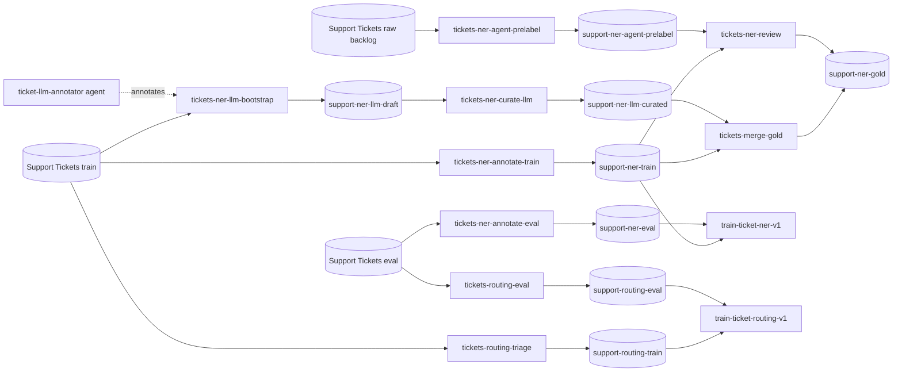

# [Ellf](https://ellf.ai) Template: Support Ticket Insights

Extract products, features, error codes, versions and integrations from customer support tickets, and route each ticket to the right queue. An LLM drafts the entity annotations, people curate the draft and annotate their own pass, a pretrained pipeline suggests the generic entity types, and the passes are adjudicated into a gold set that trains a custom spaCy NER pipeline and a separate routing classifier.

*Exported from [Ellf](https://ellf.ai) on 2026-10-27. Import it with the
[`/ellf-template`](https://ellf.ai/docs/modules#template) skill, or set it up by hand
with the commands below.*

## Workflow



## Overview

| Resource | Type | Name | Provided by | Details |
|---|---|---|---|---|
| Project | project | Support Insights | user picks name | [below](#project) |
| Training tickets | asset (`input`) | Support Tickets (train) | template sample or user | [assets/input/tickets-train.jsonl](assets/input/tickets-train.jsonl) |
| Eval tickets | asset (`input`) | Support Tickets (eval) | template sample or user | [assets/input/tickets-eval.jsonl](assets/input/tickets-eval.jsonl) |
| Backlog tickets | asset (`input`) | Support Tickets (raw backlog) | template sample or user | [assets/input/tickets-backlog.jsonl](assets/input/tickets-backlog.jsonl) |
| Synthetic tickets | asset (`input`) | Support Tickets (LLM synthetic) | written by tickets-llm-bootstrap | [tickets-llm-bootstrap](#tickets-llm-bootstrap) |
| Entity patterns | asset (`patterns`) | Ticket entity patterns | template | [assets/patterns/support_entities.jsonl](assets/patterns/support_entities.jsonl) |
| Entity labels | asset (`labels`) | Ticket entity labels | template | [assets/ticket_entities.json](assets/ticket_entities.json) |
| Universal entity labels | asset (`labels`) | Ticket universal entity labels | template | [assets/ticket_universal_entities.json](assets/ticket_universal_entities.json) |
| Routing labels | asset (`labels`) | Ticket routing labels | template | [assets/ticket_routing.json](assets/ticket_routing.json) |
| Entity guidelines | asset (`instructions`) | Ticket entity guidelines | template | [assets/ticket_entities_guidelines.md](assets/ticket_entities_guidelines.md) |
| Routing guidelines | asset (`instructions`) | Ticket routing guidelines | template | [assets/ticket_routing_guidelines.md](assets/ticket_routing_guidelines.md) |
| NER model | asset (`model`) | Ticket NER | written by train-ticket-ner-v1 | [train-ticket-ner-v1](#train-ticket-ner-v1) |
| Routing model | asset (`model`) | Ticket Routing | written by train-ticket-routing-v1 | [train-ticket-routing-v1](#train-ticket-routing-v1) |
| NER, training pool | task | tickets-ner-annotate-train | template | [Tasks](#tickets-ner-annotate-train) |
| NER, eval set | task | tickets-ner-annotate-eval | template | [Tasks](#tickets-ner-annotate-eval) |
| LLM draft | task | tickets-ner-llm-bootstrap | template | [Tasks](#tickets-ner-llm-bootstrap) |
| Model pre-labelling | task | tickets-ner-agent-prelabel | template | [Tasks](#tickets-ner-agent-prelabel) |
| Routing, training pool | task | tickets-routing-triage | template | [Tasks](#tickets-routing-triage) |
| Routing, eval set | task | tickets-routing-eval | template | [Tasks](#tickets-routing-eval) |
| Curate the LLM draft | task | tickets-ner-curate-llm | template | [Tasks](#tickets-ner-curate-llm) |
| Adjudication | task | tickets-ner-review | template | [Tasks](#tickets-ner-review) |
| Base model download | action | download-base-models | template | [Actions](#download-base-models) |
| Gold set merge | action | tickets-merge-gold | template | [Actions](#tickets-merge-gold) |
| Synthetic tickets | action | tickets-llm-bootstrap | template | [Actions](#tickets-llm-bootstrap) |
| NER training | action | train-ticket-ner-v1 | template | [Actions](#train-ticket-ner-v1) |
| NER learning curve | action | train-ticket-ner-curve | template | [Actions](#train-ticket-ner-curve) |
| Routing training | action | train-ticket-routing-v1 | template | [Actions](#train-ticket-routing-v1) |
| LLM annotator | agent | ticket-llm-annotator | template | [Agents](#ticket-llm-annotator) |
| Annotation dashboard | service | ticket-annotation-dashboard | template | [Services](#ticket-annotation-dashboard) |
| Pattern workbench | service | pattern-workbench | template | [Services](#pattern-workbench) |
| NER, training pool | dataset (`ner`) | support-ner-train | created empty | [Datasets](#datasets) |
| NER, eval set | dataset (`ner`) | support-ner-eval | created empty | [Datasets](#datasets) |
| LLM draft | dataset (`ner`) | support-ner-llm-draft | created empty | [Datasets](#datasets) |
| Curated draft | dataset | support-ner-llm-curated | created empty | [Datasets](#datasets) |
| Model pre-labels | dataset (`ner`) | support-ner-agent-prelabel | created empty | [Datasets](#datasets) |
| Gold set | dataset (`review`) | support-ner-gold | created empty | [Datasets](#datasets) |
| Routing, training pool | dataset (`textcat`) | support-routing-train | created empty | [Datasets](#datasets) |
| Routing, eval set | dataset (`textcat`) | support-routing-eval | created empty | [Datasets](#datasets) |
| Project plan | plan | project_plan | template | [plans/project_plan.md](plans/project_plan.md) |
| Entity scheme | plan | label-scheme | template | [plans/label-scheme.md](plans/label-scheme.md) |
| Launch checklist | plan | launch-checklist | template | [plans/launch-checklist.md](plans/launch-checklist.md) |
| Serving plan | plan | serving-plan | template | [plans/serving-plan.md](plans/serving-plan.md) |

All jobs use built-in recipes.

## What you need to provide

- **Ticket data:** JSONL, one ticket per line, with the ticket text in `text` and anything else in `meta`:

  ```json
  {"text": "Does Meridian API support exporting scheduled reports data to Zapier on a schedule? A pointer to the right docs page would be enough.", "meta": {"ticket_id": "SUP-68535", "channel": "in-app chat", "priority": "normal"}}
  ```

  The template includes 800 synthetic tickets about a fictional B2B analytics vendor, Meridian, split into Support Tickets (train), 240 tickets in [assets/input/tickets-train.jsonl](assets/input/tickets-train.jsonl); Support Tickets (eval), 60 tickets in [assets/input/tickets-eval.jsonl](assets/input/tickets-eval.jsonl); and Support Tickets (raw backlog), 500 tickets in [assets/input/tickets-backlog.jsonl](assets/input/tickets-backlog.jsonl). They're generated, not taken from a real helpdesk, and are enough to run the whole workflow end to end. To build a model for your own product, bring your own tickets in the format above, split the same way.
- **Secrets:** never included; create it yourself with `ellf secrets create gemini-api-key`. It holds your Google AI API key and is used by the LLM annotator agent, the synthetic tickets action and the pattern workbench. Ticket text is sent to Google's Gemini API.
- **Annotators:** assign your team to the annotation tasks with `ellf users assign <email> --task <task>`. The eval tasks need two people, and the review task is for whoever adjudicates.

## Customize

- **Products and labels:** the label definitions, guidelines and match patterns name Meridian's products (Meridian Cloud, Meridian API, …). With your own tickets, replace them in `assets/ticket_entities.json`, `assets/ticket_entities_guidelines.md` and `assets/patterns/support_entities.jsonl`, or write new patterns with the pattern workbench service.
- **Routing categories:** the six categories in `assets/ticket_routing.json` and the routing guidelines are meant to be adapted to your queues. The review task's `--label` list must match the entity labels.
- **Base model:** the pre-labelling task and the NER training use `en_core_web_sm`. Use another spaCy model for another language, or a larger one for better `ORG`, `MONEY` and `DATE` suggestions, and change `download-base-models` to match.
- **Synthetic tickets:** `tickets-llm-bootstrap` writes to `{assets}/support_tickets/synthetic/`, using the `{assets}` path alias. Change the path if your cluster has no such alias, and the task description to describe your product.
- **Gemini models:** the agent and the pattern workbench use Gemini models (`gemini-2.5-flash` by default for the agent, `gemini-2.5-pro` for the workbench). Pick the ones your key has access to.

## Setup

### Project

```bash
ellf projects create "Support Insights" "Extract products, features and error codes from customer support tickets and route them by intent. Bootstrapped with an LLM, curated by the support team, trained into a custom spaCy pipeline."
ellf config project "Support Insights"
```

### Assets

```bash
ellf publish data assets/patterns/support_entities.jsonl --kind patterns --name "Ticket entity patterns" --version 1.0.0
ellf publish data assets/ticket_routing.json --kind labels --name "Ticket routing labels" --version 1.0.0
ellf publish data assets/ticket_universal_entities.json --kind labels --name "Ticket universal entity labels" --version 1.0.0
ellf publish data assets/ticket_entities.json --kind labels --name "Ticket entity labels" --version 1.0.0
ellf publish data assets/ticket_routing_guidelines.md --kind instructions --name "Ticket routing guidelines" --version 1.0.0
ellf publish data assets/ticket_entities_guidelines.md --kind instructions --name "Ticket entity guidelines" --version 1.0.0
ellf publish data assets/input/tickets-backlog.jsonl --kind input --name "Support Tickets (raw backlog)" --version 1.0.0
ellf publish data assets/input/tickets-eval.jsonl --kind input --name "Support Tickets (eval)" --version 1.0.0
ellf publish data assets/input/tickets-train.jsonl --kind input --name "Support Tickets (train)" --version 1.0.0
```

Publish the label schemes and guidelines before the tasks: a task reads them when it's created, and there's no command to change a task's arguments later.

### Datasets

Created empty, so the plans can link to them before any job has run.

```bash
ellf datasets create support-ner-train --kind ner
ellf datasets create support-ner-eval --kind ner
ellf datasets create support-ner-llm-draft --kind ner
ellf datasets create support-ner-llm-curated
ellf datasets create support-ner-agent-prelabel --kind ner
ellf datasets create support-ner-gold --kind review
ellf datasets create support-routing-train --kind textcat
ellf datasets create support-routing-eval --kind textcat
```

- `support-ner-train` and `support-ner-eval` hold people's entity annotations on the training pool and the eval set; both training actions read them.
- `support-ner-llm-draft` holds the LLM agent's draft, which `tickets-ner-curate-llm` reads and saves to `support-ner-llm-curated`.
- `support-ner-agent-prelabel` holds the corrected `ORG`, `MONEY` and `DATE` suggestions on the backlog.
- `support-ner-gold` is written by `tickets-merge-gold` (the human and curated passes) and `tickets-ner-review` (adjudicated conflicts).
- `support-routing-train` and `support-routing-eval` hold the routing labels for the routing training action.

## Tasks

### tickets-ner-annotate-train

The main human pass: the annotation team marks the five domain entities on the training pool, with match patterns as suggestions.

```bash
ellf tasks create ner --name tickets-ner-annotate-train --dataset support-ner-train --input "Support Tickets (train)" --label-scheme "Ticket entity labels" --settings.instructions "Ticket entity guidelines" --patterns "Ticket entity patterns" --model.lang en --no-start
```

| Argument | Value | Notes |
|---|---|---|
| `--input` | Support Tickets (train) | template sample or your own tickets |
| `--label-scheme` | Ticket entity labels | label definitions shown next to the labels |
| `--settings.instructions` | Ticket entity guidelines | boundary rules |
| `--patterns` | Ticket entity patterns | match suggestions; adapt to your products |

### tickets-ner-annotate-eval

The held-out eval set, annotated by two people with patterns but no model in the loop. It's the only measurement the plan trusts.

```bash
ellf tasks create ner --name tickets-ner-annotate-eval --dataset support-ner-eval --input "Support Tickets (eval)" --label-scheme "Ticket entity labels" --settings.instructions "Ticket entity guidelines" --patterns "Ticket entity patterns" --model.lang en --no-start
```

### tickets-ner-llm-bootstrap

The LLM agent's own pass over the training pool: `ticket-llm-annotator` drafts the domain entities from the task's labels and guidelines. People see the draft through `tickets-ner-curate-llm`.

```bash
ellf tasks create ner --name tickets-ner-llm-bootstrap --dataset support-ner-llm-draft --input "Support Tickets (train)" --label-scheme "Ticket entity labels" --settings.instructions "Ticket entity guidelines" --patterns "Ticket entity patterns" --model.lang en --no-start
```

### tickets-ner-agent-prelabel

`ORG`, `MONEY` and `DATE` on the backlog, suggested by `en_core_web_sm` and corrected by one annotator, so annotator time on the main pass goes to the domain labels. Start it after `download-base-models` has run.

```bash
ellf tasks create ner --name tickets-ner-agent-prelabel --dataset support-ner-agent-prelabel --input "Support Tickets (raw backlog)" --label-scheme "Ticket universal entity labels" --settings.instructions "Ticket entity guidelines" --model.name en_core_web_sm --no-start
```

| Argument | Value | Notes |
|---|---|---|
| `--model.name` | en_core_web_sm | downloaded by `download-base-models` |

### tickets-routing-triage

One routing category per ticket on the training pool. The category depends on the intent of the whole ticket, so routing is its own component rather than derived from the entities.

```bash
ellf tasks create textcat --name tickets-routing-triage --dataset support-routing-train --input "Support Tickets (train)" --label-scheme "Ticket routing labels" --settings.instructions "Ticket routing guidelines" --labels-exclusive --no-start
```

| Argument | Value | Notes |
|---|---|---|
| `--label-scheme` | Ticket routing labels | adapt to your queues |

### tickets-routing-eval

The routing categories on the held-out eval set, which `train-ticket-routing-v1` evaluates against. Annotated by two people with no model in the loop.

```bash
ellf tasks create textcat --name tickets-routing-eval --dataset support-routing-eval --input "Support Tickets (eval)" --label-scheme "Ticket routing labels" --settings.instructions "Ticket routing guidelines" --labels-exclusive --no-start
```

### tickets-ner-curate-llm

People accept or reject the LLM draft, ticket by ticket, in the manual NER interface. Accepting a draft is much faster than drawing every span, and the rejections show where the label scheme is ambiguous.

```bash
ellf tasks create curate --name tickets-ner-curate-llm --output support-ner-llm-curated --input-input-dataset support-ner-llm-draft --settings.instructions "Ticket entity guidelines" --view-id ner_manual --no-start
```

### tickets-ner-review

Adjudicates conflicts between the human pass and the pre-labelling pass into the gold set. Agreed examples are accepted automatically.

```bash
ellf tasks create review --name tickets-ner-review --dataset support-ner-gold --datasets "support-ner-train, support-ner-agent-prelabel" --label "PRODUCT, FEATURE, ERROR_CODE, VERSION, INTEGRATION, ORG, MONEY, DATE" --auto-accept --no-start
```

| Argument | Value | Notes |
|---|---|---|
| `--label` | the eight entity labels | must match both entity label schemes |

## Actions

### download-base-models

Installs `en_core_web_sm` on the cluster, for the pre-labelling task and the NER training.

```bash
ellf actions create download_spacy_models --name download-base-models --lang en --models "en_core_web_sm" --no-start
```

### tickets-merge-gold

Merges the human pass and the curated LLM draft into the gold set.

```bash
ellf actions create db_actions --name tickets-merge-gold --merge.in-sets "support-ner-train, support-ner-llm-curated" --merge.out-set support-ner-gold --merge.input-keys "text" --merge.user-ann-keys "spans" --no-start
```

### tickets-llm-bootstrap

Generates synthetic tickets with Gemini, for a cold start without enough real tickets, or to fill out thin labels.

```bash
ellf actions create synthetic_data --name tickets-llm-bootstrap --output-name "Support Tickets (LLM synthetic)" --output-path "{assets}/support_tickets/synthetic/tickets-synthetic.jsonl" --task-description "customer support tickets for a B2B SaaS product, mentioning product names, features, error codes, versions and third-party integrations" --gemini-api-key gemini-api-key --no-start
```

| Argument | Value | Notes |
|---|---|---|
| `--output-path` | `{assets}/support_tickets/synthetic/…` | needs an `{assets}` path alias on your cluster |
| `--task-description` | see the command | describe your own product |
| `--gemini-api-key` | gemini-api-key | secret you create |

### train-ticket-ner-v1

The first NER training run, on the training pool, evaluated on the eval set, from `en_core_web_sm`. Writes the Ticket NER model.

```bash
ellf actions create train --name train-ticket-ner-v1 --data.ner --ner.train "support-ner-train" --ner.eval "support-ner-eval" --lang en --base-model en_core_web_sm --output.name "Ticket NER" --output.version "0.1.0" --label-stats --no-start
```

### train-ticket-ner-curve

A learning curve on the same data, to see whether more annotation still buys accuracy. Writes no model.

```bash
ellf actions create train --name train-ticket-ner-curve --data.ner --ner.train "support-ner-train" --ner.eval "support-ner-eval" --lang en --base-model en_core_web_sm --output.skip --train-curve --train-curve.n-samples 4 --train-curve.show-plot --no-start
```

### train-ticket-routing-v1

The routing classifier, trained once the categories are balanced. Writes the Ticket Routing model.

```bash
ellf actions create train --name train-ticket-routing-v1 --data.textcat --textcat.train "support-routing-train" --textcat.eval "support-routing-eval" --lang en --output.name "Ticket Routing" --output.version "0.1.0" --label-stats --no-start
```

## Agents

### ticket-llm-annotator

Drafts the domain entities on the training pool with Gemini. It takes its labels and guidelines from the task it's assigned to, so it works from the same definitions as the annotators.

```bash
ellf agents create gemini_agent --name ticket-llm-annotator --api-key gemini-api-key --no-start
ellf agents assign ticket-llm-annotator --task tickets-ner-llm-bootstrap
```

| Argument | Value | Notes |
|---|---|---|
| `--api-key` | gemini-api-key | secret you create |

## Services

### ticket-annotation-dashboard

Live annotation metrics for the training pool: label distribution, conflicts and per-annotator throughput.

```bash
ellf services create annotation_dashboard --name ticket-annotation-dashboard --dataset support-ner-train --refresh-seconds 30 --no-start
```

### pattern-workbench

Writes and tests spaCy match patterns with Gemini, for extending Ticket entity patterns.

```bash
ellf services create pattern_gen --name pattern-workbench --api-key gemini-api-key --model-name gemini-2.5-pro --spacy-model en_core_web_sm --no-start
```

## Plans

```bash
ellf plans write project_plan --file plans/project_plan.md
ellf plans write label-scheme --file plans/label-scheme.md
ellf plans write launch-checklist --file plans/launch-checklist.md
ellf plans write serving-plan --file plans/serving-plan.md
```

`project_plan` is the overview, `label-scheme` the reasoning behind the entity labels, `launch-checklist` the readiness gate before going live, and `serving-plan` the shape of the deployment.

Plans link to resources with `@@Type/name@@` placeholders. After everything is
created, replace each with a concept link to the new resource's id (the
`/ellf-template` skill does this for you).

---

*Exported: 2026-10-27T10:09:29Z &middot; Template format: 1 &middot; Ellf CLI: 21.0.7 &middot; Recipe packages: ellf-recipes 0.18.15 &middot; Exported with: Claude Code 2.1.311 (claude-opus-5-5)*
