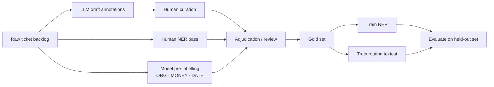

# NLP Project Plan: Support Insights

## Problem Statement

Support tickets arrive as free text and are triaged by hand. We want two things
from every incoming ticket: the structured fields a human would copy into the
tracker (product, feature, error code, version, integration), and a routing
category that sends it to the right queue. The output is a custom spaCy
pipeline that runs on the ticket stream, bootstrapped from LLM annotations
rather than from a cold start.

## Pipeline Overview

Two components, trained separately on the same annotated pool: a NER model for
the structured fields and a text classifier for routing.

## Data Strategy

| Asset | Role |
|---|---|
| @@Assets/Support Tickets (train)@@ | Annotation pool for both components |
| @@Assets/Support Tickets (eval)@@ | Held out, never used for model-in-the-loop |
| @@Assets/Support Tickets (raw backlog)@@ | Unlabelled pool for model pre-labelling and future rounds |
| @@Assets/Ticket entity patterns@@ | Match suggestions in the manual NER interface |
| @@Assets/Ticket entity labels@@ | Domain entity definitions, shown next to the labels |
| @@Assets/Ticket universal entity labels@@ | `ORG`, `MONEY`, `DATE` for the pre-labelling pass |
| @@Assets/Ticket routing labels@@ | Routing categories and where they border each other |
| @@Assets/Ticket entity guidelines@@ | Boundary rules for every NER task |
| @@Assets/Ticket routing guidelines@@ | How to tell the close categories apart |

The eval set is annotated by two people with no model in the loop, and is not
touched by the LLM draft or the pre-labelling. That is the only measurement we trust.

## Annotation Plan

| Task | Recipe | Output | Annotators |
|---|---|---|---|
| @@Tasks/tickets-ner-annotate-train@@ | ner | @@Datasets/support-ner-train@@ | The annotation team |
| @@Tasks/tickets-ner-annotate-eval@@ | ner | @@Datasets/support-ner-eval@@ | Two annotators, no model in the loop |
| @@Tasks/tickets-ner-llm-bootstrap@@ | ner | @@Datasets/support-ner-llm-draft@@ | @@Agents/ticket-llm-annotator@@ |
| @@Tasks/tickets-ner-curate-llm@@ | curate | @@Datasets/support-ner-llm-curated@@ | A developer and an annotator |
| @@Tasks/tickets-ner-agent-prelabel@@ | ner | @@Datasets/support-ner-agent-prelabel@@ | One annotator, correcting model suggestions |
| @@Tasks/tickets-routing-triage@@ | textcat | @@Datasets/support-routing-train@@ | Two annotators |
| @@Tasks/tickets-routing-eval@@ | textcat | @@Datasets/support-routing-eval@@ | Two annotators, no model in the loop |
| @@Tasks/tickets-ner-review@@ | review | @@Datasets/support-ner-gold@@ | The project lead adjudicates |

The NER and routing tasks read their labels and instructions from the assets
above, so the annotators and the LLM agent work from the same definitions.
The reasoning behind them lives in @@Plans/label-scheme@@.

@@Agents/ticket-llm-annotator@@ drafts the domain labels on
@@Tasks/tickets-ner-llm-bootstrap@@ with Gemini, from the task's label scheme
and guidelines. On @@Tasks/tickets-ner-agent-prelabel@@, a pretrained spaCy
pipeline (`en_core_web_sm`, downloaded by @@Actions/download-base-models@@)
suggests the universal entity types, and an annotator corrects them.

Live annotation metrics — label distribution, conflicts, per-annotator
throughput — are served by @@Services/ticket-annotation-dashboard@@.
@@Services/pattern-workbench@@ helps write and test new match patterns for
@@Assets/Ticket entity patterns@@.

## Evaluation Strategy

One metric per component, both measured on the held-out eval set only:

- **NER**: per-label F-score, with `INTEGRATION` and `FEATURE` watched
  separately — they're where the boundary disagreements usually are.
- **Routing**: macro F-score across the six categories, plus the confusion
  between `BUG_REPORT` and `OUTAGE`, which is the pair that costs the most when
  it goes wrong.

Training runs: @@Actions/train-ticket-ner-v1@@ and
@@Actions/train-ticket-routing-v1@@. @@Actions/train-ticket-ner-curve@@
answers the separate question of whether more annotation still buys accuracy.
Record each run's scores here.

## Roadmap

1. Publish the ticket assets, label schemes and guidelines
2. Bootstrap a draft with an LLM instead of annotating from scratch
3. Curate the draft and keep what survives
4. Pre-label the universal entity types from a pretrained pipeline
5. Annotate the eval sets with no model in the loop
6. Merge the human and curated passes into a gold set (@@Actions/tickets-merge-gold@@) and adjudicate conflicts (@@Tasks/tickets-ner-review@@)
7. Run the first NER training and read the per-label scores
8. Measure agreement on an overlap sample
9. Decide whether `INTEGRATION` needs more data or a rule-based assist
10. Train the routing classifier once the category counts are balanced

## Next Steps

- Adapt the label schemes, guidelines and patterns to your own products.
- Start @@Tasks/tickets-ner-annotate-train@@ and @@Tasks/tickets-ner-llm-bootstrap@@.

## Decision Log

- **Bootstrap with an LLM, then curate**: The first pass over the training pool is drafted by @@Agents/ticket-llm-annotator@@ and reviewed by people, rather than annotated cold. _Rationale: accept/reject on a draft is several times faster than drawing every span, and the rejections show where the label scheme is ambiguous._
- **Distil into a spaCy pipeline rather than calling an LLM per ticket**: _Rationale: the ticket stream is high volume and latency-sensitive, and the extraction task is narrow enough that a small supervised model matches the LLM once it has a few hundred examples._
- **Universal entity types suggested by a pretrained pipeline**: _Rationale: `ORG`, `MONEY` and `DATE` are generic enough for an off-the-shelf model to suggest reliably; annotator time goes to the five labels that are actually domain-specific._
- **Eval sets annotated without a model in the loop**: _Rationale: model-assisted annotation biases the measurement toward whatever the model already does well._
- **Routing kept as a separate component**: Rather than deriving the category from extracted entities. _Rationale: the category depends on the intent of the whole ticket, not on which entities appear in it._
