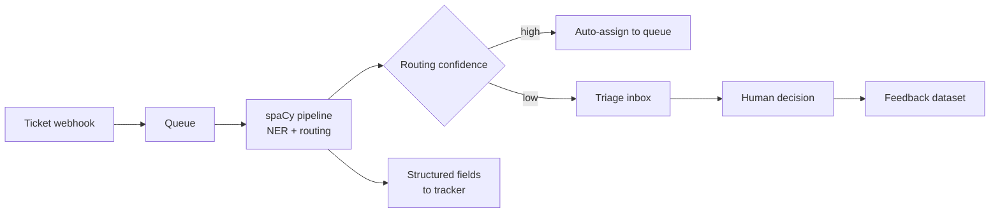

# Serving Plan: Ticket Stream Integration

How the trained pipeline gets in front of real tickets once
@@Plans/launch-checklist@@ is clear. Nothing here is built yet — this is the
shape to agree on, written down so the training work can be pointed at the
right target.

## Request path

Extraction and routing run in one pass. The structured fields are written
unconditionally; only the routing decision is gated on confidence, because a
wrong queue costs a human a round trip and a missing field does not.

## Confidence gate

The threshold is the one knob. Below it a ticket goes to the triage inbox
instead of a queue.

| Setting | Effect | Chosen because |
|---|---|---|
| Threshold on routing only | Fields always written, queue sometimes deferred | Field errors are visible and cheap to fix; queue errors are not |
| Start cautious, e.g. 0.8 | A share of tickets deferred at first | Safer for the first month |
| Reviewed monthly | Moves down as the eval score moves up | Tied to a measurement, not to a feeling |

The `BUG_REPORT` / `OUTAGE` confusion from @@Plans/project_plan@@ is the pair
that matters here: defer both when either is close, whatever the threshold
says.

## Feedback loop

Triage-inbox decisions are the cheapest annotation you'll ever get — a human
was going to make them anyway. They land in a feedback dataset and feed the
next round through @@Tasks/tickets-routing-triage@@.

They are kept out of the eval set. It stays annotated cold, or it stops being a
measurement.

## Open questions

- Where the pipeline runs: alongside the cluster, or as its own service next to
  @@Services/ticket-annotation-dashboard@@.
- Whether the raw backlog — @@Assets/Support Tickets (raw backlog)@@ — gets a
  one-off batch pass at launch, or only new tickets are processed.
- Who owns the threshold once it is live.
